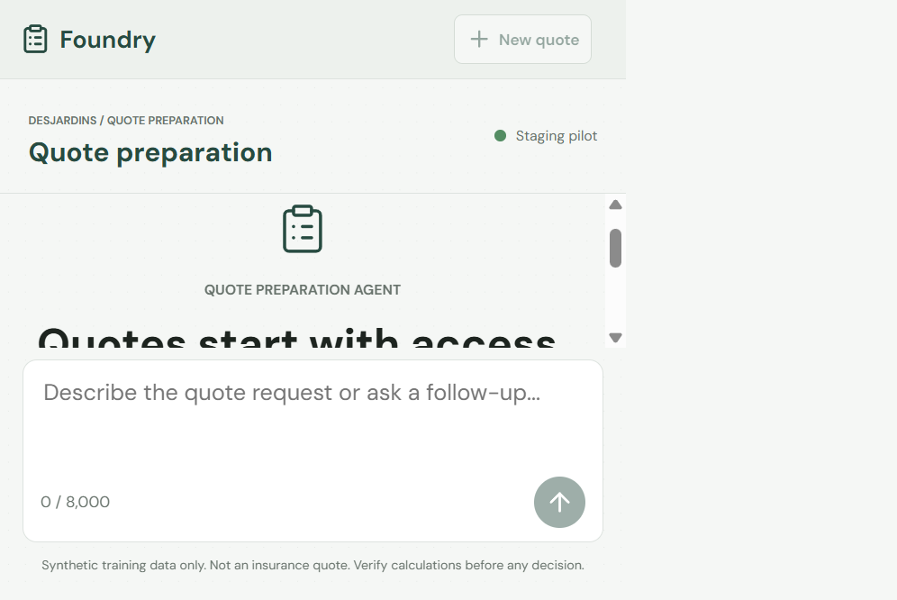
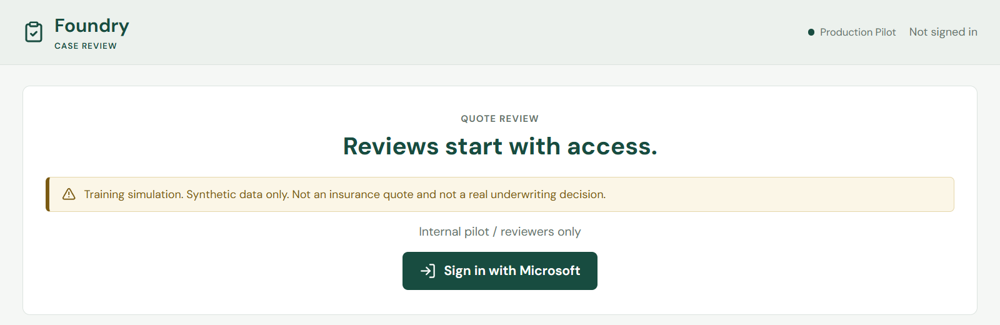

[English](README.md) | [Français](README.fr.md)

## Présentation

Ce dépôt propose un atelier pratique bilingue (anglais/français) adapté
du dépôt voisin
[`foundry-hosted-agents`](https://github.com/devopsabcs-engineering/foundry-hosted-agents).
Il remplace le scénario d'évaluation des menaces aériennes par un scénario
de services financiers : un agent synthétique de préparation de
soumissions d'assurance auto en Ontario, appuyé par un calculateur
déterministe et une étape d'approbation obligatoire par un employé,
persistée séparément, avant tout aperçu destiné au demandeur.

> [!IMPORTANT]
> Chaque donnée d'exemple, référentiel de règles et résultat de calcul de
> ce dépôt est synthétique et non contraignant. Rien ici ne représente un
> produit, un tarif ou une police Desjardins réel, et aucun organisme de
> réglementation ni assureur n'a révisé ou approuvé cet atelier.

## Parcours de l'apprenant

Le parcours par défaut de ces ateliers ne nécessite pas GitHub Copilot ni
aucun autre assistant de programmation par IA. Lorsque les auteurs de
l'atelier ont utilisé un outil assisté par IA pour rédiger ou réviser un
contenu, cette assistance est indiquée dans l'atelier ou le fichier
concerné plutôt que présentée comme faisant partie du parcours de
l'apprenant.

## Structure du dépôt

* [docs/](docs/) contient le site de l'atelier en anglais (Jekyll, thème
  Just the Docs). Commencez par [docs/index.md](docs/index.md).
* [docs/fr/](docs/fr/) contient le site de l'atelier en français, dont la
  structure correspond à celle du site anglais. Commencez par
  [docs/fr/index.md](docs/fr/index.md).
* [src/quote-preparation-agent/](src/quote-preparation-agent/) contient
  l'agent LangGraph hébergé de préparation de soumissions.
* [mcp/application-server/](mcp/application-server/) contient un service
  MCP en lecture seule exposant les données synthétiques des demandes.
* [mcp/rulebook-server/](mcp/rulebook-server/) contient un service MCP en
  lecture seule exposant les données synthétiques du référentiel de règles.
* [apps/workshop/](apps/workshop/) contient le calculateur déterministe
  et le dépôt SQLite des approbations des exercices locaux.
* [apps/reviewer-app/](apps/reviewer-app/) contient la file bilingue de
  révision par un employé. Son service et l'agent partagent le contrat
  `CaseStore` dans `src/quote-preparation-agent/case_store.py`, avec SQLite
  localement et Cosmos DB privé dans les environnements conservés.
* [apps/web-chat/](apps/web-chat/) contient une interface de clavardage
  pilote interne pour l'agent hébergé, reprise du dépôt voisin. Elle est
  déployée séparément ([infra/web-chat.bicep](infra/web-chat.bicep)), aux
  côtés de [apps/reviewer-app/](apps/reviewer-app/). Consultez les
  [liens de déploiement](#liens-de-déploiement) pour les URL actuelles
  des deux interfaces.
* [data/synthetic/](data/synthetic/) contient les données d'exemple
  synthétiques et le schéma JSON du contrat de préparation de soumissions.
* [eval/](eval/) contient le banc d'évaluation des calculs, des
  approbations, des injections et de la parité bilingue.
* [infra/](infra/) contient les modules Bicep du pilote synthétique contrôlé.
  Une livraison pilote approuvée n'est pas une approbation réglementaire
  ni celle d'un assureur.
* [scripts/](scripts/) contient les utilitaires partagés, dont le
  générateur de présentations bilingues pour l'atelier.

## Pour commencer

Commencez par la page d'accueil de l'atelier :
[docs/fr/index.md](docs/fr/index.md) en français ou
[docs/index.md](docs/index.md) en anglais. Le même contenu est publié
sous forme de site navigable à l'adresse
<https://devopsabcs-engineering.github.io/foundry-hosted-agents-fsi/fr/>
(une connexion à GitHub est requise tant que ce dépôt est privé).

Lisez l'[architecture et les frontières de confiance](docs/fr/architecture.md)
([anglais](docs/architecture.md)) avant les exercices Azure. Le graphe
achemine un identifiant synthétique validé par `INTAKE`, `REFERENCE_LOOKUP`
et `COMPOSITION`; calcul et persistance de l'ébauche ont lieu dans
`COMPOSITION`, pas dans des étapes supplémentaires. Le clavardage reçoit
seulement des messages bilingues bornés; l'API de révision expose le calcul
et consigne les décisions des employés.

## Essayer l'interface de clavardage

Pour la démonstration client de la séance 2, consultez le
[guide des fonctions natives Foundry](docs/fr/native-showcase.md)
([anglais](docs/native-showcase.md)). Il distingue les preuves du
déploiement restauré du RAG File Search natif et de la compétence opérateur
réellement exécutés, des contrôles mémoire isolés et du rejeu de traces
personnalisées. Foundry IQ, les prérequis Content Understanding et les travaux
facultatifs de red team conservent leurs limites distinctes. Les juges natifs ont manqué un contrôle
négatif connu; cette limite est documentée, sans faux succès de qualité.
Conservez les deux environnements déployés.

Consultez les [preuves actuelles et captures](docs/fr/showcase-evidence.md)
pour les remplacements réussis des deux générations échouées et la distinction
entre les images publiées et les versions réellement déployées. La livraison
approuvée [`39527950931`, tentative 2](https://github.com/devopsabcs-engineering/foundry-hosted-agents-fsi/actions/runs/39527950931)
a déployé la révision `2c3f13b` en staging v6 et production v7, avec les
interfaces de clavardage/révision et les deux services MCP prêts dans chaque
environnement. La correction de révision 2 en production, le journal actuel
et le refus d'auto-approbation ont réussi. Les deux identités reviewer ont
réussi invocation200/mémoire403. Le chat conserve son image vérifiée.
Le juge des messages au
demandeur a réussi 5/5 dans chaque langue sur les trois critères, sans erreur;
l'ancien résultat 0/10 relève d'un autre contrat et reste conservé.
Ces résultats ne garantissent pas une disponibilité continue.

L'interface dans [apps/web-chat/](apps/web-chat/) est déployée séparément en
staging et en production (consultez les [liens de déploiement](#liens-de-déploiement)
pour l'URL actuelle). Pour l'exécuter localement en utilisant l'agent
réellement déployé, activez l'environnement virtuel de l'atelier 00 et partez
de la racine du dépôt. Fournissez le vrai point de terminaison du projet
Foundry, l'inscription Entra et le groupe pilote de cet environnement.
Authentifiez votre identité Azure locale avec l'accès Foundry requis :

```powershell
python -m pip install -r apps/web-chat/requirements.txt
cd apps/web-chat/frontend
npm ci
npm run build
cd ..
$env:AGENT_ENDPOINT = "$env:FOUNDRY_PROJECT_ENDPOINT/agents/quote-preparation-agent/endpoint/protocols/openai/responses?api-version=v1"
$env:ENTRA_TENANT_ID = (az account show --query tenantId -o tsv)
$env:ENTRA_CLIENT_ID = "<ID d'inscription d'application fourni par scripts/setup-web-chat-identity.ps1>"
$env:PILOT_GROUP_ID = "<ID d'objet du groupe de sécurité pilote>"
python -m uvicorn app:create_app --factory --host 127.0.0.1 --port 8000
```

Ouvrez ensuite <http://localhost:8000/> pour respecter l'origine de redirection
enregistrée. Les quatre paramètres ci-dessus sont obligatoires au démarrage;
les trois identifiants doivent être des UUID valides. Les valeurs fictives
de l'atelier 11 servent seulement à afficher la barrière d'accès. La connexion
et l'envoi exigent la configuration réelle, l'appartenance au groupe, le point
de terminaison Responses déployé et un appelant serveur autorisé.



Si votre réseau bloque npm, utilisez votre proxy de registre approuvé. Les
deux interfaces ont été installées proprement et compilées via le proxy
Microsoft avec :

```powershell
npm ci --ignore-scripts --registry=https://packagefeedproxy.microsoft.io/npm/
```

Conservez les restrictions de téléchargement distant de npm. `EALLOWREMOTE`
peut signaler une URL absolue Azure DevOps introduite par les métadonnées du
registre. Les fichiers de verrouillage versionnés utilisent les URL canoniques
du registre npm, que npm redirige vers le proxy sélectionné. N'utilisez pas
`--allow-remote=all` et ne désactivez pas les contrôles d'intégrité. Si le proxy
approuvé refuse toujours un paquet, conservez l'erreur et contactez son
administrateur.

## Essayer l'application de révision

[apps/reviewer-app/](apps/reviewer-app/) fournit la file de dossiers
destinée aux réviseurs : chaque dossier que l'agent soumet pour révision
y apparaît. L'accès est contrôlé par un rôle d'application Entra plutôt
que par l'appartenance au groupe de sécurité du clavardage. Consultez les
[liens de déploiement](#liens-de-déploiement) pour l'URL actuelle, ou
[l'atelier 13](docs/fr/labs/lab-13-reviewer-ui.md) pour exécuter
l'application localement avec une inscription Entra réelle.



## Liens de déploiement

> [!NOTE]
> Les noms des ressources Azure et de l'environnement `azd` de production
> portent un suffixe historique `-poc` (par exemple
> `cosmos-desjardins-quote-preparation-poc` et
> `aif-desjardins-quote-preparation-poc`). Malgré ce suffixe, ces ressources
> sont celles de production, et non un déploiement de validation de concept
> distinct. Le tableau Deployment Links du wiki indique explicitement
> `(production)` ou `(staging)` pour chaque ligne. Fiez-vous à cette
> indication plutôt qu'au texte `-poc` dans un nom ou une URL.

Aucune URL de démonstration active n'est inscrite en dur ici, car les noms
d'hôtes Container Apps et le nom du projet Foundry dépendent de
l'environnement et peuvent changer lors d'un reprovisionnement.
La [page d'accueil du wiki](https://github.com/devopsabcs-engineering/foundry-hosted-agents-fsi/wiki/Home)
contient plutôt un tableau Deployment Links publié depuis les artefacts
de déploiement conservés après le flux
[`Deploy and Evaluate (Staging -> Production)`](https://github.com/devopsabcs-engineering/foundry-hosted-agents-fsi/actions/workflows/deploy-and-evaluate.yml).
La publication dépend de la réussite de l'étape wiki. Vérifiez son exécution
source et les preuves actuelles avant de traiter ses liens comme actifs.
Le tableau inclut les deux interfaces pilotes :

* L'application de révision (file d'approbation des dossiers) et
  l'interface de clavardage destinée aux demandeurs
* Le projet Foundry de l'agent hébergé (portail Azure, connexion requise)
* Le point de terminaison de l'API Responses de l'agent
* Les points de terminaison MCP `application-server` et `rulebook-server`
* Le groupe de ressources et le registre de conteneurs
* Le site de l'atelier publié sur GitHub Pages

Utilisez toujours la
[page d'accueil du wiki](https://github.com/devopsabcs-engineering/foundry-hosted-agents-fsi/wiki/Home)
pour obtenir les URL publiées plutôt que recopier d'anciens noms d'hôtes.
Les deux applications peuvent changer d'hôte lors d'un reprovisionnement;
un échec ou retard de publication du wiki n'actualise pas l'ancien tableau.

Consultez également la page
[Continuous Test Trends](https://github.com/devopsabcs-engineering/foundry-hosted-agents-fsi/wiki/Continuous-Test-Trends)
du wiki pour les résultats les plus récents des tests hors ligne, des
contrôles déterministes et des évaluations par un modèle juge.

Les scores du juge sont indicatifs, mais un échec d'invocation réelle ou une
réponse absente bloque la promotion en production. Une erreur renvoyée avec
HTTP 200 ne constitue pas une réponse réussie de l'agent. Vérifiez qu'un cas
synthétique valide atteint la révision par un employé avant de déclarer
l'environnement reconstruit prêt pour une démonstration.

L'interface de clavardage pilote dans [apps/web-chat/](apps/web-chat/) est
déployée séparément et non par
[deploy-and-evaluate.yml](.github/workflows/deploy-and-evaluate.yml).
Son modèle [infra/web-chat.bicep](infra/web-chat.bicep) est appliqué par
une commande directe `az deployment group create` dans l'environnement
Container Apps déjà provisionné par [infra/main.bicep](infra/main.bicep).
Son inscription d'application Entra est créée par
[scripts/setup-web-chat-identity.ps1](scripts/setup-web-chat-identity.ps1).
Comme l'environnement managé est recréé lorsque sa configuration réseau
change, redéployez l'interface et relancez le script d'identité après toute
reconstruction du réseau. Son URL n'est pas une sortie `azd` :
la tâche `promote-production` du flux
[deploy-and-evaluate.yml](.github/workflows/deploy-and-evaluate.yml) lit
les variables de dépôt `WEB_CHAT_APP_NAME` et `WEB_CHAT_URL` applicables
à l'environnement de production pour les inclure dans le tableau
Deployment Links du wiki. Mettez ces variables à jour après tout
redéploiement du clavardage sous un nouveau nom d'hôte.

## Restaurer la démonstration après une suppression complète

Les [preuves actuelles](docs/fr/showcase-evidence.md#livraison-approuvée-actuelle)
consignent la livraison conservée réussie. Le
[ticket #7](https://github.com/devopsabcs-engineering/foundry-hosted-agents-fsi/issues/7)
préserve l'ancien incident de suppression/reconstruction, pas le verdict
actuel de disponibilité. La procédure suivante vise seulement une future
suppression approuvée séparément; ne l'exécutez pas sur la démo conservée.

> [!IMPORTANT]
> Un déploiement réussi dans le passé ne signifie pas que la démonstration
> est actuellement accessible. Une suppression complète retire le groupe
> de ressources partagé, le registre, les projets Foundry, les bases de
> dossiers et les interfaces pilotes. Les anciens liens du wiki restent
> historiques jusqu'à la restauration des ressources correspondantes.
> Utilisez uniquement des données synthétiques. Le déploiement ne recrée
> pas les données de dossiers supprimées.

1. Confirmez les approbations de mise en service, l'abonnement et la région
   cibles. Consultez la configuration du dépôt et de ses environnements
   GitHub `staging` et `production`.
2. Recréez le groupe indiqué par `AZURE_RESOURCE_GROUP` et le registre
   indiqué par `MCP_ACR_NAME`. Le
   [flux de déploiement](.github/workflows/deploy-and-evaluate.yml)
   exige leur présence avant de déployer le réseau et de construire les
   images. Rétablissez les autorisations nécessaires à l'identité de
   déploiement au niveau du groupe de ressources, y compris l'attribution
   de rôles et l'accès Foundry. N'activez pas les identifiants
   d'administration du registre.
3. Retirez les valeurs périmées de `AGENT_PRINCIPAL_ID` et `WEB_CHAT_URL`
   des ressources supprimées, dans les variables du dépôt et les
   remplacements propres aux environnements. Conservez les inscriptions
   d'applications Entra et les groupes pilotes et de réviseurs existants.
4. Exécutez [Continuous Validation](.github/workflows/continuous-validation.yml),
   [Web Chat Build](.github/workflows/web-chat-build.yml) et
   [Reviewer App Build](.github/workflows/reviewer-app-build.yml) sur la
   révision à déployer. Les exécutions manuelles des flux d'interfaces
   testent et compilent les applications sans les déployer.
   Après fusion dans `main`, ces flux publient les images sous les étiquettes
   `v<VERSION>-<SHA-source-complet>` et `latest`, sans créer de commit ni pousser
   vers `main` protégée. Modifiez `VERSION` par une PR liée à une issue pour
   augmenter la version sémantique. La publication n'est pas un déploiement;
   déployez une image épinglée par empreinte.
5. Lancez [Deploy and Evaluate](.github/workflows/deploy-and-evaluate.yml)
   pour cette révision. Le flux restaure la préproduction, évalue l'agent
   déployé et attend l'approbation humaine requise avant la promotion en
   production. L'application de révision est incluse lorsque
   `REVIEWER_CLIENT_ID` est configuré.
   Le flux CI doit authentifier Azure CLI et `azd` avec GitHub OIDC :
   les extensions Foundry exigent une connexion native `azd` même lorsque
   `auth.useAzCliAuth` est activé.
   Le flux renouvelle l'authentification OIDC native de `azd` juste avant
   chaque déploiement d'agent, après le provisionnement potentiellement long.
6. Après chaque déploiement, le flux invoque un cas synthétique : la première
   demande de jeton matérialise l'identité de l'agent. Il vérifie le principal
   exact dans les erreurs d'autorisation Cosmos, applique au besoin
   [le module RBAC existant](infra/modules/cosmos-rbac.bicep), puis confirme
   l'accès réel avant de poursuivre. CI n'utilise pas les anciennes variables
   `AGENT_PRINCIPAL_ID`. Ne substituez pas l'identité managée du projet.
   Si un agent conservé après suppression échoue avec `invalid_scope`,
   restaurez son identité périmée ou remplacez uniquement cet agent en
   préservant son projet et les données de dossiers Cosmos.
7. Construisez et déployez séparément le clavardage dans chaque
   environnement Container Apps restauré avec
   [web-chat.bicep](infra/web-chat.bicep). Fournissez le projet Foundry,
   l'étiquette de déploiement et une image épinglée par empreinte pour
   cet environnement. Actualisez les URL de redirection réelles avec
   [setup-web-chat-identity.ps1](scripts/setup-web-chat-identity.ps1) et
   [setup-reviewer-identity.ps1](scripts/setup-reviewer-identity.ps1).
   Mettez à jour `WEB_CHAT_APP_NAME` et `WEB_CHAT_URL` dans l'environnement
   GitHub correspondant, puis les liens de déploiement du wiki.
8. Vérifiez les deux projets Foundry et leurs agents actifs, les deux
   services MCP, la disponibilité et la connexion aux interfaces, les
   réponses bilingues et l'arrivée d'une demande synthétique dans la file
   de révision. Confirmez qu'aucun montant destiné au demandeur n'est
   communiqué sans approbation par un employé. La réussite des tests hors
   ligne ne suffit pas à établir que la démonstration est prête.
