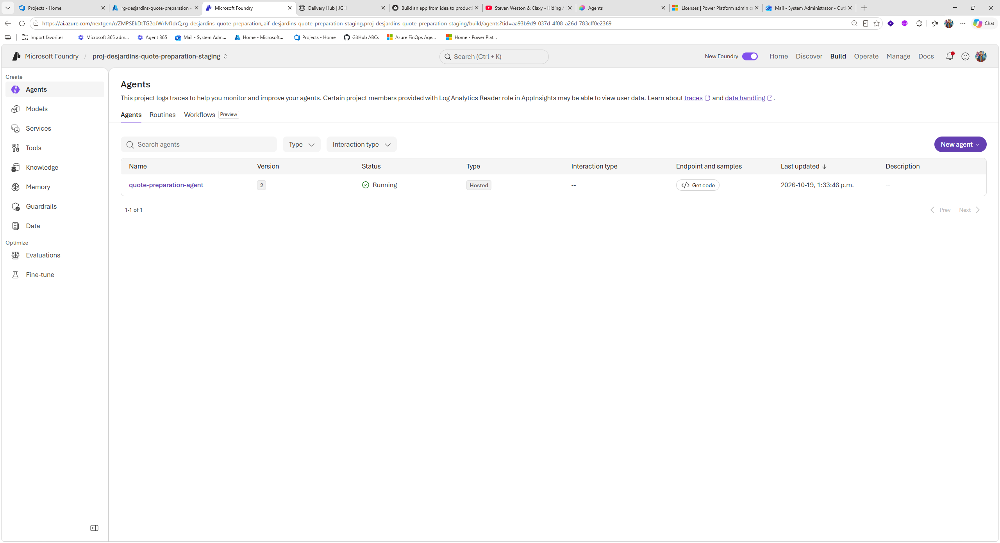
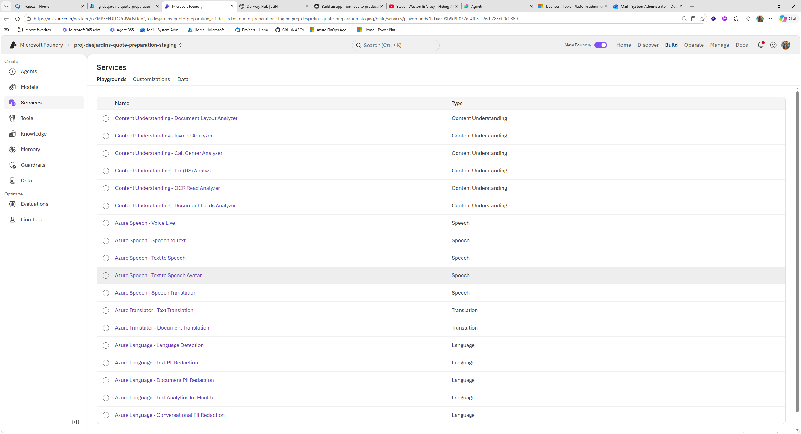
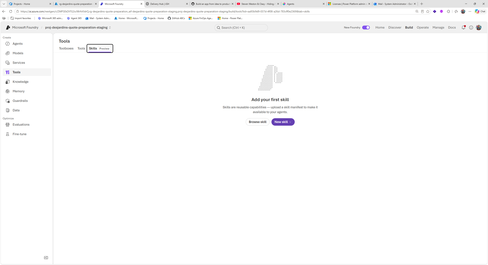
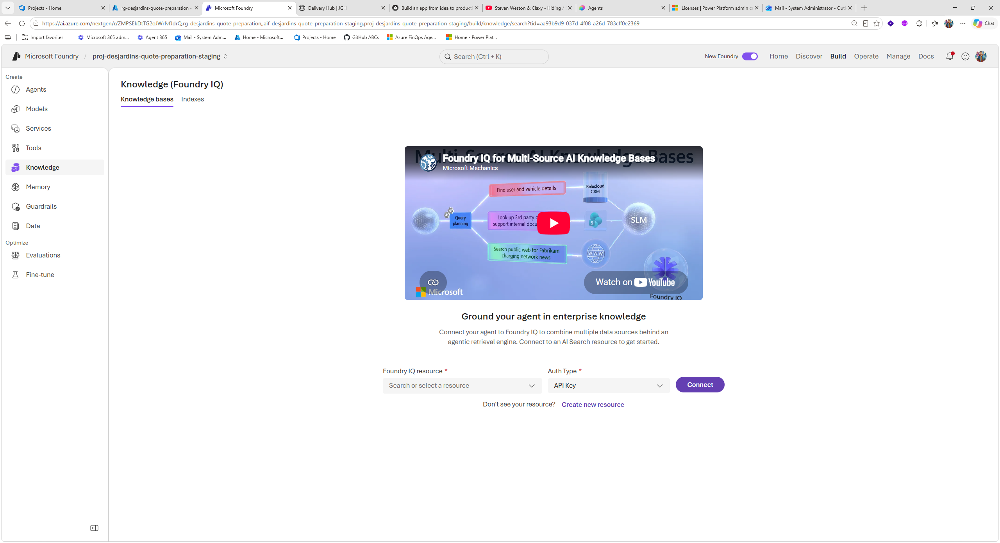
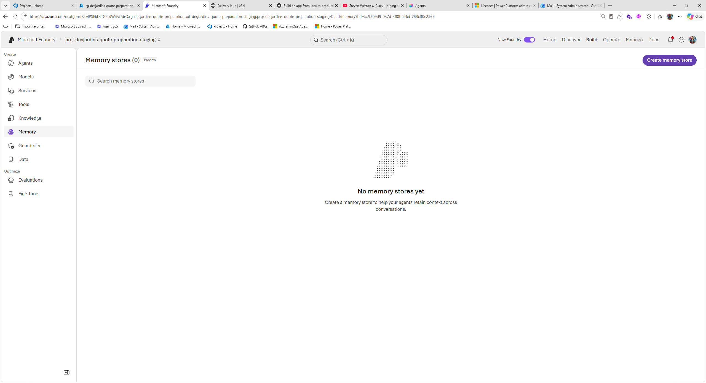
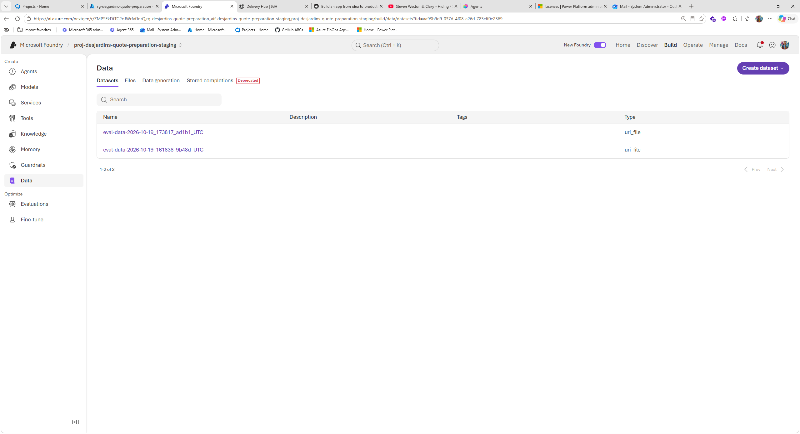
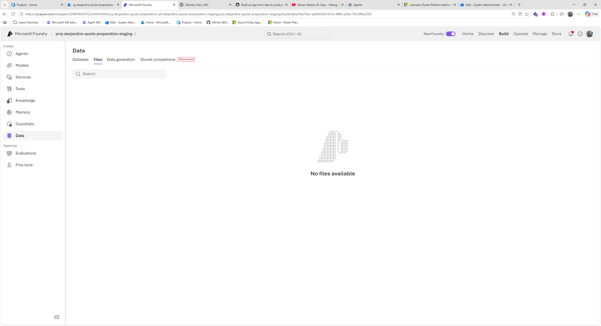
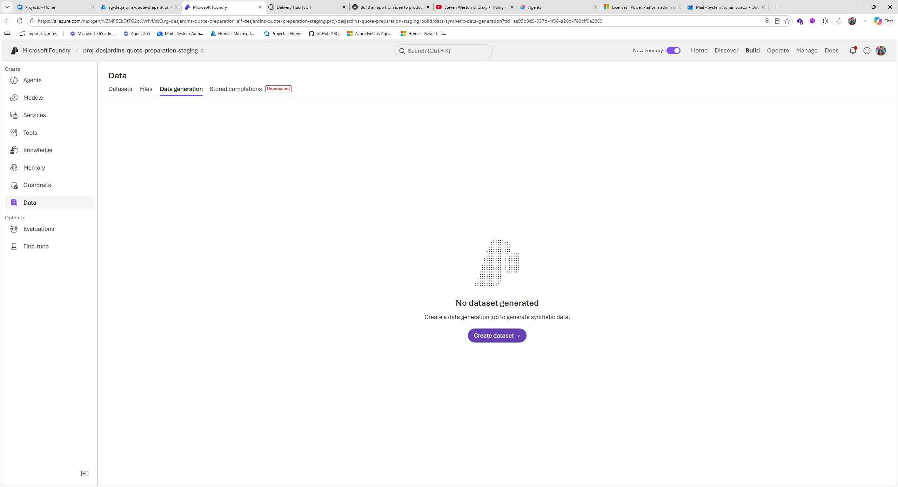
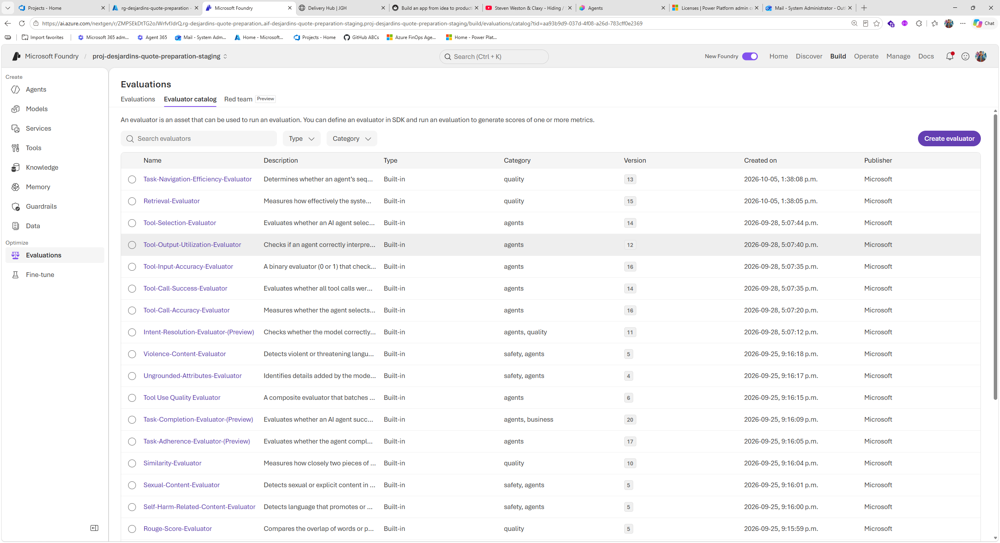
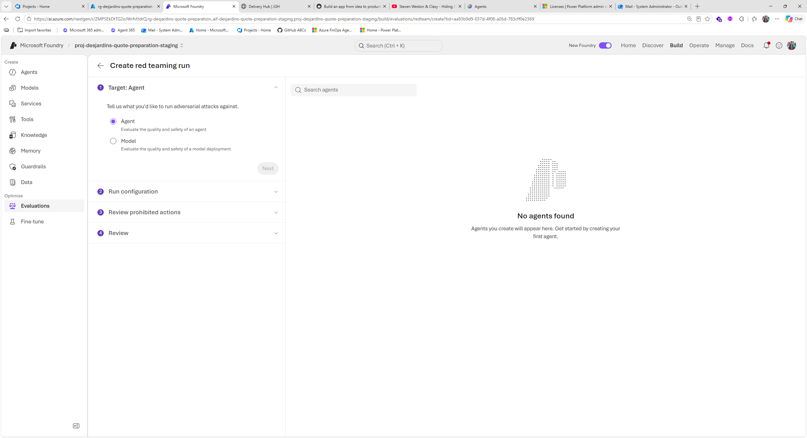

Meeting notes:
Architecture Et Déploiement De Foundry: Emmanuel a présenté à Michel, Toufik, Christian Mineau, Marie-Eve, Éric, Maxime et Andrew une solution Foundry hébergeant un agent de préparation de soumissions d’assurance automobile, en distinguant les composants Foundry des applications, serveurs MCP et pipelines externes.
Cas D’Usage: La démonstration portait sur un agent qui prépare une soumission d’assurance automobile à partir d’une conversation. L’agent peut être consommé par plusieurs interfaces, notamment une application mobile, un site Web interne, un site destiné aux clients ou un chatbot. Les écrans présentés montrent que le scénario repose sur des données synthétiques, un calculateur déterministe et une approbation d’employé avant toute prévisualisation destinée au demandeur.
Composants Externes: Michel a demandé si les serveurs MCP, les applications et les autres artefacts faisaient partie du projet Foundry. Emmanuel a précisé que les serveurs MCP et les applications consommatrices sont hébergés à l’extérieur de Foundry; le projet Foundry comprend principalement la ressource Foundry, le projet et les agents, auxquels on configure l’accès aux URL des outils externes.
MCP Et Outils: Les serveurs MCP exposent des outils en lecture seule, notamment des données de demande et des règles synthétiques. Emmanuel a montré que les URL des MCP sont configurées dans Foundry, que plusieurs outils peuvent être regroupés dans une toolbox et qu’un agent peut ensuite les appeler pour réaliser les calculs ou recherches nécessaires.
Séparation Des Dépôts: Toufik a demandé s’il fallait conserver le code de l’agent et l’infrastructure dans un même dépôt. Emmanuel a répondu qu’un monorepo convient aux équipes transversales responsables du développement, de l’infrastructure, du déploiement et de l’exploitation, mais que des dépôts séparés sont appropriés lorsque ces responsabilités sont réparties entre plusieurs équipes, comme c’est généralement le cas dans une grande organisation.
Scalabilité: Toufik a demandé qui gérait les sessions et la concurrence, puis Michel a demandé si les composants externes bénéficiaient du même autoscaling. Emmanuel a expliqué que Foundry gère automatiquement les conversations, les instances d’agents et leur montée en charge, tandis que les applications Web, les serveurs MCP et les autres composants externes doivent être dimensionnés et mis à l’échelle séparément.
Modèles, Identités Et Cycle De Vie Des Agents: Emmanuel a expliqué que Foundry est une plateforme évolutive permettant d’utiliser plusieurs modèles et langages, tout en fournissant une identité Entra, un versionnement des agents et un déploiement automatisé par pipeline.
Choix Des Modèles: Un agent doit être associé à au moins un modèle, mais Toufik a demandé si plusieurs modèles pouvaient être utilisés. Emmanuel a confirmé que plusieurs modèles peuvent être déployés et sélectionnés, notamment par l’intermédiaire d’un AI Gateway, et que les développeurs peuvent utiliser Python ou .NET ainsi que différents frameworks d’orchestration, dont LangGraph, LangChain et Microsoft Agent Framework.
Identité Entra: Chaque agent hébergé possède sa propre identité Entra managée, créée automatiquement. Cette identité peut recevoir des permissions RBAC afin d’accéder à un compte Blob Storage, une base de données ou d’autres ressources, de la même manière qu’une identité humaine, ce qui permet de gouverner les accès accordés à l’agent.
Versionnement: Emmanuel a indiqué que les changements apportés aux instructions, aux flux ou aux outils MCP peuvent créer automatiquement une nouvelle version de l’agent. Le versionnement de l’agent dans Foundry doit être distingué du versionnement du code et de l’infrastructure dans GitHub; dans l’exemple présenté, le déploiement avait produit la version 3.
Pipeline CI/CD: Le dépôt présenté regroupait le code Python de l’agent, l’infrastructure Bicep, les applications, les MCP, les données synthétiques et les évaluations. Emmanuel a expliqué que la pipeline déployait ces éléments automatiquement et permettait aussi de détruire l’environnement lorsqu’il n’était pas utilisé afin de limiter les coûts; un problème d’authentification avait toutefois empêché le déploiement complet du chatbot pendant la rencontre.
Fonctions Natives De Foundry: Emmanuel a parcouru les fonctions de supervision, de services, de compétences, de bases de connaissances et de mémoire offertes par Foundry, en précisant leurs usages et certaines limites de gouvernance.
Traces Et Monitoring: Foundry fournit une vue des traces et des conversations, avec corrélation des événements, suivi des sessions et estimation des coûts. Le monitoring peut aussi afficher l’utilisation des agents, les jetons consommés et d’autres statistiques; Foundry peut enfin suggérer des optimisations de performance ou de coût à partir des données observées.
Services Foundry: Les équipes peuvent utiliser des services existants pour la reconnaissance vocale, la synthèse vocale, la traduction, l’OCR et l’analyse de documents, ou développer leurs propres agents et outils. Emmanuel a présenté ces services comme des composants réutilisables pouvant compléter les agents personnalisés.
Skills: Toufik a demandé un exemple concret de skill. Emmanuel a expliqué qu’une skill est une capacité spécialisée, comparable à une instruction réutilisable, et a cité Azure Kusto : cette skill transforme une demande en langage naturel en requête KQL et peut l’exécuter sur Log Analytics ou Application Insights. Des skills personnalisées peuvent aussi être créées.
Knowledge Et Foundry IQ: La fonction Knowledge permet d’ajouter des documents ou d’autres sources à une base de connaissances utilisable par les agents, dans une approche apparentée au RAG. Emmanuel a aussi mentionné Foundry IQ comme mécanisme permettant de relier plusieurs sources d’information d’entreprise à un moteur de récupération agentique.
Mémoire Persistante: Toufik a demandé la différence entre la mémoire Foundry et Cosmos DB. Emmanuel a expliqué que la mémoire Foundry est une mémoire à long terme gérée par la plateforme et que les traces et conversations reposent notamment sur Cosmos DB en arrière-plan, avec une rétention limitée par défaut. Cosmos DB demeure utile lorsqu’il faut conserver les données plus longtemps, satisfaire des exigences d’audit ou obtenir un contrôle direct sur le stockage.
Segmentation De La Mémoire: Toufik a demandé comment partager la mémoire entre deux agents sans la rendre accessible à un troisième, puis Michel a soulevé la nécessité de segmenter la mémoire par utilisateur dans un chatbot multiclient. Emmanuel a reconnu que ces questions de gouvernance sont importantes et a indiqué qu’ils devaient vérifier les contrôles actuellement disponibles et la feuille de route, puisque la fonction de mémoire était encore en préversion.
Garde-Fous Et Gouvernance Des Données: Le groupe a examiné la défense en profondeur, les filtres de sécurité et la gestion des données de test, en distinguant les contrôles appliqués avant l’appel à Foundry de ceux intégrés à Foundry.
Guardrails: Emmanuel a présenté les garde-fous par défaut de Foundry, notamment les protections contre le jailbreak, la sécurité du contenu et les documents protégés. Des garde-fous personnalisés peuvent être créés et appliqués à des modèles ou à des agents précis.
Défense En Profondeur: Christian Mineau a demandé à quel niveau les garde-fous étaient installés. Emmanuel a répondu que la sécurité du contenu dans Foundry intervient lorsque la requête atteint déjà un agent Foundry, alors qu’un filtrage préalable peut être ajouté dans un AI Gateway ou un autre composant afin de bloquer certains contenus avant de consommer les ressources de l’agent.
Données Synthétiques: Les jeux de données peuvent être chargés dans Foundry ou conservés dans le dépôt et exécutés dans la pipeline. L’exemple utilisait des cas synthétiques décrivant des types de véhicules, des montants et des plans afin de vérifier les calculs, les règles et les résultats attendus sans utiliser de données réelles.
Données Hors Frontière: La connexion à des outils externes peut entraîner l’envoi de données à l’extérieur de la frontière de conformité Azure. Cette considération doit être prise en compte lorsque des MCP ou d’autres services non gérés par Foundry sont intégrés aux agents.
Évaluations Et Validation Continue: Emmanuel, Toufik, Michel et Christian Mineau ont discuté de la distinction entre les tests classiques, les évaluations de modèles et le suivi d’expériences, ainsi que de leur place dans la pipeline et dans Foundry.
Types De Tests: Le dépôt comprenait des tests unitaires, déterministes, de performance et de charge, ainsi que des évaluations non déterministes nécessitant parfois un modèle juge. Emmanuel a indiqué que les tests classiques sont généralement exécutés dans la pipeline, tandis que les évaluations peuvent être exécutées dans la pipeline ou directement dans Foundry.
Catalogue D’Évaluateurs: Toufik a demandé à voir le catalogue et la création d’un évaluateur. Emmanuel a montré que Foundry propose des évaluateurs intégrés pour la qualité, la récupération, l’utilisation des outils et la sécurité, ainsi que la possibilité de créer un évaluateur personnalisé à partir d’une rubrique, d’un prompt ou de code Python pour des vérifications déterministes.
Validation Continue: Pour suivre les changements d’une version à l’autre, la pipeline peut exécuter les tests et évaluations avant le déploiement, puis conserver les résultats. Emmanuel a indiqué que son exemple comptait 180 tests, dont des évaluations déterministes et des cas évalués par un modèle juge, même si certains tests n’avaient pas pu être exécutés à cause de l’échec du déploiement.
Investigation En Production: Toufik a décrit un cas où la qualité d’un RAG se dégrade en production et où il faut retracer la version du prompt système, le prompt utilisateur et les étapes intermédiaires. Emmanuel a confirmé que la pipeline peut récupérer des données réelles ayant révélé une dégradation et créer des évaluations à partir de ces cas, mais la capacité native de Foundry à fournir une traçabilité complète de bout en bout devait encore être vérifiée.
Pyramide Des Tests: Christian Mineau a recommandé de ne pas dépendre uniquement d’une validation de bout en bout dans une chaîne comprenant plusieurs agents et MCP. Ils ont discuté de l’intérêt d’isoler les composants, de tester chaque entrée et sortie avec des jeux de données ciblés, puis d’ajouter des évaluations intégrées lorsque le besoin est confirmé.
Suivi D’Expériences Et Priorisation: Christian Mineau, Michel, Toufik et Emmanuel ont distingué les évaluations de Foundry du suivi expérimental des prompts et du RAG, et ont convenu de confirmer le besoin avant d’ajouter une solution externe.
Besoin De Tracking: Christian Mineau a demandé si Foundry offrait un équivalent de MLflow pour conserver l’historique des modifications de prompts, de paramètres RAG et des scores associés. Michel a précisé que les évaluateurs mesurent un système déjà défini, alors que le suivi expérimental sert à comparer méthodiquement plusieurs variantes pendant l’optimisation.
Options Externes: Toufik a mentionné que LinkFuse ou Phoenix pourrait suivre les prompts, les variables, les orchestrateurs et les résultats de tests. Ils ont aussi évoqué Azure ML et MLflow, mais la présence d’une intégration native directement dans l’interface Foundry n’a pas été confirmée pendant la rencontre.
Approche Par Étapes: Christian Mineau a proposé de commencer par les fonctions natives de Foundry pour atteindre une première version, puis d’ajouter les outils avancés de suivi expérimental si les besoins d’optimisation le justifient. Toufik a indiqué qu’ils allaient examiner les évaluations natives et documenter ce qui peut être réalisé dans Foundry avant de recourir à des composants externes.
Urbanisation: Michel a rappelé que Desjardins dispose de plusieurs plateformes et que les décisions concernant le suivi, les évaluations et l’observabilité devraient être harmonisées afin d’éviter une approche différente pour chaque plateforme.
Prochaines Vérifications Techniques: La réunion s’est conclue sur la nécessité de valider les fonctions natives, les contrôles de mémoire, la traçabilité et les exigences de suivi avant de finaliser l’architecture de la solution.
Accès Et Déploiement: Emmanuel devait corriger le problème d’authentification qui empêchait le déploiement complet du chatbot et confirmer les accès au bac à sable Foundry. Les éléments présentés indiquaient aussi qu’un blocage lié à l’identité d’exécution et à l’accès Cosmos devait être résolu avant de considérer la démonstration comme entièrement opérationnelle.
Questions À Confirmer: Emmanuel devait revenir avec des précisions sur la segmentation de la mémoire par agent et par utilisateur, les contrôles de gouvernance de la mémoire en préversion et la portée exacte de la traçabilité Foundry. Toufik devait poursuivre l’examen des évaluateurs et documenter les capacités natives ainsi que les écarts nécessitant des outils externes.
Décision De Séquencement: Le groupe a convenu de ne pas installer immédiatement l’ensemble des composants avancés. Les fonctions natives de Foundry seront d’abord évaluées, puis les besoins de suivi expérimental, d’observabilité détaillée et d’investigation de bout en bout seront comparés aux solutions disponibles dans l’écosystème de la plateforme.
Follow-up tasks:
Segmentation De La Mémoire: Vérifiez les mécanismes actuellement disponibles dans Microsoft Foundry pour segmenter la mémoire entre les agents et entre les utilisateurs, puis revenez au groupe avec les contrôles pris en charge et les limites connues. (Emmanuel)
Déploiement De L’Environnement: Corrigez le problème d’authentification du déploiement afin de rendre l’environnement de démonstration et le clavardage Web accessibles. (Emmanuel)
Évaluation Des Capacités: Évaluez les fonctions d’évaluation natives de Foundry, notamment leur intégration aux pipelines CI/CD et leur capacité à analyser les problèmes de qualité en production, puis documentez les fonctionnalités qui nécessitent un outil externe. (Toufik)
Suivi Des Expériences: Clarifiez si Foundry offre nativement un suivi des expériences pour les prompts, les paramètres RAG et les versions, en vérifiant l’intégration avec Azure ML/MLflow, puis formulez une recommandation d’architecture cohérente entre les plateformes. (Toufik, Christian Mineau)
Espérant le tout utile!

---
Yes. For the workflow you're probably remembering, “Evaluations” is the closest current Foundry equivalent.

In today's Microsoft Foundry, Evaluation is where you create evaluation runs, inspect results and compare runs/versions using quality, safety and reliability metrics. Microsoft specifically describes evaluation as a way to compare versions and determine whether an application is ready to deploy.

A useful mental mapping is:

Older concept	Current Foundry conceptExperiment	Evaluation run
Experiment runs	Evaluation runs
Compare runs	Compare evaluation results
Metrics	Evaluators / evaluation metrics
Test different variants	Evaluate and compare model/agent versions
Experiment tracking	Evaluation results + associated traces/data

One important distinction: Evaluation isn't just renamed “Experiments”. The current experience is more explicitly focused on measuring models and agents against test data or production traces. It supports turn-level and conversation-level evaluation, synthetic conversations, quality/safety evaluators and CI/CD scenarios.

So for the Foundry workshop material you're looking at, I'd teach it as:

Build / iterate → Evaluate → Compare → Deploy → Monitor

rather than telling participants to go to Experiments.

If you're thinking specifically about the old Azure AI Studio “Experiments” blade, I can also show you a precise old UI → new Foundry UI mapping for your workshop.
---

DO ALL FOLLOW UPS ABOVE -- enhance current POC

Ideally we want to see whether we can do all without langfuse or is lanfuse complimentary or needed -- pros and cons
But also we want to be able to demo more including showing actual data in Memory, and almost all tabs in:

a sample useful related agent service would be nice:

add a useful built-in skill

add useful knowledge base here (create synthetic realistic industry-specific data --- or better real documents!!):

create a memory store and let us try to see some of its contents:

while we currently see data here:

nothing under files for instance:

or data generation --- would be great to see this full:

add one of the builtin evaluations in catalog:

also somethingfrom red team:

The idea is to feature more features in next demo

May also need to check lanfuse: https://github.com/langfuse/langfuse

Ensure docs and wikis are updated accordingly --- including any power point decks

keeping all bilingual
