[Français](fr/architecture.md) | [Workshop](index.md) | [Current evidence](showcase-evidence.md)

## Current implementation and deployed baseline

The retained customer demo runs a real Microsoft Foundry Responses host:
staging agent **v5**, production **v6**, approved runtime source `01af1fb`,
[release 39424857559](https://github.com/devopsabcs-engineering/foundry-hosted-agents-fsi/actions/runs/39424857559).
The `-poc` Foundry account/project suffix identifies production, not staging.
Both chat apps, both reviewer apps and four MCP apps are deployed. Publication
commits preceding issue #28 changed documentation, not the runtime. The source
trees for `src`, `apps` and `infra` matched merged main `a4b6008` at that checkpoint.
Version numbers are a dated observation, not invocation-routing parameters.

The revision-resubmission implementation below is tracked in
[issue #28](https://github.com/devopsabcs-engineering/foundry-hosted-agents-fsi/issues/28).
Its deployment must be confirmed by a subsequent approved release; the earlier
release is not evidence that these new controls are live.

All data, rates and outputs are synthetic training material. No actual
insurance quote, delivery, customer policy or automatic approval is represented.
Earlier author-only banners describe approval requirements, not the current
deployment inventory. Future infrastructure changes still require approval.

## Application architecture

Rendered image if the Mermaid embed is unavailable

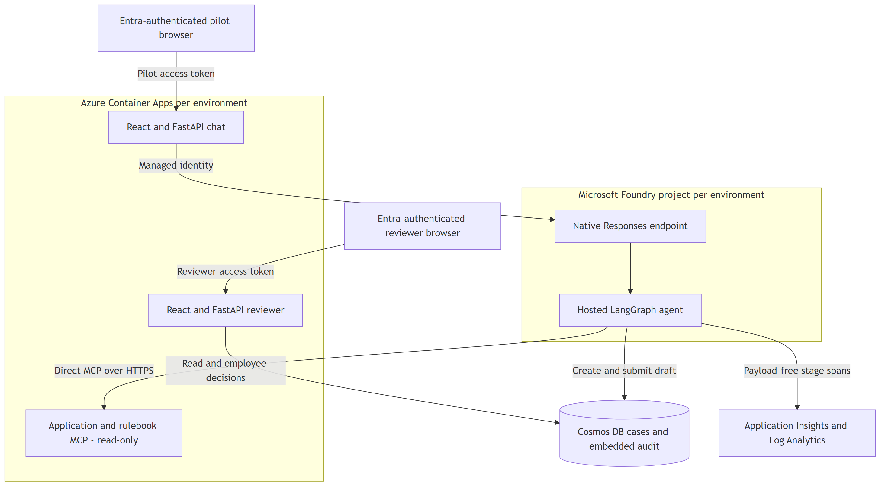

<!-- mermaid-checked: safe labels, quoted subgraphs and edge labels, closed subgraphs, unique ids -->
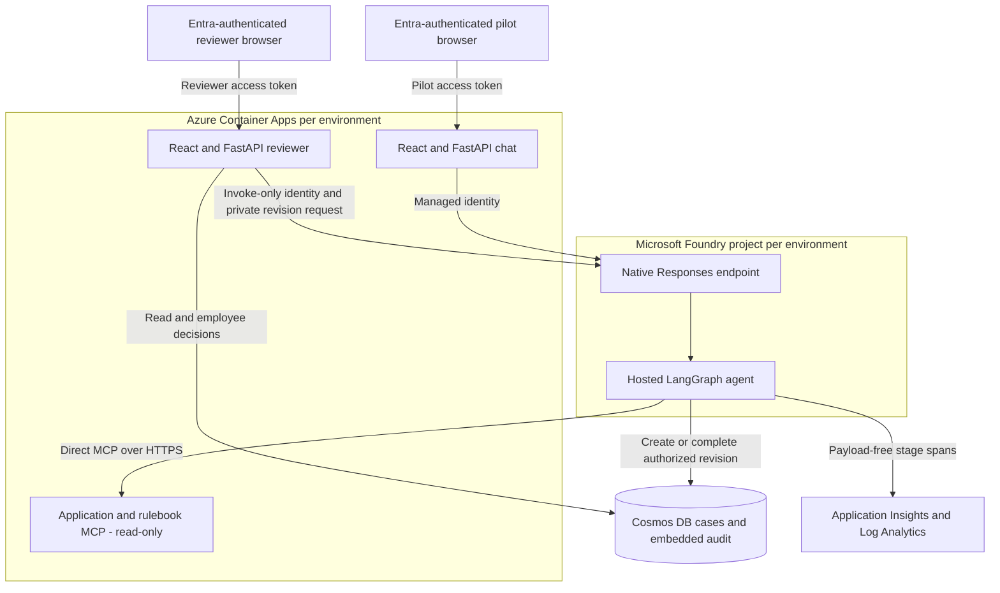

### Technology stack and responsibility

| Layer | Technology | Contract or version | Responsibility |
| --- | --- | --- | --- |
| Browser | React frontends | Locked frontend manifests | Separate applicant and employee experiences |
| Web APIs | FastAPI, PyJWT, MSAL browser | Entra access tokens | Tenant, audience and authorization checks |
| Hosted entry point | Agent Server LangGraph adapter | `1.0.0b17`, Responses `2.0.0` | Readiness, request conversion and bounded streaming |
| Orchestration | LangGraph | Deterministic state graph | Intake, reference lookup, composition |
| Tools | FastMCP | Streamable HTTP | Synthetic fixture and pinned rulebook reads |
| Business persistence | Cosmos DB | Database `quote-preparation`, container `cases`, partition `/caseId` | Case state, calculation snapshot and audit |
| Local persistence | SQLite | `CaseStore` contract | Offline workshop and tests, not cross-process hosted state |
| Native demonstrations | Azure AI Projects | SDK `2.6.0` | Separate operator memory/files/skills/evaluations |
| Telemetry | OpenTelemetry and Azure Monitor | SDK-owned hosted pipeline | Sanitized custom stages and native investigation |

No Redis, queue, third-party tracing backend or LLM pricing engine is required
by the deployed quote path. `gpt-4o-mini` is provisioned, but the graph uses
fixed templates and a pure calculator. Having a model/toolbox in the project
does not mean the graph calls a chat model or the Foundry toolbox gateway.

## Component relationships and actual tool routing

Rendered image if the Mermaid embed is unavailable

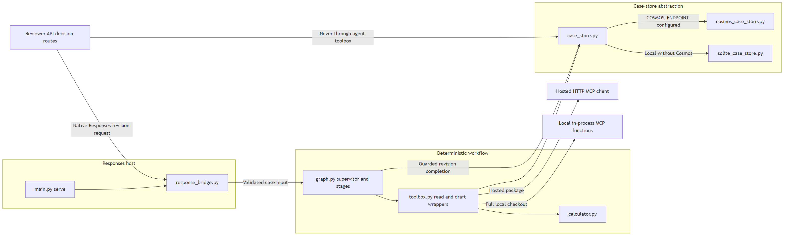

<!-- mermaid-checked: safe labels, quoted subgraphs and edge labels, closed subgraphs, unique ids -->
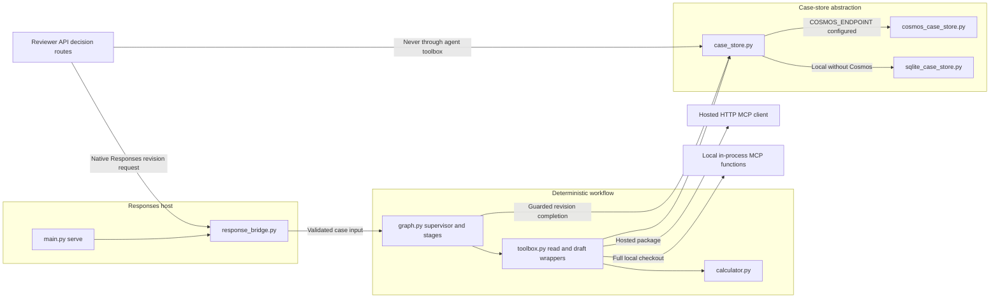

| Source | Responsibility |
| --- | --- |
| [main.py](../src/quote-preparation-agent/main.py) | Case argument runs locally; no argument starts the host on port 8088 |
| [response_bridge.py](../src/quote-preparation-agent/response_bridge.py) | Converts Responses input into fresh graph state; streams final bilingual JSON only |
| [graph.py](../src/quote-preparation-agent/graph.py) | Fixed routing and applicant-message templates; no model inference |
| [toolbox.py](../src/quote-preparation-agent/toolbox.py) | Local function calls or direct remote MCP; calculator and draft submission only |
| [case_store.py](../src/quote-preparation-agent/case_store.py) | Shared store contract and backend selection |
| [reviewer app](../apps/reviewer-app/app.py) | Authenticated decisions, audit, revision checks and explicitly confirmed synthetic queue clearing |

`azure.yaml` declares `quote-tools` and two remote connections. The current
hosted implementation nevertheless calls `APPLICATION_MCP_URL` and
`RULEBOOK_MCP_URL` directly through MCP sessions. Do not draw the toolbox
gateway as an executed hop. The read-only MCP endpoints expose synthetic data;
they are not the employee authorization boundary. The graph is compiled without
a checkpointer: Foundry conversation IDs do not create durable LangGraph state.

## Request lifecycle and missing-plan example

Rendered image if the Mermaid embed is unavailable

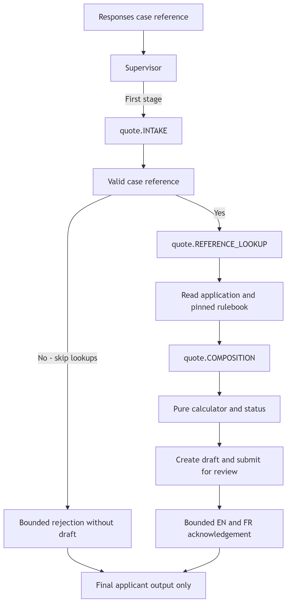

<!-- mermaid-checked: safe labels, quoted subgraphs and edge labels, closed subgraphs, unique ids -->
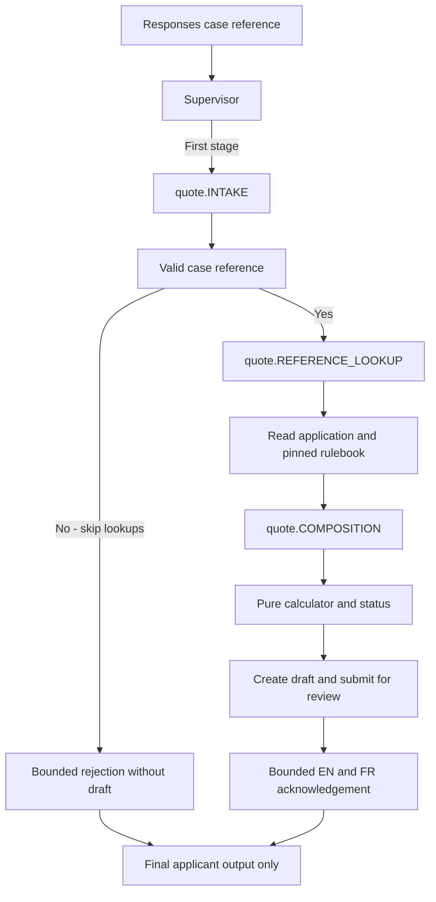

In code, each stage returns to the supervisor, which selects the next
unfinished stage and eventually `END`. The diagram expands the work within
`COMPOSITION`, not additional LangGraph nodes or telemetry stages.
There are exactly three custom stage names. Calculation and persistence are
inside `COMPOSITION`; that stage has no *remote MCP lookup*, but does call
local calculator/store wrappers.

The supplied [CASE-SYN-005 fixture](../data/synthetic/fixtures/case-syn-005-missing-plan.json)
has `input.plan: null`. The calculator returns `INCOMPLETE`,
`amountCents: null`, `issues: ["MISSING_PLAN"]`. The running agent can still
submit a case whose workflow state is `PENDING_REVIEW`, carrying that
calculation status. These are different dimensions, not a contradictory state.
The applicant receives the bilingual missing-information acknowledgement,
never the raw fixture, amount, rulebook or employee audit fields.
The fixture's illustrative `workflow`/`nextCommand` blocks are teaching data,
not instructions to auto-approve a live case.

## Employee approval and persistence boundary

Rendered image if the Mermaid embed is unavailable

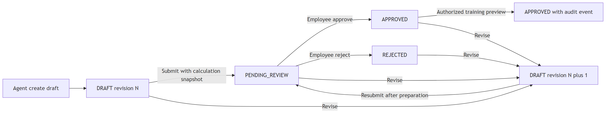

<!-- mermaid-checked: safe labels, quoted subgraphs and edge labels, closed subgraphs, unique ids -->
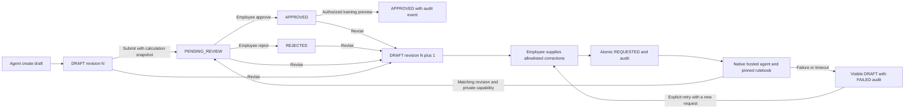

The reviewer API derives actor identity from verified Entra claims, checks
the `Reviewer` role and `Review.Access` delegated scope, and accepts the
revision the employee saw. The stores reject self-approval and invalid
transitions. Cosmos uses ETag-conditional writes and keeps the calculation
snapshot plus audit entries in the case document. This is an application
append-only audit convention, not a claim of immutable regulatory storage.
Revision clears prior approval. Preview is a training-only audited action,
not delivery; the reviewer web API currently exposes decisions and audit,
not an applicant preview/delivery endpoint.

### Returned-draft correction and agent resubmission

The browser requests `GET /api/cases?state=active`, including both `DRAFT`
and `PENDING_REVIEW`. The API's default remains pending-only for existing
clients. Approved/rejected cases remain accessible through explicit state
filters. Case detail and its audit are read from one database snapshot.

`POST /api/cases/{caseId}/prepare` accepts the exact revision and a nonempty
`corrections` object. Only synthetic `jurisdiction: ON`,
`vehicleClass: COMPACT|SEDAN`, and `plan: TRAINING_BASIC|TRAINING_EXTENDED`
are accepted. Prices, actors, rulebooks and arbitrary application JSON are
not editable. Corrections accumulate without rewriting the fixture.

The API atomically stores corrections, verified employee identity and a
server-generated private request capability before calling native Responses.
The graph validates that capability against the current stored revision,
reads trusted corrections, and recomputes with the pinned rulebook. A
`READY` result, calculation snapshot and `PREPARATION_COMPLETED` audit event
become visible together, retaining the correcting employee as preparer.
Another employee must approve. Applicant output stays bounded and bilingual.

Failed preparation stays visible as a draft, with its corrections and
`PREPARATION_FAILED` event. A lost response is reconciled from durable state;
an abandoned `REQUESTED` lease can be replaced after 240 seconds. Retries use
idempotency keys, and stale revisions/capabilities cannot overwrite a new
request. Draft calculations are explicitly labelled as the previous submission.
Audit includes corrections, a hashed preparation correlation, the native
response ID and calculation provenance. The private capability is never
returned to the browser or recorded in audit/telemetry.

The reviewer identity receives the project-scoped built-in `Foundry Agent Consumer`
role, not the broad `Foundry User` role. Its `endpoints/interact/action` data action
permits native endpoint invocation, not memory or agent management. The earlier
custom invocation role did not authorize this endpoint. Role-assignment propagation
can take several minutes; an initial 403 is not evidence that `agents/write` is needed.
Live deployment verification must prove both successful invocation and
continued denial of reviewer memory access. No new queue service is required.

The applicant chat checks pilot membership before server-side managed-identity
invocation. The employee API has a separate registration/role boundary.
Anonymous protected calls return 401; health endpoints alone prove neither
identity authorization nor hosted-agent readiness.

## Isolated native showcase, not hidden production dependencies

Rendered image if the Mermaid embed is unavailable

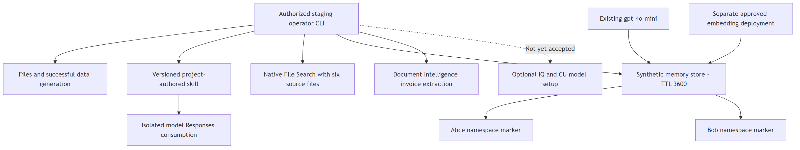

<!-- mermaid-checked: safe labels, quoted subgraphs and edge labels, closed subgraphs, unique ids -->
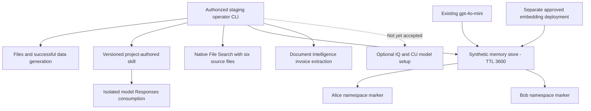

Memory recall and cross-scope controls passed; an existing reviewer workload
received memory-list 403 while the authorized operator succeeded.
Namespaces are retrieval partitions, not caller authorization or per-agent ACLs.
User-profile/chat-summary extraction is off; procedural memory is a service
default. No extraction invocation or quote-agent attachment is claimed.
Entries expire in one hour and [Lab 17](labs/lab-17-native-skills-memory.md)
reseeds the existing store instead of recreating it.
The skill is authored by this project, not a prebuilt Microsoft runtime skill.
The verified File Search and invoice paths are separate from optional Foundry
IQ and Content Understanding model setup.

## Telemetry to native evaluation

Rendered image if the Mermaid embed is unavailable

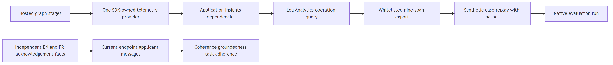

<!-- mermaid-checked: safe labels, quoted subgraphs and edge labels, closed subgraphs, unique ids -->
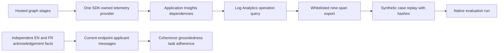

Custom spans omit applicant text and amounts; failures record sanitized ERROR
status without exception payloads. Platform request roots and application SDK
dependency roots can have different operation IDs. A root-only query cannot
prove custom stages are absent. Export verifies actual ingestion and
unambiguous case/policy lineage before producing a synthetic replay dataset;
it does not recover a private user prompt.

The current applicant benchmark passed five cases in each language on all
three criteria. Scores are advisory; missing, incomplete or errored native
evidence blocks promotion. Historical 0/10 judge and RAG negative-control
failures remain preserved. This is not a same-dataset improvement claim.

## Release and documentation architecture

Rendered image if the Mermaid embed is unavailable

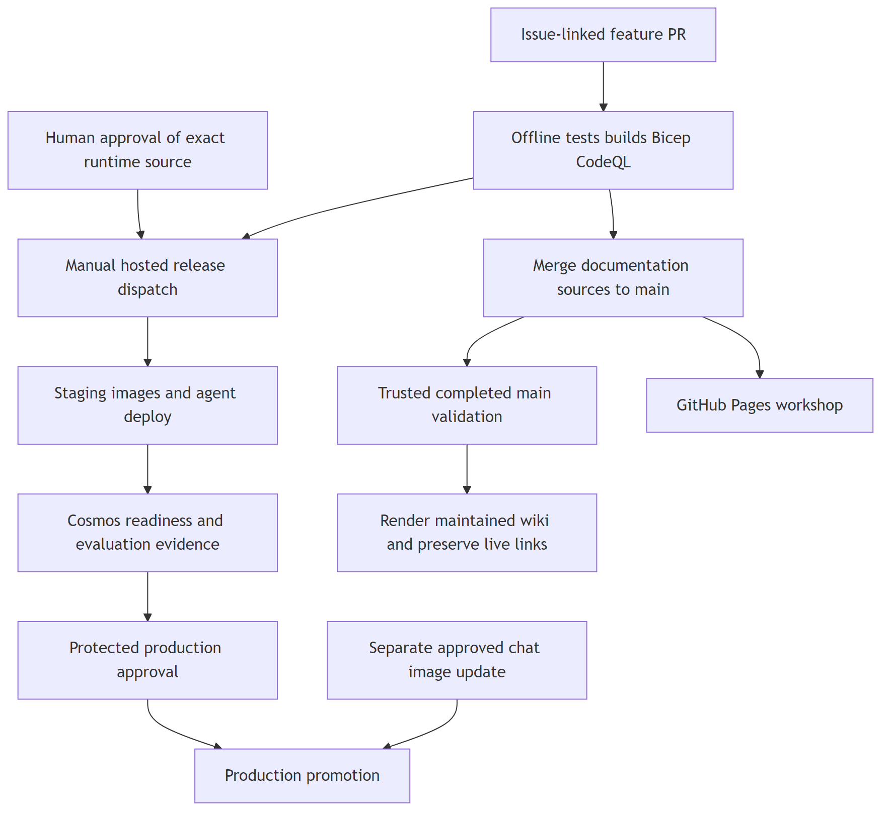

<!-- mermaid-checked: safe labels, quoted subgraphs and edge labels, closed subgraphs, unique ids -->
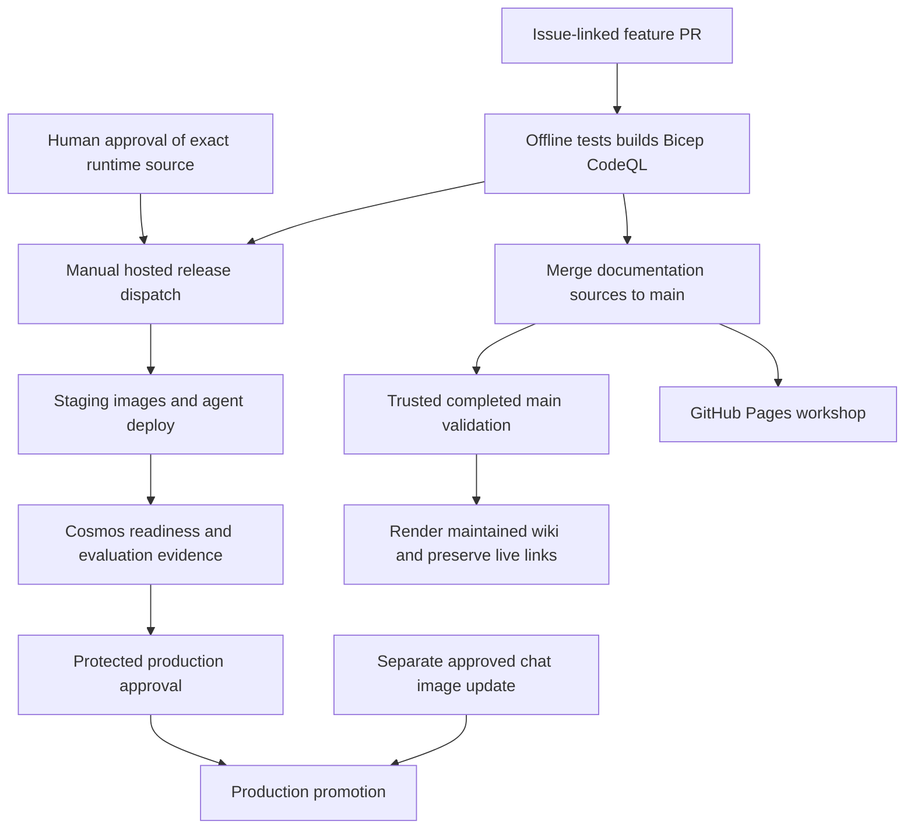

Production reuses staging-resolved reviewer/MCP image digests and rebuilds the
approved agent source; it does not copy a running staging agent container.
Chat is deployed out of band. Main frontend image builds do not update live
Container Apps automatically. Memory embedding is an opt-in staging template,
not part of the baseline deployment.

Maintained wiki pages are rendered from repository docs by
[publish_showcase_wiki.py](../scripts/publish_showcase_wiki.py), after the
publication workflow verifies completed main-run provenance. Test trends are
generated from run artifacts; Home deployment links retain the last actual
deployment fragments. No Azure redeployment is needed for documentation.

## Source and evidence map

* [Deployment manifest](../azure.yaml) and [infrastructure](../infra/README.md)
* [Native runbook](native-showcase.md) and [authentic release evidence](showcase-evidence.md)
* [Operations](wiki/operations.md), [workflow inventory](wiki/workflows.md)
  and [evidence interpretation](wiki/release-evidence.md)
* [Microsoft Foundry hosted-agent guidance](https://learn.microsoft.com/azure/ai-foundry/agents/concepts/hosted-agents)
