[English](../architecture.md) | [Atelier](index.md) | [Preuves actuelles](showcase-evidence.md)

## État déployé

La démonstration conservée utilise le véritable hôte Responses de Foundry :
agent staging **v5**, production **v6**, source approuvée `01af1fb`,
[livraison 39424857559](https://github.com/devopsabcs-engineering/foundry-hosted-agents-fsi/actions/runs/39424857559).
Le suffixe `-poc` du compte/projet désigne la production. Les deux chats, les
deux applications de révision et les quatre services MCP sont déployés.
Les arbres `src`, `apps` et `infra` correspondent au main fusionné `a4b6008`.
Ces versions constituent une observation datée, pas des paramètres de routage.
Les anciens avertissements « author-only » ne décrivent plus cet inventaire.
Toute nouvelle modification d'infrastructure reste soumise à approbation.

Les données, tarifs et résultats sont synthétiques. Aucune offre réelle,
livraison au client ou approbation automatique n'est représentée.

## Architecture applicative

Image rendue si le composant Mermaid est indisponible

<!-- mermaid-checked: safe labels, quoted subgraphs and edge labels, closed subgraphs, unique ids -->
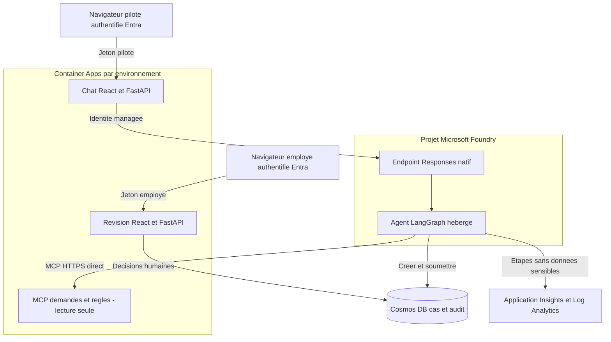

| Couche | Technologie et contrat | Responsabilité |
| --- | --- | --- |
| Interface | React, MSAL | Expériences distinctes du demandeur et de l'employé |
| API web | FastAPI, PyJWT | Validation du tenant, de l'audience et des autorisations |
| Hôte | Adaptateur LangGraph `1.0.0b17`, Responses `2.0.0` | Readiness, conversion et flux final borné |
| Orchestration | LangGraph déterministe | Intake, recherche de références et composition |
| Outils | FastMCP, HTTP streamable | Lecture de fixtures et du règlement épinglé |
| Persistance hébergée | Cosmos DB | Base `quote-preparation`, conteneur `cases`, partition `/caseId` |
| Persistance locale | SQLite | Même contrat `CaseStore`, sans partage hébergé |
| Démonstrations natives | Azure AI Projects `2.6.0` | Mémoire, fichiers, skills et évaluations isolés |
| Télémétrie | OpenTelemetry, Azure Monitor | Pipeline SDK unique et étapes assainies |

Le chemin de préparation n'utilise ni Redis, ni file de messages, ni plateforme
de traces tierce, ni modèle de tarification génératif. Le modèle provisionné
`gpt-4o-mini` n'est pas invoqué par ce graphe.

## Composants et routage réel

Image rendue si le composant Mermaid est indisponible

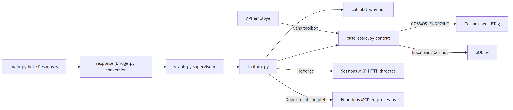

<!-- mermaid-checked: safe labels, quoted subgraphs and edge labels, closed subgraphs, unique ids -->
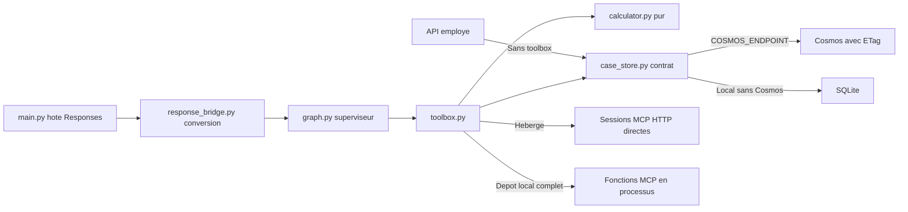

* [main.py](../../src/quote-preparation-agent/main.py) lance le CLI avec un cas
  ou l'hôte réel sur le port 8088 sans argument.
* [response_bridge.py](../../src/quote-preparation-agent/response_bridge.py)
  convertit l'entrée Responses en nouvel état et ne diffuse que le JSON final
  bilingue, jamais les états intermédiaires.
* [graph.py](../../src/quote-preparation-agent/graph.py) choisit des étapes fixes
  et des messages modèles, sans inférence.
* [toolbox.py](../../src/quote-preparation-agent/toolbox.py) expose les lectures,
  le calcul et la soumission de brouillons, pas les décisions humaines.
* [L'API employé](../../apps/reviewer-app/app.py) accède directement au magasin.

Malgré les connexions déclarées dans `azure.yaml`, l'agent appelle directement
`APPLICATION_MCP_URL` et `RULEBOOK_MCP_URL`, pas la passerelle toolbox Foundry.
Ces services publics en lecture seule ne contiennent que des données
synthétiques. Le graphe est compilé sans checkpointer : une conversation
Foundry ne crée pas de persistance conversationnelle LangGraph.

## Parcours déterministe et cas incomplet

Image rendue si le composant Mermaid est indisponible

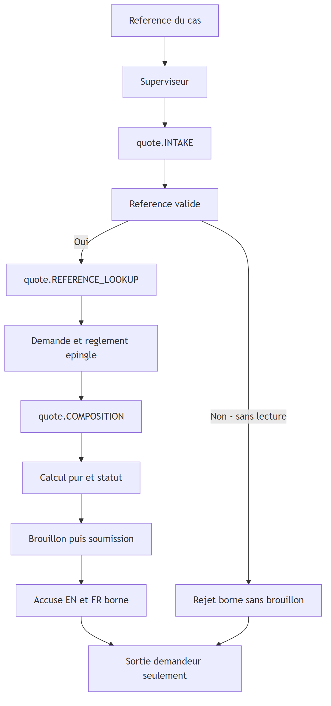

<!-- mermaid-checked: safe labels, quoted subgraphs and edge labels, closed subgraphs, unique ids -->
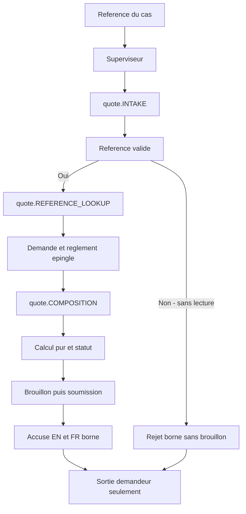

Chaque étape revient au superviseur avant la suivante et `END`. Le calcul et
la persistance font partie de `COMPOSITION`, pas de nouveaux nœuds ou spans.
Il existe exactement trois étapes personnalisées. « Pas de MCP distant dans
COMPOSITION » ne signifie pas « aucun appel de calcul ou de magasin ».

La [fixture CASE-SYN-005](../../data/synthetic/fixtures/case-syn-005-missing-plan.json)
a `input.plan: null`. Le calcul retourne `INCOMPLETE`, `amountCents: null`
et `MISSING_PLAN`. Le magasin d'exécution peut néanmoins enregistrer
`PENDING_REVIEW` avec cet instantané incomplet. Statut de calcul et état du
workflow sont deux dimensions distinctes. Le demandeur ne voit ni montant,
ni règlement brut, ni audit employé. Les blocs pédagogiques `workflow` et
`nextCommand` de la fixture ne déclenchent aucune approbation réelle.

## Approbation humaine et concurrence

Image rendue si le composant Mermaid est indisponible

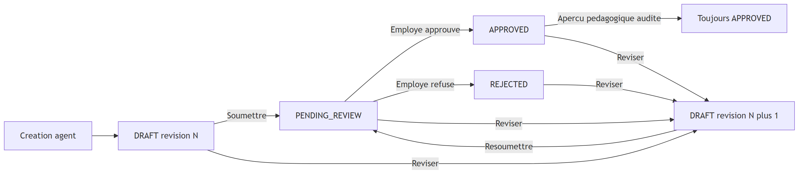

<!-- mermaid-checked: safe labels, quoted subgraphs and edge labels, closed subgraphs, unique ids -->
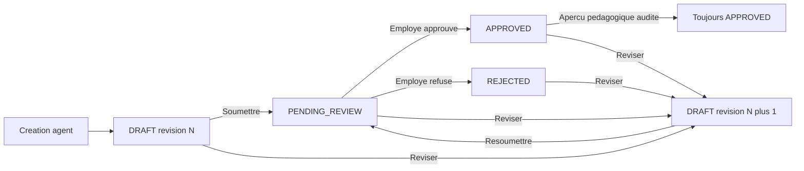

L'API vérifie le rôle `Reviewer`, le scope délégué `Review.Access`, l'identité
Entra et la révision consultée. Le magasin interdit l'auto-approbation et les
transitions invalides. Cosmos utilise des écritures conditionnelles ETag.
L'audit ajouté au document est une convention applicative, pas une garantie
de stockage réglementaire immuable. Réviser invalide l'approbation précédente.
L'aperçu du magasin reste pédagogique et audité, sans livraison ; l'API web
employé n'expose pas de route de livraison/aperçu au demandeur.
La suppression de la file synthétique exige une confirmation explicite.

Le chat vérifie l'appartenance pilote avant l'appel serveur par identité
managée. Les accès protégés anonymes retournent 401. Un endpoint de santé
ne prouve ni l'autorisation ni la disponibilité de l'agent.

## Fonctions natives isolées

Image rendue si le composant Mermaid est indisponible

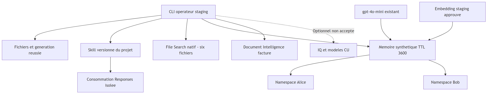

<!-- mermaid-checked: safe labels, quoted subgraphs and edge labels, closed subgraphs, unique ids -->
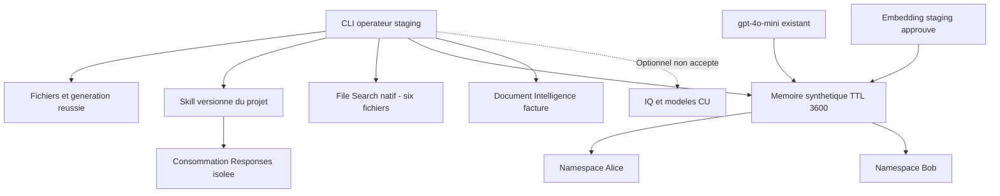

Le rappel, les contrôles croisés et le refus 403 de l'identité employé ont
été vérifiés. Les namespaces ne sont pas des ACL. L'extraction de profil et
de résumé est désactivée ; la mémoire procédurale est un défaut du service.
Aucune extraction ni liaison à l'agent métier n'est revendiquée.
Les entrées expirent après une heure :
[Lab 17](labs/lab-17-native-skills-memory.md) réensemence le magasin existant.
Le skill est écrit par ce projet, pas fourni comme skill Microsoft préinstallé.
File Search et la facture vérifiés ne prouvent pas les options IQ/CU.

## Traces et évaluation native

Image rendue si le composant Mermaid est indisponible

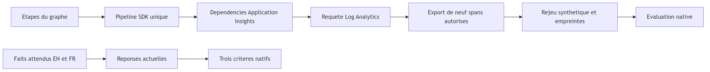

<!-- mermaid-checked: safe labels, quoted subgraphs and edge labels, closed subgraphs, unique ids -->
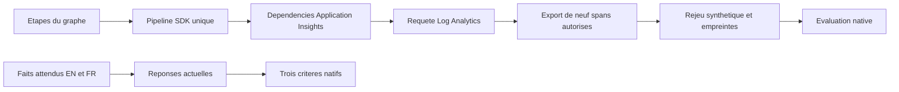

Les spans personnalisés omettent texte et montants ; les erreurs enregistrent
un statut assaini sans exception brute. Les racines de requête de plateforme
et les dépendances SDK peuvent porter des identifiants différents.
L'export exige une ingestion réelle et une provenance cas/règlement non ambiguë.
Il produit un rejeu synthétique, pas une reconstruction de requête privée.

Le benchmark demandeur actuel a réussi cinq cas par langue sur trois critères.
Les scores restent indicatifs, mais toute preuve absente, incomplète ou en
erreur bloque la promotion. Les anciens échecs juge 0/10 et contrôles RAG
restent visibles ; ce n'est pas une amélioration mesurée sur le même dataset.

## Livraison et publication documentaire

Image rendue si le composant Mermaid est indisponible

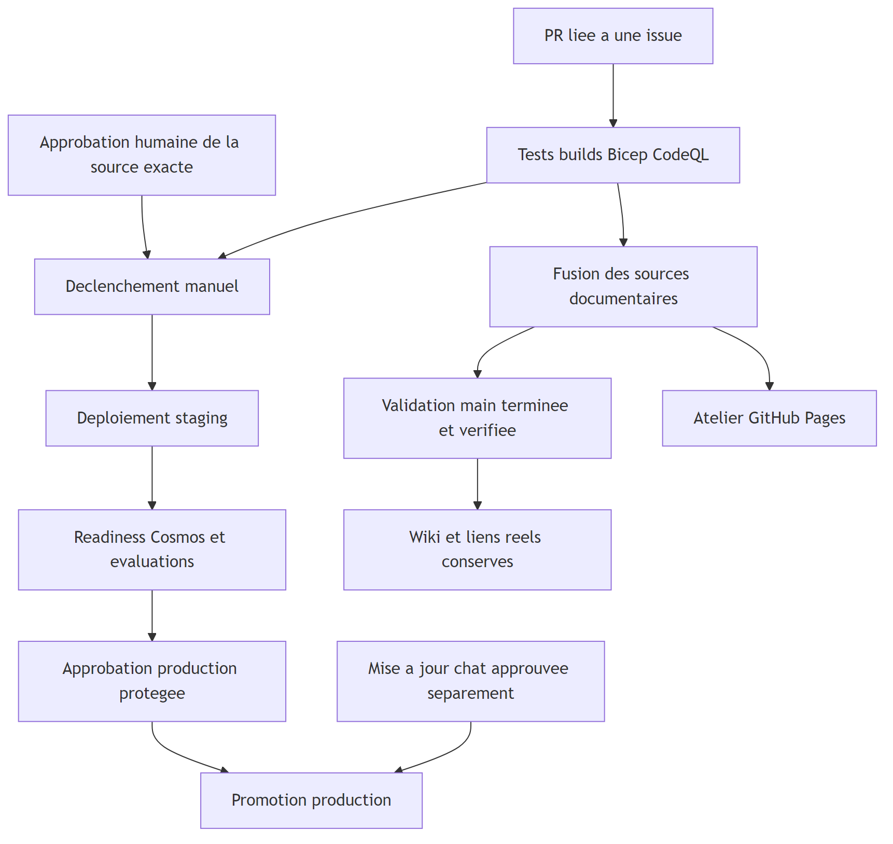

<!-- mermaid-checked: safe labels, quoted subgraphs and edge labels, closed subgraphs, unique ids -->
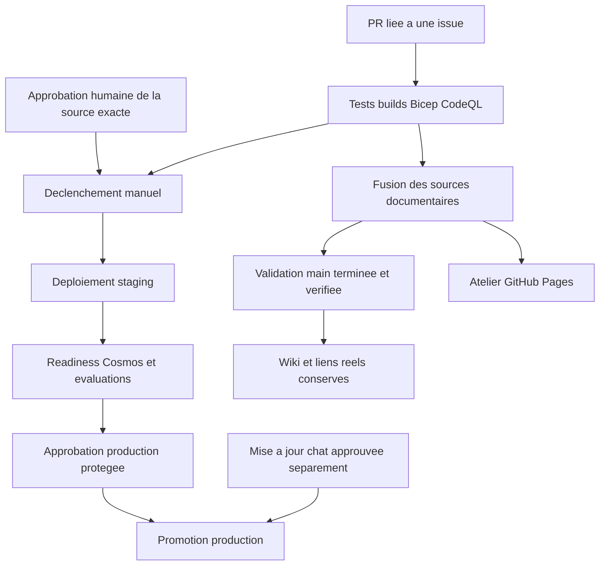

La production réutilise les digests MCP/employé résolus en staging et
reconstruit l'agent depuis la source approuvée. Le chat est mis à jour
séparément. Un build frontend sur main ne redéploie pas les applications.
L'embedding mémoire est un ajout staging optionnel.

[Le générateur wiki](../../scripts/publish_showcase_wiki.py) publie les sources
maintenues après contrôle de provenance main. Les tendances viennent des
artefacts de tests ; Home conserve les derniers liens de déploiement réels.
Une publication documentaire ne nécessite aucun redéploiement Azure.

## Références

* [Manifeste](../../azure.yaml) et [infrastructure](../../infra/README.md)
* [Guide natif](native-showcase.md) et [preuves authentiques](showcase-evidence.md)
* [Opérations](../wiki/operations.md), [workflows](../wiki/workflows.md)
  et [interprétation des preuves](../wiki/release-evidence.md)
* [Documentation Microsoft Foundry](https://learn.microsoft.com/azure/ai-foundry/agents/concepts/hosted-agents)
