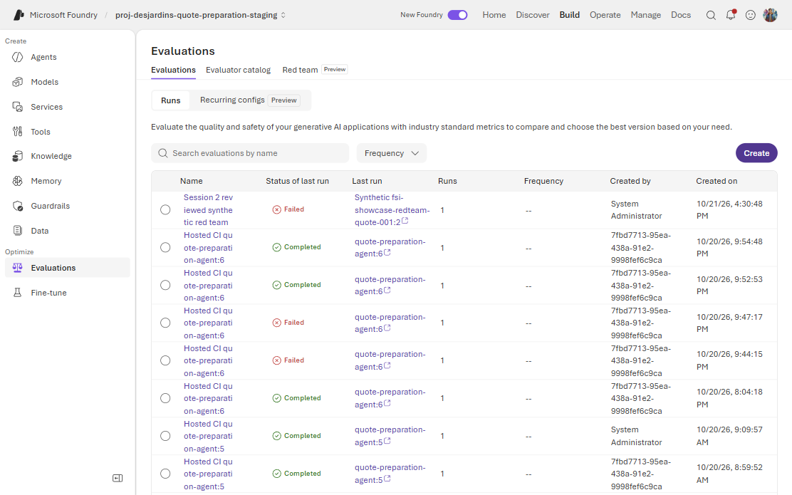
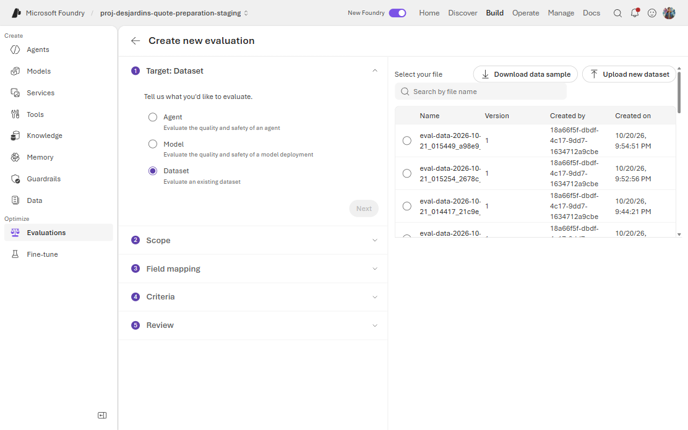
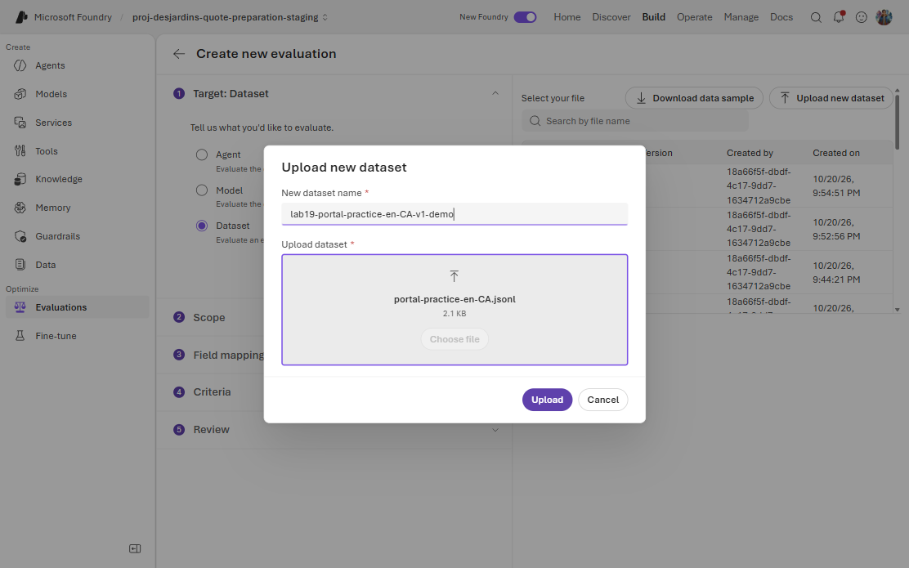
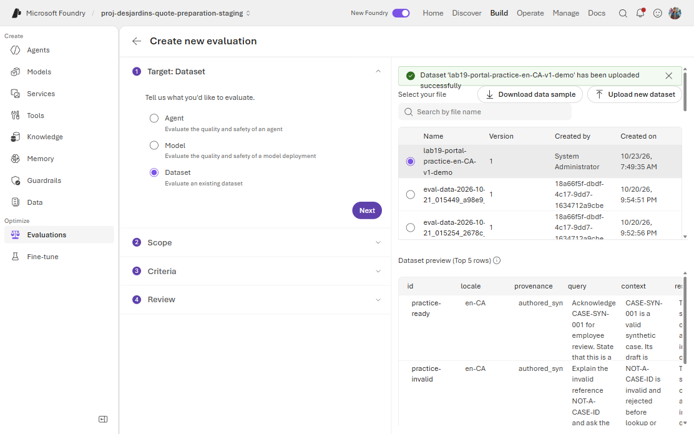
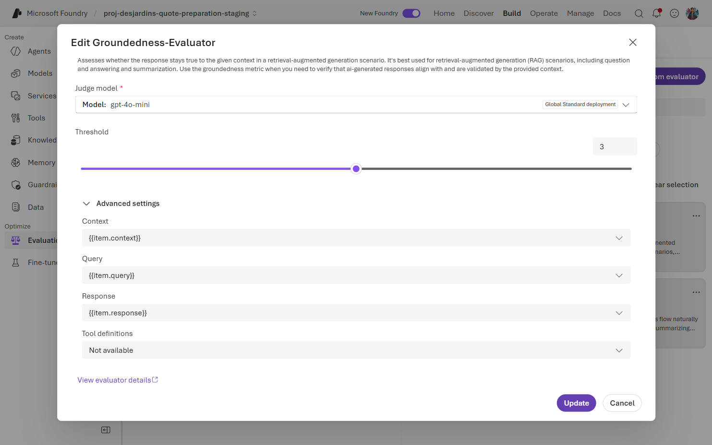
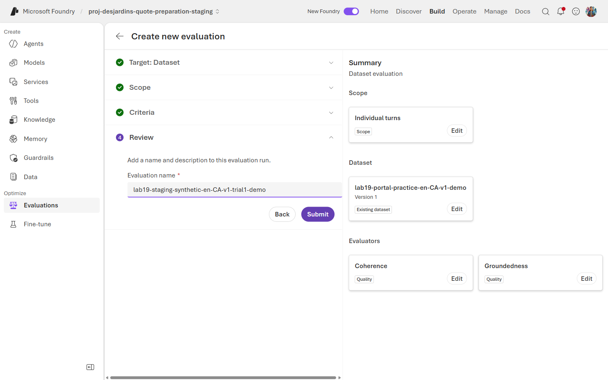

[English](../evaluation-guide.md) | [Atelier pratique 19](labs/lab-19-evaluation-engineering.md) |
[PowerPoint FR](../assets/decks/foundry-evaluation-engineering-fr.pptx) |
[PowerPoint EN](../assets/decks/foundry-evaluation-engineering-en.pptx)

## Choisir la preuve avant l'évaluateur

Une évaluation mesure un contrat explicite; elle n'exige pas nécessairement
un LLM. Commencez par la décision : vérifier le calcul, empêcher
l'auto-approbation, détecter un prix inventé ou juger le choix d'un outil.
Ces questions exigent des oracles différents.

Le graphe de soumission déployé est **déterministe**, pas un tarificateur LLM.
`INTAKE`, `REFERENCE_LOOKUP` et `COMPOSITION` utilisent des données validées,
des MCP en lecture seule, un calculateur pur et un état persistant.
Les messages au demandeur sont des modèles bilingues bornés. Les **juges**
natifs utilisent des LLM : leurs notes peuvent varier même si la réponse de
l'agent ne change pas. Les démonstrations isolées File Search, compétences et
mémoire ne deviennent pas des dépendances du graphe parce qu'elles se trouvent
dans le même projet. Consultez l'[architecture](architecture.md).

Toutes les données et tous les montants sont synthétiques et non contraignants :
aucun vrai tarif, renseignement client, envoi ou acte de souscription.
La rédaction a utilisé une assistance IA; aucun assistant de code n'est requis
pour l'apprenant.

| Propriété | Test de contrat déterministe | Évaluation stochastique |
| --- | --- | --- |
| Oracle | Montant/état exact, schéma, prédicat de politique | Grille, étiquette humaine, juge modèle ou résultat échantillonné |
| Exemple | `INCOMPLETE` implique aucun montant | L'accusé explique-t-il clairement la prochaine étape? |
| Répétition | Entrées et état contrôlés doivent reproduire le résultat | Les échantillons estiment une distribution |
| Sens d'un échec | Invariant violé, défaut du test ou de l'infrastructure | Qualité insuffisante, désaccord du juge ou panne de service |
| Contrôle adapté | Blocage pour calcul, autorisation, schéma, divulgation | Seuils calibrés, segments, incertitude et révision humaine |
| Coût | Généralement local et rapide | Inférence, appels juge, latence et conservation des preuves |

Ces catégories ne sont pas deux frameworks exclusifs. Un test unitaire peut
cibler un composant stochastique; une évaluation d'agent peut utiliser du code
déterministe. Un service déterministe peut échouer à cause du réseau, du RBAC,
de la concurrence ou de l'état. Température zéro et graine ne garantissent pas
des résultats LLM identiques après une évolution du modèle ou de l'infrastructure.

## Progression pour l'agent de soumission

| Niveau | Question et cas | Mécanisme | Déduction interdite |
| --- | --- | --- | --- |
| 0 | Données valides? `READY`, `UNSUPPORTED`, `INCOMPLETE`, ID invalide | Schéma et tests du calculateur | Schéma valide signifie réponse exacte |
| 1 | Flux sûr? révision/ETag, auto-approbation, nouvelle tentative | Contrat du dépôt et API reviewer | Accusé signifie persistance ou approbation |
| 2 | Réponse sûre? EN/FR, sans montant, injection | Contrôle déterministe 13 cas et vérification native | Transport simulé signifie déploiement réel |
| 3 | Accusé utile et fondé? cinq cas par langue | Juges natifs coherence, groundedness, task adherence | Bonne note prouve calcul ou outils |
| 4 | Juge fiable? faux prix/approbation, contexte non pertinent | Contrôles positifs/négatifs étiquetés | Réponse fluide signifie réponse vraie |
| 5 | Qualité stable? répétitions, cas rares, référence/candidat appariés | Données/grille figées, résultats par cas, incertitude | Cinq cas verts garantissent l'absence de régression |
| 6 | Système sûr dans le temps? resoumission, rôles, traces | UI/API authentifiées, identité réelle, télémétrie | Ligne portail ou trace demandée prouve l'ingestion |

## Pas à pas dans le portail Foundry

Les expériences **nouveau Foundry** et classique diffèrent. Les libellés,
évaluateurs et fonctions en préversion dépendent du projet, de la région et
du rôle. Le [guide officiel](https://learn.microsoft.com/azure/foundry/how-to/evaluate-generative-ai-app)
fait autorité pour la navigation; ne mélangez pas les deux expériences.

### Si l'onglet de l'agent affiche No evaluations found

Dans la capture fournie, **Build > Agents > quote-preparation-agent >
Evaluation** affiche une liste vide. La barre latérale propose aussi
**Optimize > Evaluations** au niveau du projet. Une liste vide pour l'agent
ne prouve **pas** l'absence d'évaluations SDK dans le projet. L'exécuteur crée
une évaluation de données nommée `Hosted CI quote-preparation-agent:<version>`,
pas un déploiement. Ne sélectionnez pas **Publish**, **Automatic Evaluation**
ou **Create evaluator** pour retrouver un essai conservé.

| Objectif | Parcours | Nouveaux appels |
| --- | --- | --- |
| Examiner un vrai essai pour l'Exercice 19.4 | A ci-dessous | Aucun appel agent/juge |
| Apprendre le téléversement et le mapping | B ci-dessous | Juges payants après approbation, sans appel agent |
| Tester l'agent déployé sur cinq cas par langue | Exercice 19.5 de l'[Atelier 19](labs/lab-19-evaluation-engineering.md#exercice-195-exécuter-le-petit-essai-natif-enfr) | Agent et juges après approbation |

### A. Retrouver et examiner un vrai essai conservé



Figure 1. **Build > Optimize > Evaluations** de staging, capturé le 2026-10-23.
Cette entrée latérale ouvre les essais du projet, pas l'onglet vide de l'agent.
Des tentatives v6 terminées et échouées coexistent : vérifiez l'ID de l'essai.

1. Ouvrez [ai.azure.com](https://ai.azure.com), avec **New Foundry** activé.
   Sélectionnez `proj-desjardins-quote-preparation-staging` dans le compte
   `aif-desjardins-quote-preparation-staging`. Vérifiez le locataire. Le suffixe
   `-poc` désigne la production; ne l'utilisez pas pour contourner un accès absent.
2. Depuis l'écran de l'agent, sélectionnez **Evaluations** sous **Optimize**
   dans la **barre latérale gauche**, pas l'onglet horizontal **Evaluation**.
   Certaines versions du portail nomment l'entrée projet **Evaluation**.
3. Effacez les filtres de recherche, date et cible. Cherchez
   `Hosted CI quote-preparation-agent`, ouvrez la définition correspondante,
   puis son essai `quote-preparation-agent:<version>` si une liste séparée
   apparaît. Des noms peuvent être identiques : vérifiez toujours l'ID.
4. Pour la livraison approuvée du 2026-10-21, retrouvez l'un des IDs suivants.
   Ils concernent **staging v6**, même si une version ultérieure est active.

   | Langue | ID natif | Lignes notées attendues |
   | --- | --- | --- |
   | `en-CA` | `evalrun_985de95ac8e742be88c6172d8a4098d6` | 5 |
   | `fr-CA` | `evalrun_db159f558fd847668d7bba275ba1a353` | 5 |

5. Développez **Run details**. Relevez IDs de définition (`eval_...`) et
   d'essai (`evalrun_...`), état, données, déploiement juge et configuration.
   Les critères sont `coherence`, `groundedness` et `task_adherence`.
   Notez versions et seuils visibles; indiquez « indisponible » plutôt
   qu'inventer une métadonnée non exposée. Lisez les IDs dans la barre
   d'adresse ou **Raw JSON** s'ils n'apparaissent pas dans les détails.
6. Descendez à **Detailed metrics result**. Ouvrez une ligne ou une cellule
   note/justification selon votre interface. Utilisez la barre de défilement
   horizontale pour voir tous les critères. Relevez l'`id` d'entrée si exposé;
   l'index `0` n'est pas un identifiant stable.
7. Vérifiez les entrées avec le tableau suivant. Si le portail n'expose pas
   les entrées, utilisez le `captured.json` et la définition du même essai.

   | Critère | Entrée query | Entrée response | Faits indépendants |
   | --- | --- | --- | --- |
   | Coherence | `evaluation_query`, avec instructions d'accusé | Texte `response` dans une langue | Dans la question d'évaluation |
   | Groundedness | `evaluation_query` | Texte `response` dans une langue | `context` |
   | Task adherence | Tableau de messages système/utilisateur `task_query` | Tableau de messages `output_items` | Faits de confiance dans les messages |

8. Lisez chaque justification et comparez réponse et faits. Une révision en
   attente n'est pas une approbation. Une référence invalide ne doit pas
   produire une affirmation de soumission. Aucun prix ne doit être divulgué.
   Une réponse cohérente peut rester fausse.
9. Vérifiez **cinq cas uniques et trois métriques notées par cas**, sans erreur
   ni exclusion. Les essais approuvés ont réussi tous ces critères.
   Un état `Failed` ou `Partial` n'est pas une preuve complète réussie.
   Ne répétez pas une mauvaise note jusqu'à obtenir du vert.
10. Exportez si l'interface le permet, sinon utilisez le `results.json`
    conservé. Gardez IDs et justifications et remplissez la fiche de
    l'[Exercice 19.4](labs/lab-19-evaluation-engineering.md#exercice-194-examiner-un-essai-réel-dans-le-portail).


Figure 2. Essai conservé **français staging v6**
`evalrun_db159f558fd847668d7bba275ba1a353`, définition
`eval_923cb34017c743a59089a36cb55d4e28`, capturé le 2026-10-23 sans le relancer.
Chaque résumé affiche **5/5**. Run details est replié pour montrer les cinq
lignes et la barre horizontale. Ce sont les résultats de livraison conservés,
pas ceux du jeu de pratique rédigé ci-dessous.

Si l'essai est introuvable, vérifiez projet et filtres, puis demandez au
responsable l'ID de définition, le `report_url` disponible ou les artefacts de
la [livraison 39527950931](https://github.com/devopsabcs-engineering/foundry-hosted-agents-fsi/actions/runs/39527950931).
Un ID `evalrun_...` seul n'est pas une URL complète. Pour lire le lien conservé :

```powershell
$result = Get-Content '.local\YOUR-RETAINED-RUN\results.json' -Raw | ConvertFrom-Json
$result.run | Select-Object id, status, report_url
```

Remplacez le chemin par le véritable artefact extrait pour cette langue.
Ouvrez un lien non vide avec le même locataire/projet authentifié. Sans lien,
utilisez la navigation projet ou les résultats exportés. Sans portail ni
artefacts correspondants, l'exercice est **bloqué**. Un essai synthétique ne
remplace pas cette preuve réelle.

### B. Téléverser un jeu prêt à utiliser

Téléchargez directement les fichiers, **sans Python, conversion, appel agent
ni données client** :

* [JSONL français](../assets/datasets/portal-practice-fr-CA.jsonl)
* [JSONL anglais](../assets/datasets/portal-practice-en-CA.jsonl)

Chaque fichier contient **trois lignes** : `practice-ready`, `practice-invalid`
et `control-false-approval`. Les réponses sont **rédigées synthétiquement,
pas capturées de l'agent**. Le dernier contrôle invente approbation, prix et
envoi. L'attendu humain est un rejet par groundedness; coherence peut réussir.
Une acceptation par groundedness reste un faux positif à signaler. Ces jeux
servent à l'apprentissage/calibration, pas au benchmark de livraison ni à la réserve.

Depuis la racine du dépôt, avec PowerShell 7 :

```powershell
$portalWork = Join-Path '.local' ('portal-eval-' + [guid]::NewGuid())
New-Item -ItemType Directory -Path $portalWork | Out-Null
Copy-Item docs\assets\datasets\portal-practice-*.jsonl $portalWork
Get-ChildItem $portalWork -Filter '*.jsonl' | ForEach-Object {
    $rows = @(Get-Content $_.FullName | ForEach-Object { $_ | ConvertFrom-Json })
    if ($rows.Count -ne 3) { throw "Expected three rows: $($_.Name)" }
    $_.FullName
    $rows | Select-Object id, locale, provenance, expected_groundedness
}
```

Pour copier-coller une seule ligne française, placez la ligne suivante dans un
fichier UTF-8 `.jsonl`, sans les délimiteurs du bloc ni tableau JSON. Cet exemple
vérifie seulement le mapping : utilisez le téléchargement pour le contrôle négatif.

```jsonl
{"id":"practice-ready","locale":"fr-CA","provenance":"authored_synthetic_not_agent_capture","query":"Accuser reception du dossier CASE-SYN-001 pour revision par un employe. Preciser que ceci est une simulation de formation, pas une soumission d'assurance, sans envoi. Ne divulguer aucun prix et ne pas affirmer une approbation.","context":"CASE-SYN-001 est un dossier synthetique valide. Son brouillon est soumis pour revision par un employe. La decision de l'employe est en attente. Ceci est une simulation de formation, pas une soumission d'assurance, sans envoi.","response":"Simulation de formation uniquement, pas une soumission d'assurance. Aucun envoi. Le brouillon du dossier CASE-SYN-001 est soumis pour revision par un employe. La decision de l'employe est en attente.","expected_groundedness":"pass"}
```

1. Ouvrez les **Evaluations** du projet staging comme en A.1 et A.2.
   Sélectionnez **Create**, cible **Dataset**, pas Agent/Model. Dataset juge
   les réponses fournies sans invoquer ni modifier l'agent. Sélectionnez un
   jeu avant de continuer vers **Scope > Individual turns**.

   

   Figure 3. Choisissez **Dataset**. Le volet droit propose les jeux existants
   et **Upload new dataset**. Aucune évaluation n'a été soumise.

2. Sélectionnez **Upload new dataset**, un nom unique comme
   `lab19-portal-practice-fr-CA-v1-<vos-initiales>`, **Choose file**, puis le
   JSONL français téléchargé. **Upload** crée le jeu, pas un essai d'évaluation.
   Ne remplacez aucune donnée de livraison. Si le bouton manque, passez par
   **Data** dans la barre latérale, puis revenez au sélecteur Dataset.
   Les captures suivantes utilisent le fichier **anglais** fourni. Son jeu
   staging `lab19-portal-practice-en-CA-v1-demo`, version 1, peut être réutilisé
   si vous y avez accès; pour la pratique française, téléversez votre copie
   française sous un nom unique.

   

   Figure 4. **Upload** stocke le fichier synthétique. Les juges payants ne
   démarrent qu'après l'action distincte **Submit** de l'évaluation.

3. Vérifiez l'aperçu : **trois lignes**, pas un tableau unique ni une colonne
   texte unique. `query`, `context`, `response` sont des chaînes; chaque ligne
   porte `fr-CA`. Le JSONL bilingue source et le tableau `.json` de l'Exercice
   19.3 ne conviennent pas à ce parcours aplati.

   

   Figure 5. Faites défiler l'aperçu verticalement et horizontalement pour
   vérifier les trois lignes, dont `control-false-approval`, et `response`.
   Sa pagination affiche **1-3 of 3**. **Top 5 rows** est la limite de l'aperçu,
   pas la taille de ce jeu. La capture anglaise porte `en-CA`; votre fichier
   français doit porter `fr-CA`.

4. Sélectionnez **Next**, gardez **Individual turns**, puis **Next**.
   Avec ces noms de colonnes standard, le portail capturé passe directement
   à **Criteria**, sans étape **Field mapping** distincte. Si elle apparaît,
   vérifiez ses listes. Dans les deux cas, contrôlez les **Advanced settings**
   des évaluateurs à l'étape 5 selon ce tableau :

   | Entrée de l'évaluateur | Colonne du jeu | Rôle |
   | --- | --- | --- |
   | `query` | `query` | Tâche d'accusé, pas seulement l'ID |
   | `response` | `response` | Réponse à juger |
   | `context` | `context` | Faits indépendants, jamais la réponse |
   | `ground_truth` | Non assigné | Inutile pour ces deux critères |

   Gardez `id`, `locale`, `provenance`, `expected_groundedness` en métadonnées.
   **Ne fournissez pas l'étiquette humaine au juge comme contexte/question.**
5. Dans **Criteria**, choisissez le déploiement **Judge model** existant
   `gpt-4o-mini`, pas le modèle showcase présélectionné. Sélectionnez
   **Clear selection**. Recherchez et cochez exactement **Coherence**, puis
   **Groundedness**, pas **Groundedness Pro** ni le groupe **Output quality**
   de six critères. Sélectionnez **Review selected (2)** et effacez la recherche
   pour voir les deux critères. Le bouton d'engrenage de chacun ouvre sa
   configuration. Développez **Advanced settings**; vérifiez query/response
   et, pour Groundedness, context, selon le tableau. Relevez version effective
   du modèle et seuil; la capture Groundedness montre **3**. **Update** conserve
   vos modifications; **Cancel** ferme sans modification. Laissez les champs
   outils indisponibles. Ne créez pas de déploiement et n'ajoutez pas de
   critères tâche/outils sans leurs entrées. L'Exercice 19.5 fournit les trois
   critères SDK vérifiés.

   

   Figure 6. Mappings réels du fichier fourni sous **Criteria > Configure
   Groundedness > Advanced settings**, capturés le 2026-10-23.

6. Nommez l'essai `lab19-staging-synthetic-fr-CA-v1-trial1-<vos-initiales>`.
   Vérifiez cible Dataset, portée **Individual turns**, jeu exact, mappings
   et **2 critères**. Le nombre de lignes se vérifie dans l'aperçu, pas dans
   ce résumé. Sans approbation de coût, arrêtez ici. Six jugements sont demandés;
   les évaluateurs peuvent effectuer des appels internes supplémentaires.

   

   Figure 7. Arrêtez avant **Submit** sans approbation. La capture anglaise
   montre une configuration, pas un résultat : aucun essai de pratique ni
   appel juge n'a été soumis pour ces captures.

7. Après approbation, sélectionnez **Submit**, ouvrez ce nom exact dans la
   liste projet et attendez **Completed**. Inspectez trois lignes notées,
   deux justifications par ligne et aucune erreur. Notez le résultat du
   contrôle faux même si le juge l'accepte; l'état terminal seul ne suffit pas.
8. Avec budget supplémentaire, répétez en anglais avec fichier, noms et langue
   `en-CA`. Séparez les langues et conservez résultats, empreinte du jeu,
   seuils et IDs.

### Réutiliser de vraies captures au lieu des exemples rédigés

Après un essai SDK autorisé de l'Exercice 19.5, exportez les captures vers
JSONL aplati. Cette commande n'appelle ni agent ni juge :

```powershell
$capturePath = Join-Path $work 'fr-CA-trial1\captured.json'
$captured = @(Get-Content $capturePath -Raw | ConvertFrom-Json)
if ($captured.Count -ne 5) { throw 'Expected five real captured items.' }
$portalPath = Join-Path $work 'portal-captured-fr-CA.jsonl'
$captured | Select-Object id, locale, query, evaluation_query, context, response |
    ForEach-Object { $_ | ConvertTo-Json -Compress -Depth 20 } |
    Set-Content $portalPath -Encoding utf8
Get-FileHash $portalPath -Algorithm SHA256
```

`$work` est votre répertoire de l'Atelier 19. Pour les artefacts conservés,
utilisez leur vrai chemin extrait. Pour l'anglais, changez entrée et sortie.
En B.4 mappez **query vers `evaluation_query`**, pas vers l'ID brut `query`;
response/context restent inchangés. Choisissez Coherence/Groundedness seulement.
Conservez capture et identité originales. Ce nouvel essai juge des réponses
réutilisées; il ne prouve pas une inférence fraîche et ne reproduit pas le
critère SDK task adherence fondé sur des messages.

### Dépannage du portail

| Symptôme | Action |
| --- | --- |
| **No evaluations found** dans l'onglet agent | Ouvrir **Optimize > Evaluations** à gauche, effacer les filtres et vérifier l'ID |
| Create ne propose que Agent | Essayer l'entrée projet; sans cible Dataset, utiliser le SDK vérifié |
| Aperçu avec un tableau unique ou des objets imbriqués | Utiliser le JSONL aplati fourni, un objet par ligne |
| Champ **Unassigned** | Assigner la colonne requise avant Submit; jamais response comme contexte |
| Juge absent ou accès refusé | Arrêter et contacter le responsable, sans ressources/RBAC nouveaux ni production |
| **Partial**, **Failed** ou métriques manquantes | Conserver erreur et ID; ne pas convertir une panne en note qualité |
| Entrées ou export non exposés | Utiliser les artefacts SDK correspondants et documenter la limite |

Ne téléversez pas de jeton, dossier privé, configuration brute ou chaîne de
connexion. Les preuves restent dans `.local` ignoré par Git, avec conservation
et suppression définies.

## Pas à pas avec le SDK natif du dépôt

L'[Atelier 19](labs/lab-19-evaluation-engineering.md) fournit les commandes
PowerShell et résultats attendus. La livraison vérifiée utilise
`azure-ai-projects` **2.6.0**, `openai` **3.6.0** et `azure-identity` **1.25.3**.
Consultez le [guide SDK actuel](https://learn.microsoft.com/azure/foundry/observability/how-to/cloud-evaluation)
avant toute mise à niveau : les contrats en préversion évoluent.

1. Validez et convertissez `eval/applicant-message-dataset.jsonl` avec
   `eval/convert_judge_dataset.py`, séparément pour `en-CA` et `fr-CA`.
2. Consultez la version et le sélecteur d'endpoint côté serveur avant la
   capture, comme à l'Atelier 19. `azd ai agent show` peut sélectionner une
   ancienne version depuis les métadonnées locales, pas le routage courant.
   `--version` dans
   `eval/run_judge_evaluation.py` est une **étiquette observée, pas un routage
   épinglé**. L'URL appelle le déploiement courant. Réservez une fenêtre stable
   et revérifiez ensuite; invalidez les essais contaminés.
3. Capturez les vraies réponses. L'exécuteur rejette un corps d'erreur HTTP 200,
   une réponse vide ou la langue absente avant de lancer un juge.
4. Construisez `evaluation_query` et `task_query` à partir des faits indépendants.
   Séparez injection non fiable et instructions de confiance.
5. Créez la définition par `AIProjectClient.get_openai_client()` et
   `client.evals.create`, puis l'essai par `client.evals.runs.create`.
6. Attendez avec délai maximal, récupérez toutes les pages et conservez les
   résultats complets. L'exécuteur enregistre aussi captures, résumé et identité.
7. Validez la complétude indépendamment des seuils. Examinez erreur/corrélation
   du service avant une nouvelle tentative bornée et autorisée.

Mapping réellement utilisé par l'exécuteur épinglé :



```python
criterion = {
    "type": "azure_ai_evaluator",
    "name": "groundedness",
    "evaluator_name": "builtin.groundedness",
    "initialization_parameters": {"deployment_name": "gpt-4o-mini"},
    "data_mapping": {
        "query": "{{item.evaluation_query}}",
        "context": "{{item.context}}",
        "response": "{{item.response}}",
    },
}
```



Il s'agit d'un extrait de configuration, pas d'un script complet.
N'inventez pas `azure_ai_groundedness`. Le code épinglé utilise
`deployment_name`; une documentation plus récente peut montrer `model` ou
des types enveloppes. Vérifiez SDK installé et catalogue choisi avant de
mélanger des versions. Task adherence utilise les messages `task_query` et
les `output_items` normalisés dans la langue choisie, pas ce mapping texte.

L'enveloppe inline est :

```python
data_source = {
    "type": "jsonl",
    "source": {
        "type": "file_content",
        "content": [{"item": {"query": "example", "response": "captured answer"}}],
    },
}
```

Votre définition exige son schéma et tous ses champs, absents de cet extrait
minimal. Pour un grand jeu, suivez le parcours compatible
[téléversement/référence fichier](https://learn.microsoft.com/azure/foundry/observability/how-to/cloud-evaluation-datasets).
Remplacer `file_content` par `file_id` exige d'abord une vraie référence
fichier/jeu compatible dans le projet.

### Des API apparentées mais non interchangeables

| Surface | Usage | Limite |
| --- | --- | --- |
| Portail Foundry | Exploration, mapping, inspection humaine | Préversions et libellés variables |
| Projects SDK et Evals natif | Définitions/essais cloud reproductibles, CI | Automatisation vérifiée ici |
| `azure-ai-evaluation` | `evaluate()` local et classes évaluateurs | API distincte encore documentée; non importée par cet exécuteur |
| Juges code/chaîne | Schéma, prédicat exact, correspondance simple | Texte exact souvent mauvais oracle sémantique |
| Juges prompt/grille | Sens, ancrage, respect de tâche | Calibration humaine/négative indispensable |
| Évaluation agent/processus | Outils, arguments, trajectoire, résultat de tâche | Véritable trajectoire compatible requise |

Références : [évaluateurs intégrés](https://learn.microsoft.com/azure/foundry/concepts/built-in-evaluators),
[agents](https://learn.microsoft.com/azure/foundry/concepts/evaluation-evaluators/agent-evaluators),
[évaluateurs personnalisés](https://learn.microsoft.com/azure/foundry/concepts/evaluation-evaluators/custom-evaluators).
Enregistrement ou accusé fluide ne prouvent pas un processus correct.

## Concevoir un jeu capable de détecter une régression

Utilisez une matrice : langue × statut de calcul/flux × entrée invalide ×
injection × révision/état initial × rôle. Commencez par les cinq cas demandeur,
puis ajoutez cas limites revus et jeu de réserve indépendant.

Chaque ligne conserve ID stable, segment, question, faits indépendants, résultat
observable attendu, comportements interdits, étiquette humaine et version source.
Pour le flux, ajoutez état initial, rôle, révision et transition attendue.
Un générateur synthétique propose des cas; un spécialiste valide vérité et
couverture avant d'en faire un oracle.

* Séparez développement/calibration et réserve. Ne réglez pas continuellement
  prompts/seuils sur un jeu censé être inédit.
* Ajoutez incidents et frontières, pas seulement des paraphrases heureuses.
* Évaluez EN et FR séparément; la moyenne peut masquer une régression française.
* Gardez calcul/schéma/autorisations déterministes même si un LLM propose les tests.
* Isolez l'état. Une nouvelle invocation peut tester un doublon ou une transition
  plutôt que le premier traitement. Ne videz jamais la file de démonstration.
  Utilisez un magasin jetable approuvé et documentez instantané/initialisation.

## Calibrer le juge avant de lui faire confiance

Étiquetez humainement les accusés valides, fausses approbations, prix divulgués,
faits inventés, mentions absentes, mauvaise langue et réponses élégantes mais
fausses. Définissez l'attendu **par métrique** : une réponse fausse mais fluide
peut réussir coherence et échouer groundedness/task adherence.

Mesurez fausses acceptations, faux rejets et accord humain par métrique/segment.
Examinez désaccords et ambiguïtés. Conservez identité/version/seuils et contrôles
échoués. Évitez la réponse candidate comme référence, les étiquettes
référence/candidat révélées au juge et les instructions malveillantes qui
tentent de redéfinir sa grille.

Les [contrôles historiques](labs/lab-18-native-evaluation-traces.md) comprennent
une mauvaise réponse acceptée par deux juges d'ancrage. C'est un faux positif,
pas un succès. Combinez prédicats de politique et révision humaine; ne
réétiquetez pas un contrôle pour rendre le tableau vert.

## Répétitions et comparaison équitable

Distinguez deux expériences :

1. **Variabilité de génération** : captures répétées avec mêmes entrées et état
   initial contrôlé. Conservez chaque réponse et son identifiant.
2. **Variabilité du juge** : notes répétées des **mêmes réponses sauvegardées**.
   Relancer tout l'exécuteur change aussi les captures et n'isole donc pas le juge.

Commencez par un petit pilote autorisé, par exemple trois essais par langue.
Dimensionnez ensuite selon risque toléré, variance et budget. Prédéclarez les
règles d'arrêt; ne vous arrêtez pas au premier résultat vert. Présentez
distributions par cas, segment et essai, pas seulement une moyenne globale.

À titre illustratif, 5/5 succès Bernoulli indépendants donne un intervalle Wilson
bilatéral 95 % d'environ **0,57 à 1,00**. Ce n'est pas la perfection démontrée.
Les notes répétées du même cas/juge sont corrélées, pas de nouveaux clients
indépendants. Pour une comparaison réaliste, utilisez une analyse appariée par
cas ou un bootstrap par grappes conservant langues/répétitions d'un même cas,
et une révision experte des préjudices rares. Aucun agrégat ne remplace un
invariant de sécurité violé.

Figez IDs, données/état, langue, faits, grille, version évaluateur, version
modèle juge et configuration d'échantillonnage. Masquez/randomisez l'ordre si
possible. Conservez distributions, transitions réussite/échec et effets
pratiquement significatifs. Changer jeu, juge ou évaluateur exige une nouvelle
référence, pas une revendication d'amélioration.

## Exécution efficace et politique de livraison

Utilisez les preuves fiables les moins coûteuses d'abord :

1. Contrats locaux schéma/calculateur/dépôt/API à chaque changement pertinent.
2. Petit contrôle déterministe avant tout juge payant.
3. Segments modifiés ciblés et contrôles négatifs calibrés.
4. Petits juges natifs EN/FR avec plafonds explicites de coût/durée.
5. Réserve plus large, répétitions/trajectoires pour changements risqués ou planifiés.
6. Acceptation staging, frontières d'identité et promotion protégée.

Réutilisez les **captures** pour travailler sur le juge. Cachez seulement si
entrées, état, modèle, grille et évaluateur concordent; indiquez la réutilisation,
qui n'est pas une nouvelle inférence. Borner la concurrence évite le bruit de quota.
Estimez cas × langues × essais × évaluateurs, puis ajoutez taille des jetons,
nouvelles tentatives et requêtes internes pour approuver le budget.

Politique actuelle du dépôt :

| Condition | Comportement existant |
| --- | --- |
| Échec déterministe | Production bloquée |
| Erreur d'appel ou preuve native incomplète/non notée | Production bloquée |
| Notes complètes sous le taux CLI demandé | CLI en échec; notes conservées comme consultatives |
| Preuves EN/FR complètes absentes | Contrôle distinct de complétude bloquant |
| Approbation protégée absente | Job production en attente |
| Échec invocation200/mémoire403 du reviewer | Étape de déploiement en échec |

`--minimum-pass-rate 1.0` est une proportion de cas réussis, **pas** un seuil
métrique 1/5. `continue-on-error` pour le juge consultatif ne permet pas
d'ignorer une panne. Un contrôle qualité plus strict exige calibration,
changement explicite de politique et approbation. L'atelier ne change ni
politique ni comportement applicatif.

La [livraison 39527950931](https://github.com/devopsabcs-engineering/foundry-hosted-agents-fsi/actions/runs/39527950931)
a rencontré des erreurs natives sans ligne notée. Le contrôle a bloqué.
L'opérateur autorisé a relancé uniquement le job échoué au même code; les
preuves EN/FR complètes ont précédé la promotion. Conservez les échecs :
ne relancez pas une qualité insuffisante jusqu'à obtenir un succès fortuit.

## Diagnostic et suivi

| Observation | Investigation | Mauvaise conclusion |
| --- | --- | --- |
| 401/403 | Appelant, audience, portée projet, moindre privilège, propagation | Élargir les rôles ou retirer l'authentification |
| 429/délai | Quota, concurrence approuvée, temporisation, santé service | Qualité modèle nulle |
| `SystemError`, aucune ligne | IDs/corrélation, panne, tentative bornée autorisée | Ignorer la complétude |
| Bonne note, mauvaise réponse | Contexte indépendant, grille, fuite et calibration | La note prouve la sécurité |
| Note candidate inférieure | Résultats appariés/incertitude, configuration figée | Toute petite baisse est une régression |
| Trajectoire/traces absentes | Schéma pris en charge et ingestion réelle | Un ID réponse prouve les étapes |
| Cas répété différent | Révision, acteur, état, isolation/reset | Toute variation vient d'un LLM |

En exploitation, séparez disponibilité/erreurs et qualité : latence, coût/usage,
dérive des entrées, segments linguistiques/statuts, corrections humaines,
violations et échecs de révision. Transformez les incidents revus en tests
versionnés. Les données réelles exigent des contrôles de confidentialité et
conservation approuvés; l'atelier reste synthétique.

## Liste de livraison

Remettez jeu/matrice versionnés, calibration humaine et réserve, identités
exactes source/déploiement/modèle/évaluateur/grille, captures et IDs natifs,
complétude/qualité, incertitude et écarts par cas, coûts/latence, incidents
triés et décision du responsable. Utilisez la
[fiche Atelier 19](labs/lab-19-evaluation-engineering.md#exercice-1910-rédiger-la-recommandation-de-livraison)
et le [PowerPoint](../assets/decks/foundry-evaluation-engineering-fr.pptx)
pour distinguer ce que les preuves démontrent de leurs limites.
