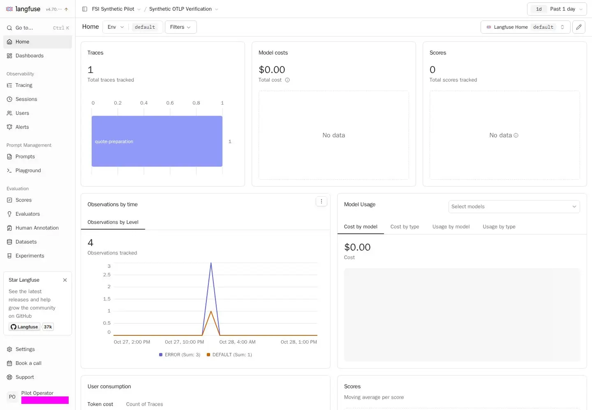
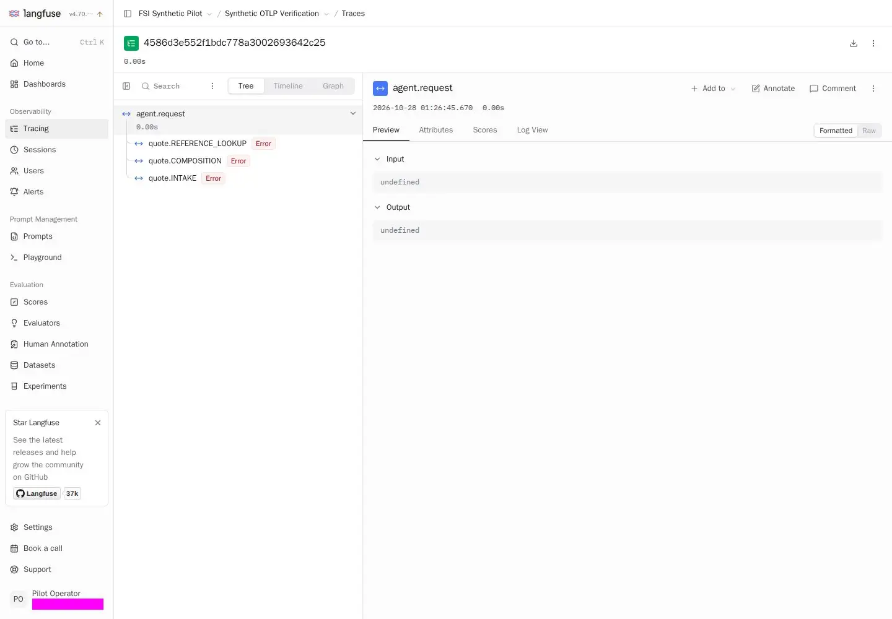
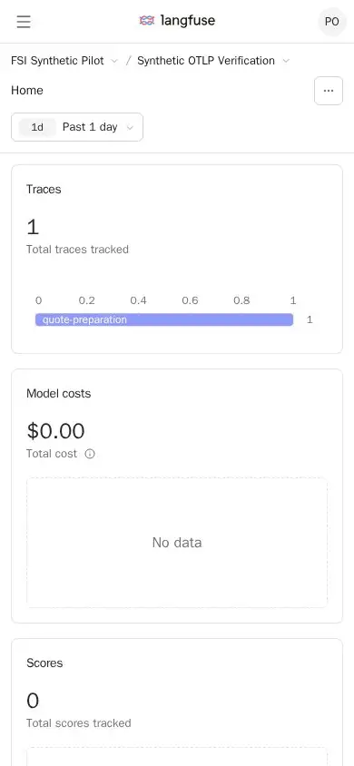

[English](../langfuse-pilot-evidence.md) | [Guide d'intégration](langfuse-integration.md) | [Accueil des ateliers](index.md)

## Résultat vérifié

Langfuse 4.70.1 est déployé sur la VM Azure isolée `langfuse-synthetic-pilot`
dans `rg-langfuse-synthetic-pilot`, East US 2. À `2026-10-27T23:15:53Z`, un
script invité exécuté par Azure Run Command authentifié a retourné une application
saine et six conteneurs actifs. Ce premier contrôle prouvait seulement
l'existence du runtime. La vérification synthétique suivante a créé organisation,
projet et clés API protégées sans compte humain. À `2026-10-28T01:27:54Z`, une
relecture authentifiée a retourné quatre observations persistées émises par le
véritable exporteur OTLP du dépôt. Cela prouve l'ingestion synthétique locale à
la VM, pas l'export depuis Foundry distant ni la réception correspondante dans Azure.

Après un démarrage manuel approuvé, nettoyage et santé ont été vérifiés à
`2026-10-28T12:37:36Z`. La VM a ensuite été volontairement désallouée, état vérifié
à `12:39:22 UTC`. C'est un pilote de démonstration sur demande, pas un service
permanent. Les contrôles existants d'arrêt et de réseau sont restés intacts.

À `2026-10-27T23:53:37Z`, une capture Playwright locale à la VM a aussi vérifié
connexion et inscription sur ordinateur et connexion mobile. Les images réelles
ont été transférées par la gestion Azure authentifiée, comparées aux SHA256 de
la VM et examinées visuellement. Cela établit l'existence de l'interface sans
affirmer qu'un tunnel SSH opérateur fonctionne.

Après approbation explicite, le premier utilisateur humain a été créé et son
appartenance propriétaire à l'organisation existante vérifiée à
`2026-10-28T14:46:42Z`. Les écrans projet authentifiés ordinateur/mobile et la
trace synthétique persistée ont été capturés à `14:56 UTC`. Le nettoyage a réussi
à `15:20:44 UTC`; la VM était de nouveau désallouée à `15:22:31 UTC`. Réseau,
export de production, clés de projet et configuration applicative de référence
étaient inchangés.

L'implémentation a été fusionnée dans la [PR 63](https://github.com/devopsabcs-engineering/foundry-hosted-agents-fsi/pull/63)
au commit `42c627cddba2cc14743f8120322634227d1f7366`.
La [livraison protégée](https://github.com/devopsabcs-engineering/foundry-hosted-agents-fsi/actions/runs/40567253202)
a évalué l'agent staging version 7 et promu la production version 8. Ce suivi
de preuves est enregistré dans l'[issue 64](https://github.com/devopsabcs-engineering/foundry-hosted-agents-fsi/issues/64).
L'export facultatif Langfuse de l'agent de production reste désactivé.

La maintenance approuvée à `2026-10-28T20:31:57Z` a vérifié les inscriptions
désactivées dans les deux conteneurs Langfuse et l'état compte/projet conservé.
La VM a été confirmée désallouée à `20:34:18 UTC`. La section
[Inscriptions](#inscriptions) détaille contrôles et limites : aucun nouveau
test de connexion ou refus de l'API d'inscription n'a été exécuté.

## Inventaire Azure

La [réponse VM historique](../assets/langfuse-pilot/2026-10-27/azure-vm.json)
indique `VM running`, SKU `Standard_D4s_v6` (4 vCPU, 16 Gio), Trusted Launch,
Secure Boot, vTPM et authentification par mot de passe désactivée. Adresses
publique/privée : `20.96.32.65` et `10.90.0.4`. Le provisioning était `Updating`
pendant la collecte; cet inventaire ne prouve pas que la tâche s'est terminée.

## Observations du runtime invité

Le collecteur borné a retourné les résultats suivants à `23:15:53 UTC`.
Ces observations ne remplacent pas un nouveau contrôle de santé.

| Contrôle                                | Résultat observé                                                           |
|-----------------------------------------|----------------------------------------------------------------------------|
| Cloud-init                              | `status: done`                                                             |
| Services système Docker et SSH           | Tous deux actifs                                                           |
| Serveur Docker                          | `29.1.3`                                                                   |
| Docker Compose                          | `2.40.3+ds1-0ubuntu1~24.04.1`                                                |
| Langfuse web                            | Actif, sain, zéro redémarrage                                               |
| Langfuse worker                         | Actif, aucun contrôle de santé configuré, zéro redémarrage                   |
| PostgreSQL, Redis, ClickHouse, MinIO      | Chacun actif, sain, zéro redémarrage                                        |
| Réponse de santé applicative             | `{"status":"OK","version":"4.70.1"}`                                        |
| Ports hôte publiés                       | Web seulement, `127.0.0.1:3000`; aucune base ni stockage objet publié        |
| Fichier d'environnement protégé          | `600 root:root /opt/langfuse-pilot/.env`                                     |
| Disque                                  | 8 % utilisés, environ 114 Gio disponibles                                   |
| Mémoire                                 | Environ 12 973 Mio disponibles, sans swap                                   |

Le SHA256 du Compose déployé correspondait à la
[source livrée](../../infra/langfuse-pilot/docker-compose.yml) :

```text
ea0fca82d6ce775c14e62e99c2b6e86d92388366a72818860785f44e9d9156ab
```

Les identifiants des six images correspondaient aux digests figés dans cette
source. Le worker actif n'est pas un contrôle de santé réussi. Aucun secret,
environnement de conteneur développé ni clé SSH privée n'a été capturé.

Une nouvelle [réponse brute du runtime](../assets/langfuse-pilot/2026-10-27/runtime-response.json)
à `2026-10-28T00:03:21Z` confirme six conteneurs actifs, zéro redémarrage, cinq
contrôles sains, aucun contrôle worker, publication loopback seule, permissions
protégées, version applicative saine et SHA256 Compose inchangé. Le disque
était à 11 %, environ 111 Gio libres; mémoire disponible : 12 887 Mio.
Le répertoire daté regroupe cette session, y compris après minuit; les
horodatages internes restent la référence.

## Vérification OTLP synthétique

Avec approbation explicite synthétique uniquement, l'initialisation sans interface
supportée a créé organisation `fsi-synthetic-pilot`, projet
`fsi-synthetic-otel-pilot` et une clé API de projet. Il y avait zéro utilisateur
avant et après cette phase. Les clés restent dans
`/opt/langfuse-pilot/.synthetic-project.env`, `root:root`, mode `0600`; aucune
valeur n'a été capturée. Secrets et Compose initiaux sont restés inchangés;
la configuration temporaire d'initialisation a été retirée après retour du web
à sa configuration de référence.

Les [preuves d'ingestion](../assets/langfuse-pilot/2026-10-28/ingestion-evidence.json)
contiennent authentification initiale, métadonnées d'émission et réponse réelle
de l'API observations v2 authentifiée. L'exporteur inchangé, limité aux métadonnées,
a émis la trace `4586d3e552f1bdc778a3002693642c25` avec le SDK OpenTelemetry et
l'exporteur OTLP/HTTP version `1.45.1`. La relecture HTTP 200 a retourné exactement :

| Observation              | Identifiant du span | Identifiant du parent |
|--------------------------|---------------------|-----------------------|
| `agent.request`          | `51db8e92e94df806`  | Aucun                 |
| `quote.INTAKE`           | `725fd27a3ca2f941`  | `51db8e92e94df806`    |
| `quote.REFERENCE_LOOKUP` | `2e3b37547cd2464c`  | `51db8e92e94df806`    |
| `quote.COMPOSITION`      | `5dcf76bd3f94194f`  | `51db8e92e94df806`    |

Identifiants et liens parentaux correspondaient à l'émission. Un cinquième span
local de scope exclu n'est pas arrivé. Les marqueurs synthétiques de confidentialité
placés dans prompts, réponses, identités, arguments d'outil, métadonnées de
ressource et exceptions étaient absents des observations. Entrées/sorties nulles,
identités vides et descriptions d'exception absentes. Les trois étapes portaient
volontairement `ERROR` pour tester le statut sans contenu d'exception; ce ne sont
pas des échecs de production.

Aucune mesure de modèle, d'usage ou de coût n'a été émise. Langfuse retournait
des détails de modèle/usage vides, des valeurs numériques par défaut de zéro et
un coût total nul : ce ne sont pas des tokens mesurés. Le collecteur local
original conservait les cinq spans et leurs événements inchangés. Cela vérifie
la projection localement, pas l'ingestion Application Insights.

Le transfert par la gestion authentifiée a été comparé au SHA256 invité avant
extraction; le hachage de l'exporteur correspondait aussi au dépôt. Certains
horodatages JSON ont des offsets UTC explicites représentant les mêmes instants.
Cette phase d'ingestion ne vérifiait ni compte humain ni tableau de bord; leur
validation approuvée suit. Foundry distant, corrélation Azure et juges restent
non vérifiés.

## Blocage SSH

Les tentatives opérateur avec la clé privée existante et vérification stricte
de la clé hôte Ed25519 obtenue par Azure authentifié échouaient avant la bannière :

```text
kex_exchange_identification: read: Connection reset
Connection reset by 20.96.32.65 port 22
```

Dans la VM, SSH écoutait et les scans de clés réussissaient sur loopback et
l'interface privée. Aucune entrée SSH dans le journal pour les tentatives externes.
Des captures réseau bornées montraient des resets, pas un échange SSH normal;
leur adresse source ne suffit pas à identifier la cause.

L'[historique NSG](../assets/langfuse-pilot/2026-10-27/nsg-activity.json) enregistre
des écritures réussies par `da847d8c-ee71-44de-b462-6775e7d649a7` à
`19:28:55 UTC` et `23:27:51 UTC`. Entre ces opérations, l'opérateur a explicitement
approuvé le seul rétablissement de TCP 22 depuis `76.65.61.229/32`, écrit à
`23:10:54 UTC`. SSH échouait toujours. La [réponse NSG suivante](../assets/langfuse-pilot/2026-10-27/azure-nsg.json)
ne contient de nouveau aucune règle personnalisée.

L'enquête en lecture seule a identifié `MCAPSGovernance-AutomationApp`.
Issuer, application et objet de l'Activity Log correspondaient à l'inscription
Azure Lighthouse `66482794-ff49-5d5b-9c20-59d14e281fc7`, nommée
`MCAPSGovernanceAutomation`, dans le tenant gestionnaire
`975f013f-7f24-47e8-a7d3-abc4752bf346`. Son autorisation Contributor cite cet
objet exact. Le [transfert d'identité](https://github.com/devopsabcs-engineering/foundry-hosted-agents-fsi/issues/64#issuecomment-6457443722)
conserve les deux identifiants de corrélation. L'inscription pointe vers le
[support de gouvernance MCAPS](https://aka.ms/fdpowiki). L'identité est vérifiée,
pas la justification de politique des écritures.

Les restaurations se sont arrêtées comme convenu. Aucun CIDR élargi, port web
public, port SSH alternatif ni contournement de sécurité. Les responsables de
l'abonnement/gouvernance doivent convenir d'un accès opérateur supporté. Ne
retirez pas la délégation, ne désactivez pas la gouvernance et ne restaurez pas
répétitivement la règle. Son rétablissement seul ne résout pas le reset de façon prouvée.

## Preuves de l'interface

Un navigateur temporaire Playwright 1.61.1 / Chromium 149.0.7827.55 s'exécutait
dans la VM sur `http://127.0.0.1:3000`. Le
[manifeste de capture](../assets/langfuse-pilot/2026-10-27/ui-evidence.json) conserve
horodatages, URL, statuts HTTP, titres, dimensions, tailles, SHA256, champs
observés et mesures de pixels non vides.

Les trois pages ont retourné HTTP 200, sans erreur de page, requête échouée ou
réponse HTTP en erreur observée pendant la capture. La santé retournait aussi
HTTP 200 et `{"status":"OK","version":"4.70.1"}`.

| Vue                    | Dimensions  | Taille de l'image | Capture UTC    |
|------------------------|-------------|-------------------|----------------|
| Connexion ordinateur   | 1440 x 1000 | 8 158 octets      | `23:53:39.182` |
| Inscription ordinateur | 1440 x 1000 | 8 230 octets      | `23:53:40.534` |
| Connexion mobile       | 390 x 844   | 6 282 octets      | `23:53:41.553` |

### Connexion sur ordinateur


### Inscription sur ordinateur

Cette capture historique précède le durcissement approuvé ci-dessous; elle ne
décrit pas la configuration actuelle des inscriptions.


### Connexion mobile


### Provenance et portée

L'archive de 19 696 octets contenait uniquement ces trois images et leur
manifeste. Son SHA256 vérifié localement correspondait à celui de la VM :

```text
2522e259f8680d62aaa755e31b568acc6d88f60b300a8f77151c3395baf40abd
```

Taille et SHA256 de chaque image correspondaient au manifeste; les trois ont
été examinées visuellement. Digest de l'image navigateur :
`sha256:5b8f294aff9041b7191c34a4bab3ac270157a28774d4b0660e9743297b697e48`.
Seuls des formulaires vides et exemples intégrés ont été capturés; aucun
identifiant saisi ni formulaire de création soumis.

Ces captures par le canal de gestion prouvent le rendu local, pas un tunnel SSH
depuis le poste. Visiter l'inscription ne crée ni compte ni projet.

## Intégration humaine approuvée

Avec l'approbation séparée du premier courriel fourni, l'initialisation sans
interface supportée a créé un seul compte humain dans l'organisation existante.
La [preuve utilisateur](../assets/langfuse-pilot/2026-10-28/user-evidence.json)
enregistre cet utilisateur approuvé unique, son rôle `OWNER` et le projet
existant dans l'organisation. Projet/clé API restent uniques; les clés n'ont
pas été recréées ou renouvelées. Ce rôle n'établit pas un accès administrateur
à toute l'instance.

Le mot de passe aléatoire reste uniquement dans
`/opt/langfuse-pilot/.synthetic-user.env`, `root:root`, mode `0600`. La
substitution d'initialisation temporaire a été retirée, le web restauré et les
variables `LANGFUSE_INIT_*` supprimées. Secrets initiaux, Compose et clés de
projet étaient inchangés. Les inscriptions sont restées inchangées pendant
l'intégration, puis désactivées lors de la maintenance approuvée ci-dessous.
Aucun mot de passe, clé API, cookie ou état de stockage navigateur dans les preuves.

### Projet et trace

Le [manifeste authentifié](../assets/langfuse-pilot/2026-10-28/authenticated-ui-evidence.json)
enregistre une réponse de session HTTP 200 correspondant à l'identité approuvée,
les pages projet et la trace synthétique existante. Playwright `1.61.1` et
Chromium `149.0.7827.55` s'exécutaient dans la VM sur `http://localhost:3000`,
pas dans un tunnel du poste. Le digest Linux AMD64 immuable du navigateur est
enregistré dans le manifeste.

| Vue                        | Dimensions  | Taille de l'artefact | Capture UTC    |
|----------------------------|-------------|----------------------|----------------|
| Projet authentifié         | 1440 x 1000 | 33 802 octets        | `14:56:23.476` |
| Trace synthétique persistée | 1440 x 1000 | 26 194 octets        | `14:56:24.948` |
| Projet mobile authentifié  | 390 x 844   | 8 718 octets         | `14:56:26.507` |







La trace contenait `agent.request`, `quote.INTAKE`, `quote.REFERENCE_LOOKUP` et
`quote.COMPOSITION`. Les trois statuts d'erreur sont les injections synthétiques
décrites plus haut. Panneaux modèle/coût vides et zéros par défaut ne mesurent
ni usage ni facturation. Le courriel approuvé était masqué. Aucune exception de
page ni réponse HTTP en erreur observée; dix requêtes `net::ERR_ABORTED` pendant
navigation/arrêt restent dans le manifeste, sans filtrage.

Les JPEG originaux ont passé les contrôles de pixels non vides. Chromium les a
convertis en WebP pour le transfert borné; tailles/hachages des originaux et des
conversions restent dans le manifeste. L'archive de cinq fichiers, 68 455 octets,
a passé le contrôle des valeurs secrètes et son SHA256 complet a été vérifié
localement avant extraction :

```text
4b6b5e60421d879dda426a2ac169fcd387912b93c399e75f5f8782a22f9ce492
```

Tous les hachages correspondaient et les trois images ont été examinées.
Interface authentifiée locale et appartenance sont vérifiées; accès interactif
depuis le poste et récupération sécurisée du mot de passe exigent toujours un
parcours approuvé par la gouvernance. Ne copiez le mot de passe ni dans le chat,
le dépôt, les sorties de commande ni les captures.

## Inscriptions

L'opérateur a approuvé un démarrage borné pour désactiver les inscriptions,
vérifier le compte existant, nettoyer et désallouer, sans modifier réseau ou
export de production. Le [résultat invité nettoyé](../assets/langfuse-pilot/2026-10-28/signup-hardening-evidence.json)
à `2026-10-28T20:31:57.939369Z` enregistre :

* `AUTH_DISABLE_SIGNUP=true` dans `.env` protégé et les deux conteneurs Langfuse
* Un utilisateur correspondant à `emmanuel@devopsabcs.com`, avec le rôle `OWNER` de l'organisation existante
* Une organisation, un projet et une clé API; le projet appartient toujours à cette organisation
* Six services actifs, cinq contrôles de santé réussis, aucun contrôle worker configuré
* Santé HTTP 200 avec `{"status":"OK","version":"4.70.1"}`
* Seul le port web `127.0.0.1:3000` publié
* Hachages Compose, identifiants utilisateur/projet et autres paramètres d'environnement inchangés
* Trois fichiers protégés toujours `0600 root:root`, aucune variable d'initialisation dans les conteneurs applicatifs
* Répertoire temporaire de la tâche supprimé, aucun secret divulgué

Cela vérifie configuration effective et appartenance en base, pas une nouvelle
connexion, un refus d'API d'inscription ni un accès public. Aucun utilisateur,
projet ou clé recréé; aucune modification NSG, identité, gouvernance ou export
de production demandée. L'[observation finale d'alimentation](../assets/langfuse-pilot/2026-10-28/signup-hardening-power-evidence.json)
confirme `PowerState/deallocated` à `2026-10-28T20:34:18.3798186Z`.

## Nettoyage des diagnostics

La [réponse de nettoyage](../assets/langfuse-pilot/2026-10-27/cleanup-response.json)
à `2026-10-28T00:04:44Z` confirme le retrait de l'image navigateur et du répertoire
invité de preuves de la tâche après transfert vérifié. La capture bornée a
supprimé son conteneur. Les six conteneurs applicatifs restaient actifs, avec
`{"status":"OK","version":"4.70.1"}` après nettoyage.

Les ressources Run Command terminées `langfuse-evidence-inspect` et
`langfuse-evidence-recover` ont été supprimées; la liste suivante était vide.
VM, conteneurs applicatifs, volumes, environnement protégé, règles réseau et
clés SSH conservés. Aucun ingress public ni droit d'identité ajouté.

Le [nettoyage OTLP](../assets/langfuse-pilot/2026-10-28/cleanup-evidence.json) à
`2026-10-28T12:37:36Z` confirme le retrait de l'image client Python temporaire,
des conteneurs clients et du répertoire de test. Aucune variable d'initialisation
dans les conteneurs applicatifs. Six services actifs, cinq contrôles sains,
aucun contrôle worker, santé HTTP 200 version `4.70.1`, seul `127.0.0.1:3000`
publié. Volumes, secrets initiaux et clés root-only conservés; réseau et export
de production inchangés.

Le [nettoyage après intégration](../assets/langfuse-pilot/2026-10-28/user-cleanup-evidence.json)
à `2026-10-28T15:20:44Z` confirme six services actifs sans redémarrage, cinq
contrôles sains, publication loopback seule, aucune variable d'initialisation et
identifiants root-only conservés. Conteneurs navigateur, image téléchargée et
répertoire invité ont été retirés après vérification locale de l'archive et des
images. Appartenance, volumes, secrets et contrôles réseau/gouvernance conservés.

## Fonctionnement sur demande

Une désallocation inattendue a interrompu le premier nettoyage avant l'exécution
du script. La recherche bornée dans l'Activity Log n'en a pas établi la cause;
politique Azure ou planification restent des hypothèses. L'opérateur a approuvé
le démarrage manuel pour les démonstrations Langfuse. La VM a été volontairement
désallouée après le nettoyage. La [preuve initiale](../assets/langfuse-pilot/2026-10-28/power-evidence.json)
enregistre `PowerState/deallocated` à `2026-10-28T12:39:22Z`; la
[preuve après intégration](../assets/langfuse-pilot/2026-10-28/user-power-evidence.json)
confirme `2026-10-28T15:22:31Z`. Après durcissement, la
[preuve la plus récente](../assets/langfuse-pilot/2026-10-28/signup-hardening-power-evidence.json)
confirme `2026-10-28T20:34:18.3798186Z`.

Pour une fenêtre de démonstration/maintenance approuvée, démarrez uniquement cette VM :

```powershell
az vm start --subscription 64c3d212-40ed-4c6d-a825-6adfbdf25dad --resource-group rg-langfuse-synthetic-pilot --name langfuse-synthetic-pilot
```

Vérifiez la santé applicative par la gestion ou un accès privé approuvé. Le
démarrage ne prouve pas SSH. Avant une démo interactive depuis le poste,
obtenez un accès approuvé par la gouvernance et récupérez le mot de passe root-only
de façon sécurisée. Appartenance, connexion et captures authentifiées sont déjà
vérifiées localement par le canal de gestion; ne recréez ni compte ni projet.
Ne publiez pas de port web et ne copiez aucun secret dans le chat ou les preuves.

Après la fenêtre, désallouez la VM au lieu de seulement arrêter l'OS :

```powershell
az vm deallocate --subscription 64c3d212-40ed-4c6d-a825-6adfbdf25dad --resource-group rg-langfuse-synthetic-pilot --name langfuse-synthetic-pilot
```

Conservez les contrôles d'arrêt existants. La désallocation arrête la facturation
calcul, pas disque/IP publique allouée. Les volumes persistants ne constituent
pas une sauvegarde validée.

## Limites restantes

* SSH opérateur et tunnel restent bloqués.
* Compte et interface authentifiée locale sont vérifiés, pas l'accès depuis le poste ou la livraison sécurisée du mot de passe.
* Les inscriptions sont désactivées dans la configuration effective; aucun nouveau refus de l'API d'inscription ni nouvelle connexion n'a été testé pendant le durcissement.
* L'ingestion OTLP synthétique locale est vérifiée, pas la réception correspondante Azure/Langfuse.
* La VM est volontairement désallouée entre les fenêtres approuvées.
* Un agent Foundry distant ne peut pas atteindre le tunnel loopback du poste.
* L'export distant exige routage, TLS et injection de secrets approuvés séparément.
* Ce pilote synthétique sur une VM n'a ni HA, restauration validée, expiration automatique configurée dans le dépôt ni approbation de production.

Les réponses JSON sont des preuves Azure CLI ponctuelles, pas des attestations
signées. Alimentation VM, santé HTTP, rendu de l'interface, intégration humaine
et ingestion de télémétrie sont des critères de vérification distincts.