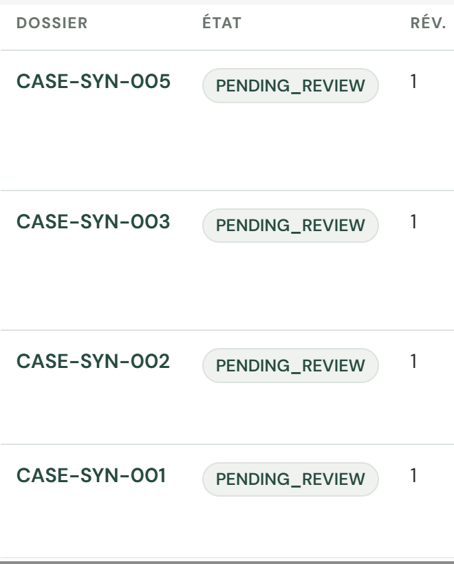

[English](../showcase-evidence.md) | [Guide natif](native-showcase.md) | [Laboratoires](labs/index.md)

## État du déploiement

Preuves recueillies le 2026-10-20 UTC. Les deux environnements restent déployés.
La [livraison 39411002808](https://github.com/devopsabcs-engineering/foundry-hosted-agents-fsi/actions/runs/39411002808)
a déployé le code approuvé
`b0778c7d33460591dfe4056403b8c6674ed57e4b` en staging puis en production.
Les requêtes SDK adressées aux deux projets distincts confirment
`quote-preparation-agent:4` en staging et `quote-preparation-agent:5` en
production. Le contrôle d'approbation GitHub existant a été respecté, sans
modifier sa protection. Les commits ultérieurs de documentation ne constituent
pas un nouveau déploiement du runtime.

| Runtime | Digest réellement exécuté | Révision prête |
| --- | --- | --- |
| Chat staging | `sha256:f036a1622e77ee1920a7d7530a9c0e67bf35d789c68c2c6d9a027acb0f95fc34` | `foundry-quote-chat-staging--0000002` |
| Chat production | Même digest de chat | `foundry-quote-chat--0000001` |
| Reviewer staging | `sha256:ed04abc06ce750d61bd04e2a5a8b8f451458c15abfd28b870b4de598ce15f630` | `foundry-quote-reviewer-staging--0000005` |
| Reviewer production | Même digest de reviewer | `foundry-quote-reviewer--0000002` |

Le MCP application utilise
`sha256:a8235a2e88a707e3ff9f39811d23ea067076d23900aa36e4e705325ceb324265`;
le MCP rulebook utilise
`sha256:2f917c4379c776514caecdc4a00089f6e3512dcd0b07b77b248a649a41e67aae`.
Chaque image MCP de production correspond au digest testé en staging.
Les deux services déclarent leur dernière révision prête dans chaque environnement.
Le chat conserve son digest vérifié antérieur. Cette livraison reconstruit
reviewer/MCP et corrige le streaming de l'agent, sans nouvelle image de chat.

Le workflow a réussi les tests hors ligne, la validation Bicep/what-if, le
déploiement staging, le contrôle déterministe et le déploiement production,
y compris les vérifications réelles de l'accès Cosmos de chaque agent.
Ce contrôle ne rétablit les droits de données de l'identité réellement
déployée que si une requête prouve leur absence. Le mode natif azd est
resélectionné avant chaque connexion OIDC. Aucun nouveau secret, contournement
d'authentification, service Search, modèle d'embedding ou démantèlement
n'a été nécessaire.

### Régression réelle indépendante

Des requêtes Responses natives ont réussi dans les deux environnements,
indépendamment du résultat du workflow. Chaque réponse contient exactement les
champs non vides `en-CA` et `fr-CA`, sans divulgation numérique ou monétaire
destinée au demandeur.

| Entrée synthétique | Résultat attendu et observé dans les deux environnements |
| --- | --- |
| `CASE-SYN-001` | Soumission `READY` pour révision employé |
| `CASE-SYN-003` | Soumission `UNSUPPORTED` pour révision employé |
| `CASE-SYN-005` | Soumission `INCOMPLETE` pour révision employé |
| `NOT-A-CASE-ID` | `REJECTED_INTAKE` avant toute recherche |

Les quatre applications ont réussi `/healthz` et `/api/config`. Les requêtes
anonymes de création de conversation et de liste des cas ont reçu HTTP 401.
Cela ne prouve ni une nouvelle conversation authentifiée dans le navigateur
ni une décision humaine de reviewer.
La lecture Cosmos indépendante par l'opérateur a reçu HTTP 403, conformément
aux droits de données existants; aucun droit supplémentaire n'a été ajouté.
La lecture ultérieure par le reviewer production authentifié, à
`2026-10-20T03:53:42Z`, a confirmé quatre dossiers synthétiques persistés,
distinctement des contrôles Cosmos réussis par les agents déployés.

L'évaluation déterministe a réussi ses 13 cas. Le juge LLM consultatif
`evalrun_350161dee4644d13addfac89320ee336` a terminé sans erreur de service,
mais avec 0/10 cas réussis. Ses critères de cohérence, groundedness et
task-adherence ont échoué. Le workflow le traite explicitement comme
consultatif : la réussite du déploiement ne signifie pas que ce juge de
qualité sémantique a réussi.

### Capture de la livraison réussie précédente

Capture du résumé GitHub Actions réel à `2026-10-20T02:46Z`,
et non d'une maquette locale. Il s'agit de l'ancienne livraison 39356610865,
pas de son remplacement 39411002808 lié ci-dessus.

Les anciennes versions natives restent listées, notamment staging v2 et
production v3 de la
[restauration initiale](https://github.com/devopsabcs-engineering/foundry-hosted-agents-fsi/actions/runs/39293980605).
Aucun rollback n'a été exécuté sur la démo conservée. Si nécessaire, utilisez
le workflow protégé existant avec un artefact antérieur approuvé.
L'ancien digest de chat
`sha256:ccfab1bc368463602c5b5f85cc6b93cde242e9a03c7b3000a6cf8cee007fce70`
a été confirmé comme conservé et lisible dans ACR. Cela prouve la disponibilité
de l'artefact, pas un rollback de trafic testé ni la conservation d'une ancienne
révision Container Apps.

## Reprise des deux générations échouées

Les échecs historiques restent visibles. Deux nouvelles opérations natives les
remplacent avec une référence autonome de 19 881 octets contenant 26 leçons
techniques. Une simple répétition avec l'ancien contenu avait aussi échoué.

| Opération historique | Cause réelle | Remplacement réussi | Lignes téléchargées |
| --- | --- | --- | --- |
| `datagen-4e74a27bd5f24a87a08ea35ad788c8cb` | Moins de 1 Ko | `datagen-a866fd3be0104ae4b6ec4808b76cbec2` | 6 |
| `datagen-af8399a33bd7477b8279591b5a408c7a` | Contexte insuffisamment autonome | `datagen-afe38ec64fb744a09e845119139e4064` | 5 |

Dans Foundry Data generation, cherchez
`showcase-synthetic-dataset-recovered-v3` et
`showcase-synthetic-dataset-v2-recovered-v3`. Les deux ont atteint `succeeded`.
Leur fichier source est `file-21aee188caff46979b16bf3abc40beb1`.
La valeur 15 est un maximum demandé, pas une quantité garantie.

| Fichier produit | SHA-256 téléchargé |
| --- | --- |
| `file-b9923ced057f450eaa8347bf7e68dfae-dg` | `82efe086958d8756bfa5612573b5e1c02d7cebaf5948bfed0457d97bd91f07d4` |
| `file-9c7c0515bfea4f73a12deb4a6de40142-dg` | `0f99391d6ce77d2a5e0b1e25e6fbf9bd55e1eeebdfc310ebf2a3a30364b1ea69` |

Le CLI a vérifié la provenance des sorties natives avant téléchargement.
Les exemples nécessitent une révision humaine; aucun entraînement n'a été lancé.
Suivez le [laboratoire de génération](labs/lab-15-native-files-generation.md)
pour reproduire les étapes avec vos propres identifiants.

## Captures authentiques des applications

Ces captures actualisées montrent les pages sans connexion après la livraison
vérifiée. Elles ne prouvent ni une conversation authentifiée ni une décision
employé. La provenance du runtime est établie par le workflow, le SDK et les
digests ci-dessus, pas par les seules captures. Elles ne contiennent ni données
de demandeur ni jetons.

### Chat staging

Capture `2026-10-20T02:56Z` du
[chat staging](https://foundry-quote-chat-staging.victorioussand-be863134.eastus2.azurecontainerapps.io).

### Révision employé en production

Capture `2026-10-20T02:50Z` du
[reviewer production](https://foundry-quote-reviewer.gentleplant-e170129b.eastus2.azurecontainerapps.io).

### Persistance vérifiée par le reviewer production authentifié

Le parcours normal de connexion Microsoft a ensuite abouti. La file du reviewer
production autorisé affichait `CASE-SYN-001`, `CASE-SYN-002`, `CASE-SYN-003` et
`CASE-SYN-005`, tous `PENDING_REVIEW`, révision 1. Les heures de soumission
restaient visibles dans la file réelle. Aucune décision employé, suppression
de file ou modification de dossier n'a été effectuée.

Cette capture française réelle date de `2026-10-20T03:55:08Z`. Le cadrage ne
conserve que les identifiants synthétiques, états et révisions, sans détails du
compte, préparateurs ni primes. Aucune valeur de l'interface n'a été modifiée.

### Agent staging Foundry authentifié

Après la connexion humaine, le playground staging affichait
`quote-preparation-agent`, version 3, avec l'indicateur d'exécution. Cette capture
d'en-tête date de `2026-10-20T03:34:42Z`; le cadrage exclut les détails du compte.
Elle prouve l'agent, sa version et son état observés, pas une conversation réussie.

L'ancienne requête réelle `CASE-SYN-001` du playground v3 s'est terminée, mais
le message assistant n'affichait aucun texte. Ce n'était pas un test réussi.
Les tests de protocole ont confirmé l'absence d'événements de texte natifs et
l'utilisation d'un objet là où le texte doit être une chaîne. Le correctif
transmet le message bilingue final en texte JSON, avec les événements de
contenu, texte et fin ordonnés, sans état intermédiaire du workflow. La réponse
sans streaming conserve son objet bilingue existant. Les tests locaux des
événements sérialisés et du graphe réel passent. Après approbation humaine,
la livraison 39411002808 a déployé le correctif en staging, version 4.
Le playground authentifié a affiché la réponse bornée complète en anglais et
en français pour `CASE-SYN-001`, indépendamment des tests API.

Capture réelle du playground staging à `2026-10-20T11:07:34Z`.
Seuls le zoom, le retour à la ligne du code et le cadrage ont été adaptés
pour la lisibilité et pour exclure le bandeau du compte. Aucune valeur modifiée.

### Playground production authentifié

Le même artefact approuvé a franchi le contrôle production existant.
Le playground réel v5 a aussi affiché la réponse bilingue complète
`CASE-SYN-001`. Capture à `2026-10-20T11:17:36Z`, avec les mêmes adaptations
de lisibilité et le même cadrage excluant le compte qu'en staging.
Le lien v5 fourni par le SDK a remplacé la vue v4 initialement périmée du
portail, sans modifier la configuration de l'agent ni l'authentification.

### Générations rétablies dans le portail

Capture staging Data generation à `2026-10-20T10:56:21Z`.
Les deux jobs recovered-v3 affichent Succeeded, avec 6 et 5 lignes.
Les échecs historiques restent visibles, sans suppression ni changement d'état.

### Six fichiers sources indexés

Capture Knowledge, Indexes, `showcase-synthetic-native-knowledge:1`,
à `2026-10-20T10:55:59Z`. Le vector store File Search natif et les six
fichiers français/anglais affichent l'état completed. Il ne s'agit ni de
Foundry IQ ni d'un outil attaché à l'agent de soumission hébergé.

### Skill natif créé par le projet

Capture Tools, Skills Preview, à `2026-10-20T10:57:03Z`.
`showcase-synthetic-bilingual-brief` est en version 1. Ce skill est créé par le
projet, pas intégré par Microsoft. Les preuves distinctes du runtime opérateur
établissent sa consommation; cette liste prouve seulement son enregistrement.

### Résultats d'évaluation sans embellissement

Capture à `2026-10-20T11:01:43Z` du run historique
`evalrun_e2bfaa11b8bb4994a5d89e12c9c9bc7c` ciblant staging v3.
Le portail affiche coherence 0/10, groundedness 1/10 et task adherence 1/10.
Les réussites ponctuelles de métriques ne changent pas le résultat global :
0/10 cas réussis. Le panneau Run details est replié pour exclure l'identité
du créateur. Il ne s'agit pas de l'évaluation de la nouvelle livraison.

### Liste native des traces

Capture des Traces de l'agent staging à `2026-10-20T10:58:50Z`.
Les invocations racines réelles de v3 affichent Completed. La requête du
playground ayant produit un message vide est aussi terminée : un span terminé
ne suffit pas à prouver une réponse utile. Les jetons sont à zéro et les coûts
indisponibles. Cela ne prouve ni les étapes détaillées ni un rejeu réussi.

## Limites de qualité natives

File Search a vérifié six réponses citées et deux refus exacts `OUT_OF_CORPUS`.
Il ne s'agit ni de Foundry IQ ni d'un nouvel outil de l'agent hébergé.
Le skill du projet a été consommé par un runtime opérateur isolé dans les deux
ordres linguistiques.

L'évaluateur de retrieval a séparé les contrôles pertinents et non pertinents,
5/1. Groundedness v18 et groundedness_pro v8 ont accepté une réponse connue
comme erronée sur l'autorisation : leurs contrôles négatifs ont donc échoué.
Ce n'est pas un gain de qualité démontré. La publication locale de traces a reçu
HTTP 403; un flush réussi n'a pas été présenté comme une ingestion.
Cela se distingue des invocations hébergées réellement ingérées ci-dessous.

### Ingestion native des invocations hébergées

Des requêtes Log Analytics ciblant les opérations exactes ont trouvé un span
`invoke_agent` réussi pour chaque agent appelé indépendamment :

| Environnement | Identifiant réel d'opération | Spans observés |
| --- | --- | --- |
| Staging | `715c5c7da66449cba2faf91432945904` | Une invocation hébergée réussie |
| Production | `c76f5a78438e42aa8546bb9f2405260d` | Une invocation hébergée réussie |

Le span production a été enregistré à `2026-10-20T02:42:26.5330371Z`.
Les champs personnalisés étape, référence de cas, hachage de politique et type
d'exécution sont vides. Cela prouve l'ingestion de l'invocation, pas la
visibilité des étapes déterministes ni le rejeu trace-vers-dataset.
Ces contrôles restent ouverts; aucune provenance de cas ni aucun dataset de
rejeu n'ont été inventés. L'inventaire natif contient toujours zéro magasin
mémoire : aucune démonstration de mémoire native active n'est revendiquée.

Consultez le [guide natif](native-showcase.md) et la
[documentation Microsoft Foundry](https://learn.microsoft.com/azure/ai-foundry/).
