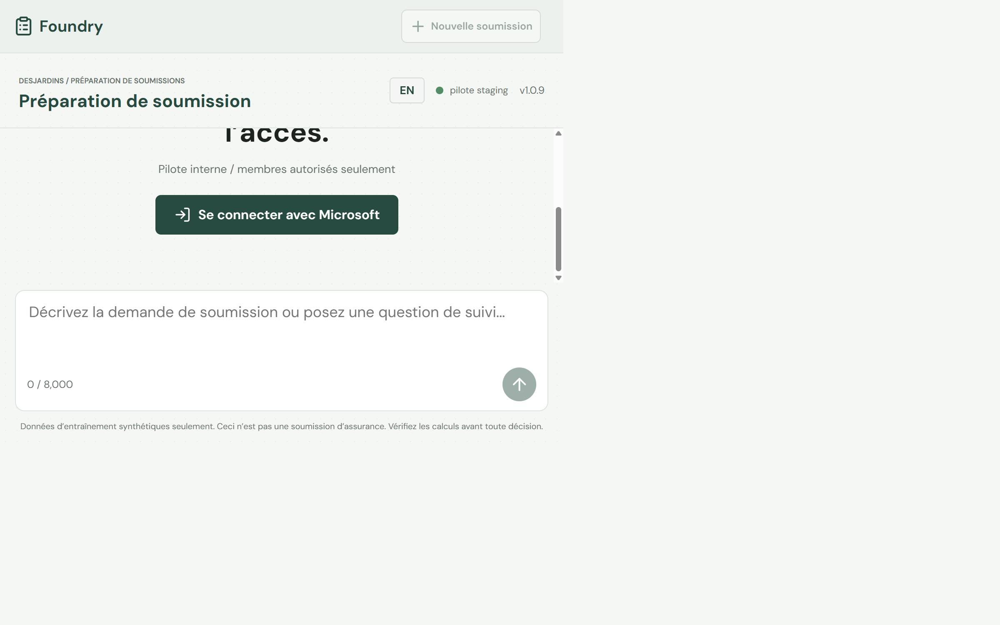

[English](../showcase-evidence.md) | [Guide natif](native-showcase.md) | [Laboratoires](labs/index.md)

## État du déploiement

Preuves recueillies le 2026-10-20 UTC. Les deux environnements restent déployés.
La [livraison 39356610865](https://github.com/devopsabcs-engineering/foundry-hosted-agents-fsi/actions/runs/39356610865)
a déployé le code approuvé
`25f3e54037a4063fa5bba1781af8e5b4b20ce1c8` en staging puis en production.
Les requêtes SDK adressées aux deux projets distincts confirment
`quote-preparation-agent:3` en staging et `quote-preparation-agent:4` en
production. Le contrôle d'approbation GitHub existant a été respecté, sans
modifier sa protection. Les commits ultérieurs de documentation ne constituent
pas un nouveau déploiement du runtime.

| Runtime | Digest réellement exécuté | Révision prête |
| --- | --- | --- |
| Chat staging | `sha256:f036a1622e77ee1920a7d7530a9c0e67bf35d789c68c2c6d9a027acb0f95fc34` | `foundry-quote-chat-staging--0000002` |
| Chat production | Même digest de chat | `foundry-quote-chat--0000001` |
| Reviewer staging | `sha256:3fc629e2ddc44604a23fa3f08603cea0dcf1a6aa3177c9e47dd40ec51dc8e132` | `foundry-quote-reviewer-staging--0000004` |
| Reviewer production | Même digest de reviewer | `foundry-quote-reviewer--0000001` |

Le MCP application utilise
`sha256:019360cb0c87d69328ef0e0b7595130d4f706d00462a0040db3a5e1be19c8fac`;
le MCP rulebook utilise
`sha256:5ff4d4f5693944d2ae36b232eccf89664717aea83b8c3045f2dc7ee3bacaa0de`.
Chaque image MCP de production correspond au digest testé en staging.
Les deux services déclarent leur dernière révision prête dans chaque environnement.

Le workflow a réussi les tests hors ligne, la validation Bicep/what-if, le
déploiement staging, le contrôle déterministe et le déploiement production,
y compris les vérifications réelles de l'accès Cosmos de chaque agent.
Ce contrôle ne rétablit les droits de données de l'identité réellement
déployée que si une requête prouve leur absence. Le mode natif azd est
resélectionné avant chaque connexion OIDC. Aucun nouveau secret, contournement
d'authentification, service Search, modèle d'embedding ou démantèlement
n'a été nécessaire.

### Régression réelle indépendante

Des requêtes Responses natives ont réussi dans les deux environnements,
indépendamment du résultat du workflow. Chaque réponse contient exactement les
champs non vides `en-CA` et `fr-CA`, sans divulgation numérique ou monétaire
destinée au demandeur.

| Entrée synthétique | Résultat attendu et observé dans les deux environnements |
| --- | --- |
| `CASE-SYN-001` | Soumission `READY` pour révision employé |
| `CASE-SYN-003` | Soumission `UNSUPPORTED` pour révision employé |
| `CASE-SYN-005` | Soumission `INCOMPLETE` pour révision employé |
| `NOT-A-CASE-ID` | `REJECTED_INTAKE` avant toute recherche |

Les quatre applications ont réussi `/healthz` et `/api/config`. Les requêtes
anonymes de création de conversation et de liste des cas ont reçu HTTP 401.
Cela ne prouve ni une nouvelle conversation authentifiée dans le navigateur
ni une décision humaine de reviewer.
La lecture Cosmos indépendante par l'opérateur a reçu HTTP 403, conformément
aux droits de données existants; aucun droit supplémentaire n'a été ajouté.
La lecture de persistance par un reviewer authentifié reste dans le
[suivi #17](https://github.com/devopsabcs-engineering/foundry-hosted-agents-fsi/issues/17),
distincte des contrôles Cosmos réussis par les agents déployés.

L'évaluation déterministe a réussi ses 13 cas. Le juge LLM consultatif
`evalrun_e2bfaa11b8bb4994a5d89e12c9c9bc7c` a terminé sans erreur de service,
mais avec 0/10 cas réussis. Ses critères de cohérence, groundedness et
task-adherence ont échoué. Le workflow le traite explicitement comme
consultatif : la réussite du déploiement ne signifie pas que ce juge de
qualité sémantique a réussi.

### Capture du déploiement réussi

Capture du résumé GitHub Actions réel à `2026-10-20T02:46Z`,
et non d'une maquette locale.

Les anciennes versions natives restent listées, notamment staging v2 et
production v3 de la
[restauration initiale](https://github.com/devopsabcs-engineering/foundry-hosted-agents-fsi/actions/runs/39293980605).
Aucun rollback n'a été exécuté sur la démo conservée. Si nécessaire, utilisez
le workflow protégé existant avec un artefact antérieur approuvé.
L'ancien digest de chat
`sha256:ccfab1bc368463602c5b5f85cc6b93cde242e9a03c7b3000a6cf8cee007fce70`
a été confirmé comme conservé et lisible dans ACR. Cela prouve la disponibilité
de l'artefact, pas un rollback de trafic testé ni la conservation d'une ancienne
révision Container Apps.

## Reprise des deux générations échouées

Les échecs historiques restent visibles. Deux nouvelles opérations natives les
remplacent avec une référence autonome de 19 881 octets contenant 26 leçons
techniques. Une simple répétition avec l'ancien contenu avait aussi échoué.

| Opération historique | Cause réelle | Remplacement réussi | Lignes téléchargées |
| --- | --- | --- | --- |
| `datagen-4e74a27bd5f24a87a08ea35ad788c8cb` | Moins de 1 Ko | `datagen-a866fd3be0104ae4b6ec4808b76cbec2` | 6 |
| `datagen-af8399a33bd7477b8279591b5a408c7a` | Contexte insuffisamment autonome | `datagen-afe38ec64fb744a09e845119139e4064` | 5 |

Dans Foundry Data generation, cherchez
`showcase-synthetic-dataset-recovered-v3` et
`showcase-synthetic-dataset-v2-recovered-v3`. Les deux ont atteint `succeeded`.
Leur fichier source est `file-21aee188caff46979b16bf3abc40beb1`.
La valeur 15 est un maximum demandé, pas une quantité garantie.

| Fichier produit | SHA-256 téléchargé |
| --- | --- |
| `file-b9923ced057f450eaa8347bf7e68dfae-dg` | `82efe086958d8756bfa5612573b5e1c02d7cebaf5948bfed0457d97bd91f07d4` |
| `file-9c7c0515bfea4f73a12deb4a6de40142-dg` | `0f99391d6ce77d2a5e0b1e25e6fbf9bd55e1eeebdfc310ebf2a3a30364b1ea69` |

Le CLI a vérifié la provenance des sorties natives avant téléchargement.
Les exemples nécessitent une révision humaine; aucun entraînement n'a été lancé.
Suivez le [laboratoire de génération](labs/lab-15-native-files-generation.md)
pour reproduire les étapes avec vos propres identifiants.

## Captures authentiques des applications

Ces captures actualisées montrent les pages sans connexion après la livraison
vérifiée. Elles ne prouvent ni une conversation authentifiée ni une décision
employé. La provenance du runtime est établie par le workflow, le SDK et les
digests ci-dessus, pas par les seules captures. Elles ne contiennent ni données
de demandeur ni jetons.

### Chat staging

Capture `2026-10-20T02:56Z` du
[chat staging](https://foundry-quote-chat-staging.victorioussand-be863134.eastus2.azurecontainerapps.io).

### Révision employé en production

Capture `2026-10-20T02:50Z` du
[reviewer production](https://foundry-quote-reviewer.gentleplant-e170129b.eastus2.azurecontainerapps.io).

### Agent staging Foundry authentifié

Après la connexion humaine, le playground staging affichait
`quote-preparation-agent`, version 3, avec l'indicateur d'exécution. Cette capture
d'en-tête date de `2026-10-20T03:34:42Z`; le cadrage exclut les détails du compte.
Elle prouve l'agent, sa version et son état observés, pas une conversation réussie.

La requête réelle `CASE-SYN-001` du playground s'est terminée, mais le message
assistant n'affichait aucun texte. Ce défaut de compatibilité du streaming est
en cours d'analyse; il ne constitue pas un test de conversation réussi. Les
résultats API bilingues sans streaming vérifiés ci-dessus restent des preuves
distinctes. Aucun runtime de streaming corrigé n'a été déployé ou vérifié dans
cette capture.

L'accueil production affichait aussi la version 4 pendant la navigation
authentifiée, mais aucune capture de l'agent production n'a été enregistrée.
La navigation suivante a échoué avec `ERR_NETWORK_IO_SUSPENDED`, puis les onglets
partagés sont devenus indisponibles. Un nouvel onglet a atteint la page de
connexion avec une erreur de magasin IndexedDB; cela n'annule pas la connexion
humaine réussie auparavant.
Les captures des générations, fichiers indexés, skill, évaluations et traces,
ainsi que la lecture reviewer autorisée, restent à obtenir. Le suivi explicite est
[#17](https://github.com/devopsabcs-engineering/foundry-hosted-agents-fsi/issues/17).

## Limites de qualité natives

File Search a vérifié six réponses citées et deux refus exacts `OUT_OF_CORPUS`.
Il ne s'agit ni de Foundry IQ ni d'un nouvel outil de l'agent hébergé.
Le skill du projet a été consommé par un runtime opérateur isolé dans les deux
ordres linguistiques.

L'évaluateur de retrieval a séparé les contrôles pertinents et non pertinents,
5/1. Groundedness v18 et groundedness_pro v8 ont accepté une réponse connue
comme erronée sur l'autorisation : leurs contrôles négatifs ont donc échoué.
Ce n'est pas un gain de qualité démontré. La publication locale de traces a reçu
HTTP 403; un flush réussi n'a pas été présenté comme une ingestion.
Cela se distingue des invocations hébergées réellement ingérées ci-dessous.

### Ingestion native des invocations hébergées

Des requêtes Log Analytics ciblant les opérations exactes ont trouvé un span
`invoke_agent` réussi pour chaque agent appelé indépendamment :

| Environnement | Identifiant réel d'opération | Spans observés |
| --- | --- | --- |
| Staging | `715c5c7da66449cba2faf91432945904` | Une invocation hébergée réussie |
| Production | `c76f5a78438e42aa8546bb9f2405260d` | Une invocation hébergée réussie |

Le span production a été enregistré à `2026-10-20T02:42:26.5330371Z`.
Les champs personnalisés étape, référence de cas, hachage de politique et type
d'exécution sont vides. Cela prouve l'ingestion de l'invocation, pas la
visibilité des étapes déterministes ni le rejeu trace-vers-dataset.
Ces contrôles restent ouverts; aucune provenance de cas ni aucun dataset de
rejeu n'ont été inventés. L'inventaire natif contient toujours zéro magasin
mémoire : aucune démonstration de mémoire native active n'est revendiquée.

Consultez le [guide natif](native-showcase.md) et la
[documentation Microsoft Foundry](https://learn.microsoft.com/azure/ai-foundry/).
