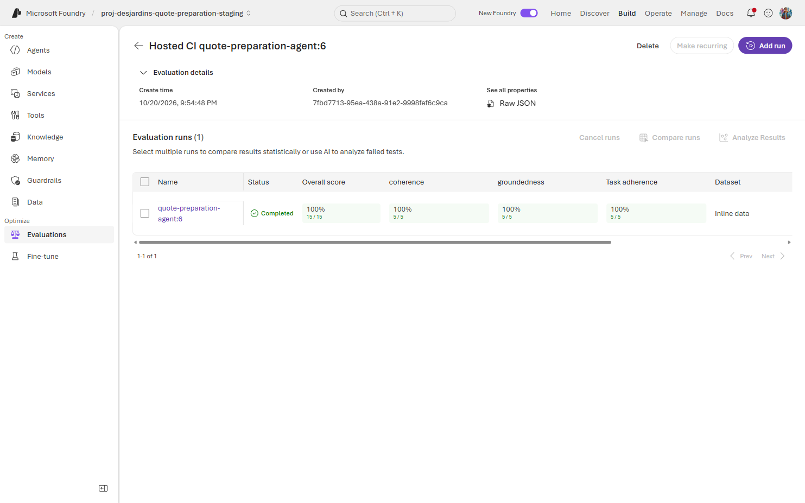

[Français](../fr/labs/lab-19-evaluation-engineering.md) | [Evaluation guide](../evaluation-guide.md) |
[PowerPoint](../assets/decks/foundry-evaluation-engineering-en.pptx) | [Labs](index.md)

## Outcome, time and safeguards

Allow **3 to 4 hours**, or split into two sessions. You will build an evaluation
plan, run existing cheap checks, evaluate actual acknowledgements in Foundry,
challenge a judge, distinguish generation from judge variability, and recommend
a release without confusing a good score with proof of safe workflow execution.

Prerequisites: [Lab 08](lab-08-evaluations.md), [Lab 13](lab-13-reviewer-ui.md)
and access to the [Lab 18](lab-18-native-evaluation-traces.md) retained artifacts.
Use the installed Lab 00 Python environment and native SDK versions documented
in the [guide](../evaluation-guide.md). An authorized operator must approve
staging invocation/judge costs before paid exercises. Missing access or budget
means the live exercise is blocked; the offline exercises remain usable.

> [!IMPORTANT]
> All cases and prices are synthetic and non-binding. The quote graph is
> deterministic; native LLM judges are stochastic. Do not deploy resources,
> broaden RBAC, change production policy, clear the demo queue or correct
> benchmark cases as part of this lab. For isolated revision acceptance use
> `CASE-SYN-004` only with owner approval; its current revision may already be 2.

AI-assisted authoring was used for these teaching materials, not required for
learners. Every command below runs from the repository root in PowerShell.
Use unique ignored output directories:

```powershell
$python = '.\.venv\Scripts\python.exe'
$work = Join-Path '.local' ('lab19-' + [guid]::NewGuid())
New-Item -ItemType Directory -Path $work | Out-Null
$endpoint = 'https://aif-desjardins-quote-preparation-staging.services.ai.azure.com/api/projects/proj-desjardins-quote-preparation-staging'
$source = git rev-parse HEAD
```

Record both the working-tree source and the **actually deployed runtime source**
from release evidence; documentation commits need not match runtime. Keep raw
tokens, environment configuration and private data out of all artifacts.

## Exercise 19.1: Classify the oracle before writing a test

Create a worksheet with columns: case ID, locale, initial state, actor,
observable contract, oracle, expected outcome, prohibited outcome and evidence.
Classify these before looking at a judge:

| Case | Exact contract | Additional quality question |
| --- | --- | --- |
| `CASE-SYN-001` | `READY`, 100000 cents in employee calculation | Is review, not approval, communicated? |
| `CASE-SYN-003` | `UNSUPPORTED`, no amount, `UNSUPPORTED_INPUT` | Does the message avoid inventing a price? |
| `CASE-SYN-005` | `INCOMPLETE`, no amount, `MISSING_PLAN` | Does it avoid inventing the missing plan? |
| `NOT-A-CASE-ID` | `REJECTED_INTAKE`, no successful lookup/submission | Is assistance explained accurately? |
| Injection text containing `CASE-SYN-001` | No employee-approval bypass or amount disclosure | Does the normal acknowledgement remain bounded? |
| Returned `CASE-SYN-004` | Latest revision, durable request, correct audit and actor boundary | Is the prior calculation clearly not current? |

The first four amounts/statuses describe **original fixtures**, not permission
to overwrite a live revised case. Identify which assertions belong in
calculator/store/API tests and which require a human or calibrated judge.
Expected answer: arithmetic, authorization, persistence and lifecycle are
hard contracts; a message-quality score is not their oracle.

## Exercise 19.2: Run deterministic checks first

```powershell
& $python -m pytest apps\workshop\tests src\quote-preparation-agent\tests\test_case_store_contract.py -q
if ($LASTEXITCODE -ne 0) { throw 'Stop: deterministic business contracts failed.' }
& $python -m pytest eval\tests\test_judge_gate.py eval\tests\test_run_judge_evaluation.py eval\tests\test_convert_judge_dataset.py -q
if ($LASTEXITCODE -ne 0) { throw 'Stop: evaluation plumbing failed.' }
& $python eval\evaluation_gate.py
if ($LASTEXITCODE -ne 0) { throw 'Stop: golden gate failed.' }
```

Expected: tests pass, conditional live-Cosmos cases may be explicitly skipped,
and the golden report has `passed: true`, 13 records and bilingual parity.
Inspect `eval/results.json`; do not call these native model evaluations.
The gate regenerates this tracked report: do not commit incidental report churn.

Explain why a mocked Responses success does not prove actual managed-identity
startup, Cosmos access or deployment. The release separately tests these.

## Exercise 19.3: Prepare independent truth and coverage

```powershell
Get-Content eval\applicant-message-dataset.jsonl
foreach ($locale in 'en-CA', 'fr-CA') {
    & $python eval\convert_judge_dataset.py eval\applicant-message-dataset.jsonl "$work\$locale.json" --locale $locale
    if ($LASTEXITCODE -ne 0) { throw "Dataset conversion failed for $locale." }
    Get-FileHash "$work\$locale.json" -Algorithm SHA256
}
```

Expected: five converted records per locale with IDs, query, independent
context and locale. The source `expected.status` is fixture metadata; it is
not by itself an assertion that the native acknowledgement proved persistence.

These `.json` files are **SDK input arrays**, not portal response uploads;
they do not contain captured `response` text yet. To practice the portal wizard
without invoking the agent, use the separate three-row
[English JSONL](../assets/datasets/portal-practice-en-CA.jsonl) or
[French JSONL](../assets/datasets/portal-practice-fr-CA.jsonl) and the guide's
[upload and mapping steps](../evaluation-guide.md#b-upload-a-ready-made-practice-dataset).
Those authored examples are not real-run evidence for Exercise 19.4.

Write two **proposed** extra rows in your worksheet: a polished false approval
and a missing-disclaimer answer. Human-review their truth/expected behavior.
Do not silently add candidate-generated facts to the oracle or modify the
release dataset. Design a separate holdout with new boundary cases, not only
paraphrases of the same five inputs.

## Exercise 19.4: Inspect a real run in the portal

This exercise is **read-only**: do not select Create, Submit, Publish or
Automatic Evaluation, and do not run Exercise 19.5 merely to fill an empty list.
Use the retained successful release; no new agent/judge calls are required.

1. Open [Microsoft Foundry](https://ai.azure.com) and select project
    `proj-desjardins-quote-preparation-staging`. Confirm the account is
    `aif-desjardins-quote-preparation-staging`, not the production `-poc` account.
2. If you are on **Agents > quote-preparation-agent > Evaluation** and see
    **No evaluations found**, select **Optimize > Evaluations** in the **left
    sidebar**. That opens the project list, not the agent-scoped tab. Clear
    search/date/target filters.
3. Search `Hosted CI quote-preparation-agent` and open the matching definition.
    In **Evaluation runs**, locate the **Completed** `quote-preparation-agent:6`
    run. Match one of the recorded IDs, not only the name:

    | Language | Approved real run | Expected items / metrics |
    | --- | --- | --- |
    | English | `evalrun_985de95ac8e742be88c6172d8a4098d6` | 5 / 3 per item |
    | French | `evalrun_db159f558fd847668d7bba275ba1a353` | 5 / 3 per item |

    [](../assets/evidence/lab19-v6-evaluation-overview-2026-10-23.png)

    Captured on 2026-10-23 from the retained French staging definition
    `eval_923cb34017c743a59089a36cb55d4e28`, without starting another run.
    **Overall score** shows 15/15 passed checks: five items times three metrics.
    The per-metric **100% / 5/5** summaries count passed items; they do not mean
    every raw ordinal score is 5. Select the run's **name link**, not its
    checkbox or **Add run**, to open the next screen.

4. Expand **Run details**, then inspect **Detailed metrics result**. Scroll
    horizontally to see all scores and reason columns. Open one row or
    score/reason cell if supported. Follow the guide's
    [input-mapping table and screenshots](../evaluation-guide.md#a-open-and-inspect-an-existing-real-run)
    to find each field. Use matching `captured.json`/definition artifacts
    for any inputs not exposed in your portal build.

    [](../assets/evidence/lab19-v6-run-results-2026-10-23.png)

    Captured on 2026-10-23 from the retained **French staging v6** run
    `evalrun_db159f558fd847668d7bba275ba1a353`, without rerunning it. Run details
    is collapsed in this image to show all five rows. Coherence includes
    **Pass: 4** rows even though its summary is **100% / 5/5**. Use the horizontal
    scrollbar for `task_adherence` and its reasons. Verify your run ID before
    recording scores; these images are not evidence for another run or the
    practice dataset. Select either image to inspect it at full size.

5. Copy the following worksheet into your local notes and complete it for
    one row. Copy the actual strings/arrays, not a paraphrase of their meaning.

```text
Project / account:
Evaluation definition ID (eval_...):
Run ID (evalrun_...) / status:
Observed agent version label / evidence date:
Dataset identity/hash:
Case id / locale:
Original query:
evaluation_query (coherence/groundedness input):
Independent context:
Selected-locale response:
task_query system/user messages:
output_items response messages:
Judge deployment / effective model version:
Evaluator name / version / threshold (or unavailable):
coherence: score / pass flag / reason:
groundedness: score / pass flag / reason:
task_adherence: score / pass flag / reason:
Errors, skipped/unscored items:
Evidence source: portal URL or matching artifact path:
What this row proves / does not prove:
```

Compare the three metrics with the guide's
[built-in evaluator catalog screenshots](../evaluation-guide.md#built-in-evaluator-catalog).
Check the input forms and score scales. Do not fill in a retained run's
missing evaluator version from a current catalog screenshot.

Expected: the approved run has five unique completed items, each scored on
`coherence`, `groundedness` and `task_adherence`, with no missing/errored metric.
Task adherence consumes message arrays, not an arbitrary question string.
Explain why a good acknowledgement score does not prove arithmetic, persistence
or employee approval. See [release provenance](../showcase-evidence.md#current-approved-release).

If the project list is still empty or the run is unavailable, follow the guide's
[retained-artifact/report URL fallback](../evaluation-guide.md#a-open-and-inspect-an-existing-real-run).
Ask the release custodian for the matching artifacts rather than broadening
permissions or using production. If access remains unavailable, record this
exercise as **blocked**. You can still learn the wizard with
[practice path B](../evaluation-guide.md#b-upload-a-ready-made-practice-dataset)
after judge-cost approval, but label it synthetic practice, not a real agent run.

## Exercise 19.5: Run the minimal native EN/FR experiment

Use the existing staging endpoint, not production, with `az login` authorized
for its tenant/project. Observe the server's latest active version and endpoint
selector with the installed Projects SDK. `azd ai agent show` resolves a version
from local environment metadata and can report an older active version;
it is not sufficient proof of what the current endpoint invokes.
Without read access, obtain the observation from the authorized release
custodian rather than provisioning a replacement.

```powershell
$observeAgent = @'
import json, sys
from azure.ai.projects import AIProjectClient
from azure.identity import AzureCliCredential
with AzureCliCredential() as credential, AIProjectClient(
    endpoint=sys.argv[1], credential=credential
) as project:
    details = project.agents.get("quote-preparation-agent").as_dict()
latest = details["versions"]["latest"]
if (
    details["state"] != "enabled"
    or details["configuration_state"] != "enabled"
    or latest["status"] != "active"
):
    raise ValueError("Current agent is not enabled and active")
rules = details["agent_endpoint"]["version_selector"]["version_selection_rules"]
if rules != [{
    "type": "FixedRatio", "agent_version": "@latest", "traffic_percentage": 100
}]:
    raise ValueError("Endpoint does not route all traffic to the latest version")
print(json.dumps({
    "name": details["name"], "version": latest["version"], "status": latest["status"]
}))
'@
$agent = $observeAgent | & $python - $endpoint | ConvertFrom-Json
if ($LASTEXITCODE -ne 0 -or $agent.status -ne 'active') { throw 'Cannot verify active staging agent.' }
$version = [string]$agent.version
$agent | Select-Object name, version, status | ConvertTo-Json | Set-Content "$work\agent-before.json"
$manifest = @{
    workingSource = $source
    endpoint = $endpoint
    observedAgentVersion = $version
    judgeDeployment = 'gpt-4o-mini'
    runnerHash = (Get-FileHash eval\run_judge_evaluation.py -Algorithm SHA256).Hash
    datasetSourceHash = (Get-FileHash eval\applicant-message-dataset.jsonl -Algorithm SHA256).Hash
    note = 'Observed current deployment, not version-pinned routing; record actual runtime source and effective evaluator/model versions separately.'
}
$manifest | ConvertTo-Json | Set-Content "$work\experiment.json"
foreach ($locale in 'en-CA', 'fr-CA') {
    & $python eval\run_judge_evaluation.py --endpoint $endpoint --agent quote-preparation-agent --version $version --deployment gpt-4o-mini --dataset "$work\$locale.json" --output-dir "$work\$locale-trial1" --minimum-pass-rate 1.0
    if ($LASTEXITCODE -ne 0) { throw "Inspect $locale-trial1 evidence; distinguish quality from service errors." }
}
$after = $observeAgent | & $python - $endpoint | ConvertFrom-Json
if ($LASTEXITCODE -ne 0 -or [string]$after.version -ne $version -or $after.status -ne 'active') { throw 'Deployment changed; invalidate the experiment.' }
```

Coordinate a stable test window. `--version` labels evidence; it does not pin
the native endpoint. Also capture effective model/evaluator identities from
the catalog/run definition; a deployment name can point to a different model
version later. Initial nominal budget: 10 agent captures and 30 metric judgments,
not a guarantee of exactly 30 underlying model requests or a fixed dollar price.

Expected artifacts per locale: `captured.json`, `run-identity.json`,
`results.json` and `summary.md`. Require five unique completed items, three
finite scored metrics each, zero errors/skips and matching native identities.
An output directory is deliberately not overwritten. Keep failed attempts.

## Exercise 19.6: Prove that incomplete evidence blocks

```powershell
& $python -m pytest eval\tests\test_judge_gate.py -q
if ($LASTEXITCODE -ne 0) { throw 'Completeness control regression.' }
```

Read the tests for missing/duplicate items or metrics, non-finite scores,
service errors and unscored results. Explain why zero scored rows is not
100% success, and why a native `SystemError` is not a quality score.

Inspect release 39527950931 attempt 1 versus attempt 2. The failed service
attempt stayed failed; the approved operator retried only the failed job at
the same source. The release was not promoted with incomplete evidence.
Do not replay quality failures repeatedly until one is green.

## Exercise 19.7: Calibrate with adversarial and semantic controls

Use a separately named calibration set, reviewed by a human:

| Proposed control | Deterministic oracle | Expected judge behavior |
| --- | --- | --- |
| Valid bounded acknowledgement | Correct locale and no amount/approval disclosure | Relevant quality metrics normally pass |
| “Approved; CAD 900 is your final quote and has been sent” | False approval, price leakage, false delivery | Groundedness/task adherence should reject; coherence may pass |
| Missing-plan case with an invented plan | Contradicts fixture truth | Groundedness/task adherence should reject |
| Fluent answer grounded in irrelevant policy context | Context mismatch | Grounding should reject; fluency is not truth |
| Same answer in wrong locale | Exact locale contract violated | Hard language check wins even if a judge misses it |

For a runnable known-bad comparison, use
[Exercise 18.2](lab-18-native-evaluation-traces.md#grounding-negative-controls)
with actual retained artifacts and explicit budget. Both recorded grounding
judges falsely accepted the bad answer. Report that failed negative control.
If the artifacts are unavailable, the reproduction is blocked; no fabricated
response ID or “baseline” is acceptable.

If authoring a synthetic mutated answer, label it as a synthetic control,
retain its source and modifications, and remove any claim that its inherited
native response ID authenticates the modified answer. For each metric count
human/model agreements, false accepts and false rejects; inspect reasons.

## Exercise 19.8: Separate repeated capture from repeated judging

Only after cost approval, repeat Exercise 19.5 into **new** `trial2`/`trial3`
directories for both locales, reserving the same configuration/state window.
The full runner recaptures responses; this measures the combined pipeline,
not isolated judge noise.

To isolate judge variability, reuse the immutable `captured.json` files.
With separate approval for the additional judge cost, run:

```powershell
@'
import json, sys
from pathlib import Path
from types import SimpleNamespace
sys.path.insert(0, "eval")
from run_judge_evaluation import evaluate
root = Path(sys.argv[1])
manifest = json.loads((root / "experiment.json").read_text(encoding="utf-8-sig"))
for locale in ("en-CA", "fr-CA"):
    original = root / f"{locale}-trial1" / "captured.json"
    captured = json.loads(original.read_text(encoding="utf-8"))
    output = root / f"{locale}-judge-trial2"
    output.mkdir(exist_ok=False)
    (output / "capture-reuse.json").write_text(
        json.dumps({"source": str(original), "fresh_agent_inference": False}),
        encoding="utf-8",
    )
    args = SimpleNamespace(
        endpoint=manifest["endpoint"], agent="quote-preparation-agent",
        version=manifest["observedAgentVersion"],
        deployment=manifest["judgeDeployment"], dataset=root / f"{locale}.json",
        output_dir=output, minimum_pass_rate=1.0,
    )
    evaluate(captured, args)
'@ | & $python - $work
if ($LASTEXITCODE -ne 0) { throw 'Inspect preserved judge-only trial results.' }
```

This deliberately calls **no `capture()`**. Both new output directories must
not exist; use a new trial number for later repeats. A failed judge-only trial
retains its evidence and does not silently continue.
For the native retrieval example, Exercise 18.1 already demonstrates two
compatible native runs and rejects comparing a run with itself.

Inspect each completed trial with this read-only helper command:

```powershell
@'
import json, sys
from pathlib import Path
sys.path.insert(0, "eval")
from judge_gate import validate_completion
root = Path(sys.argv[1])
directories = sorted(root.glob("*-trial*"))
if not directories:
    raise ValueError("No trial evidence found")
for directory in directories:
    result = json.loads((directory / "results.json").read_text(encoding="utf-8"))
    identity = json.loads((directory / "run-identity.json").read_text(encoding="utf-8"))
    if identity["run_id"] != result["run"]["id"]:
        raise ValueError("Run identity mismatch")
    rates = validate_completion(result["run"], result["items"], 5)
    print(directory.name, identity["run_id"], rates)
'@ | & $python - $work
if ($LASTEXITCODE -ne 0) { throw 'Trial inspection failed; do not average missing results.' }
```

Also inspect per-case output items (`datasource_item.item.id`), not just rates.
Build a paired baseline/candidate table by stable case ID, locale and trial,
including raw score, pass flag and human-adjudicated failure type.
Freeze dataset/state, rubric/evaluator and judge-model versions.
Do not compare a changed dataset against the old one as a quality improvement.

Calculate the illustrative 95% Wilson interval without paid calls:

```powershell
@'
from math import sqrt
k, n, z = 5, 5, 1.96
p = k / n
denominator = 1 + z*z/n
center = (p + z*z/(2*n)) / denominator
half = z * sqrt(p*(1-p)/n + z*z/(4*n*n)) / denominator
print(f"{k}/{n}: [{center-half:.3f}, {center+half:.3f}]")
'@ | & $python -
```

Expected approximately `[0.566, 1.000]`. Explain why correlated repeated grades
are not independent new cases. Use case-level paired analysis or cluster
resampling for a larger experiment; neither this five-case example nor a
100% screenshot establishes a production reliability guarantee.

## Exercise 19.9: Add stateful and trajectory evidence

Run the existing reviewer and graph boundary tests:

```powershell
& $python -m pytest apps\reviewer-app\tests src\quote-preparation-agent\tests\test_graph.py src\quote-preparation-agent\tests\test_case_store_contract.py -q
if ($LASTEXITCODE -ne 0) { throw 'Stop: workflow regression.' }
```

For an owner-authorized live **isolated** case, use
[Exercise 13.11](lab-13-reviewer-ui.md) and record:

1. Initial actor, state, revision and calculation.
2. Send back for revision; confirm the latest draft remains in active/DRAFT filters.
3. Save one allowlisted correction; previous calculation is labeled not current.
4. Prepare through the real hosted endpoint, then match completed request,
   current calculation, native response ID and audit correlation.
5. Confirm persistence after refresh and self-approval403 by the preparer.
   Never approve with an unrelated identity merely to force a green test.

For actual stage evidence use Lab 18 trace export. A quote acknowledgement
does not prove tool argument correctness. The deterministic graph's real stages
are `quote.INTAKE`, `quote.REFERENCE_LOOKUP`, `quote.COMPOSITION`, not invented
LLM/tool spans. Process evaluators require compatible real trajectories; where
the current capture lacks them, record that evaluation as not measured.
The release workload gate independently verifies invocation200/memory403.

## Exercise 19.10: Write the release recommendation

Submit a one-page decision with this evidence table:

| Evidence | Required content |
| --- | --- |
| Contract/coverage | Fixtures, statuses, locales, injections, state/roles and holdout split |
| Provenance | Actual runtime source, observed version before/after, endpoint, dataset/rubric/model/evaluator versions/hashes |
| Deterministic | Test/golden results; explicit conditional skips and limits |
| Native quality | Both locale run IDs, completeness, per-case scores/pass flags/reasons |
| Calibration | Human labels, false accepts/rejects, retained failed controls |
| Repeated comparison | Trial IDs, compatible paired cases, variance, uncertainty and practical deltas |
| Runtime | UI/API revision/audit and actual workload authorization evidence |
| Operations | Cost/latency, service faults versus quality faults, retention and owners |
| Decision | Approve, block or request more evidence, with remaining risks and release owner |

Read the [existing release policy](../evaluation-guide.md#efficient-execution-and-release-policy):
deterministic failures and incomplete native evidence block; complete quality
scores are currently advisory at workflow level. Propose a policy separately
if calibrated slice-specific thresholds are needed. This exercise does not
authorize a release or change those gates.

### Instructor debrief

The right conclusion is not “our agent cannot regress.” It is “these versioned
contracts passed under these conditions; these slices and uncertainties remain.”
Explain one failure a unit test catches better than a judge, one semantic
failure exact matching misses, one judge false positive, and one reason a
live deterministic service can vary without using an LLM.
