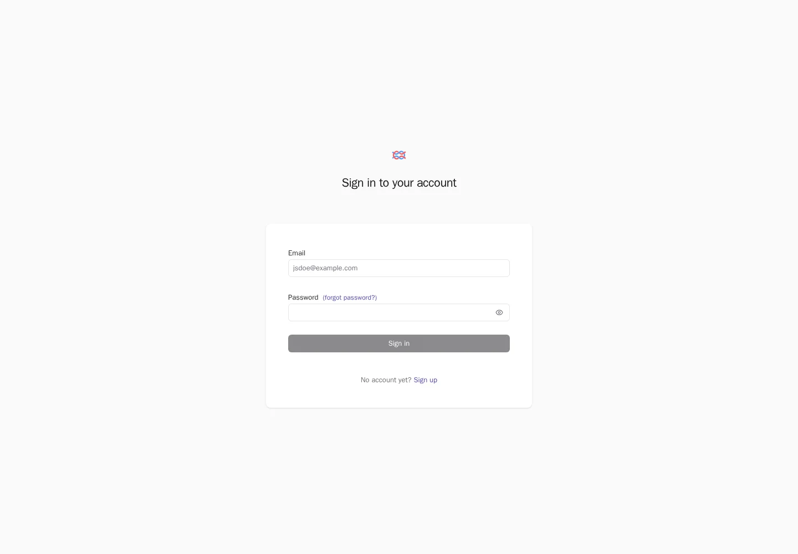
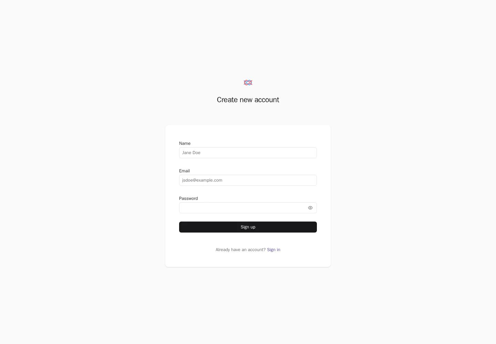
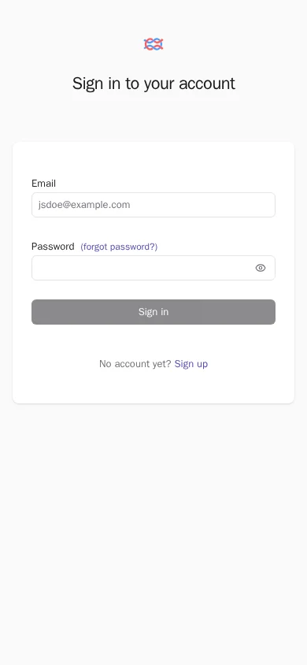

[Integration guide](langfuse-integration.md) | [Workshop home](index.md)

## Verified outcome

Langfuse 4.70.1 is deployed on the isolated Azure VM
`langfuse-synthetic-pilot` in `rg-langfuse-synthetic-pilot`, East US 2.
At `2026-10-27T23:15:53Z`, a guest script executed through authenticated Azure
Run Command returned a healthy application and six running containers.
That initial check established runtime existence only. Subsequent synthetic
verification created an organization, project, and protected API keys without
creating a human account. At `2026-10-28T01:27:54Z`, authenticated read-back
returned four persisted observations emitted by the repository's actual OTLP
exporter. This verifies VM-local synthetic ingestion, not remote Foundry delivery
or matching Azure backend receipt.

After an approved manual startup, cleanup and health checks passed at
`2026-10-28T12:37:36Z`. The VM was then deliberately deallocated and that state
was verified at `12:39:22 UTC`. It is an on-demand demonstration pilot, not an
always-running service. Existing shutdown and network controls were left intact.

At `2026-10-27T23:53:37Z`, a guest-local Playwright capture also verified the
desktop sign-in, desktop sign-up, and mobile sign-in pages. The actual screenshots
were transferred through authenticated Azure management, checked against their
VM-generated SHA256 values, and visually inspected. This establishes rendered
UI existence without claiming a working operator SSH tunnel.

The implementation was merged in [PR 63](https://github.com/devopsabcs-engineering/foundry-hosted-agents-fsi/pull/63)
at commit `42c627cddba2cc14743f8120322634227d1f7366`.
The [protected release](https://github.com/devopsabcs-engineering/foundry-hosted-agents-fsi/actions/runs/40567253202)
promoted production agent version 8. This pilot evidence follow-up is tracked in
[issue 64](https://github.com/devopsabcs-engineering/foundry-hosted-agents-fsi/issues/64).
The production agent's optional Langfuse export remains disabled.

## Azure inventory

The historical [VM response](assets/langfuse-pilot/2026-10-27/azure-vm.json) reports
`VM running`, SKU `Standard_D4s_v6` (4 vCPU, 16 GiB), Trusted Launch, Secure Boot,
vTPM, and password authentication disabled. The public/private addresses are
`20.96.32.65` and `10.90.0.4`. Its provisioning state was `Updating` while guest
evidence collection was in progress; that inventory is not a claim that the
evidence job finished successfully.

## Guest runtime observations

The bounded runtime collector returned the following at `23:15:53 UTC`.
These are observations from its output, not a substitute for a fresh health check.

| Check | Observed result |
| --- | --- |
| Cloud-init | `status: done` |
| Docker and SSH system services | Both active |
| Docker server | `29.1.3` |
| Docker Compose | `2.40.3+ds1-0ubuntu1~24.04.1` |
| Langfuse web | Running, healthy, zero restarts |
| Langfuse worker | Running, no health check configured, zero restarts |
| PostgreSQL, Redis, ClickHouse, MinIO | Each running, healthy, zero restarts |
| Application health response | `{"status":"OK","version":"4.70.1"}` |
| Published host ports | Web only, `127.0.0.1:3000`; no published database/object-storage ports |
| Protected environment file | `600 root:root /opt/langfuse-pilot/.env` |
| Disk | 8% used, approximately 114 GiB available |
| Memory | Approximately 12,973 MiB available; no swap |

The deployed Compose file's SHA256 matched the
[released source](../infra/langfuse-pilot/docker-compose.yml):

```text
ea0fca82d6ce775c14e62e99c2b6e86d92388366a72818860785f44e9d9156ab
```

Container image IDs matched the six digest-pinned images in that source.
The worker's running state must not be described as a passing worker health check.
No secrets, expanded container environments, or private SSH keys were captured.

A fresh [raw runtime response](assets/langfuse-pilot/2026-10-27/runtime-response.json)
at `2026-10-28T00:03:21Z` confirmed the same six running containers, zero restarts,
five passing health checks, the worker without a configured health check,
loopback-only publication, protected environment file permissions, healthy
application version, and unchanged Compose SHA256. Disk usage was then 11%
with approximately 111 GiB available; available memory was 12,887 MiB.
The dated asset directory groups this evidence session, including its checks
after midnight; timestamps inside each response remain authoritative.

## Synthetic OTLP verification

With explicit synthetic-only approval, supported headless initialization created
organization `fsi-synthetic-pilot`, project `fsi-synthetic-otel-pilot`, and one
project API key. There were zero users before and after initialization.
Credentials remain in `/opt/langfuse-pilot/.synthetic-project.env`, owned by
`root:root` with mode `0600`; no key values were captured. The original secrets
and Compose files were unchanged, and the temporary initialization configuration
was removed after the web container returned to its baseline configuration.

The [ingestion evidence](assets/langfuse-pilot/2026-10-28/ingestion-evidence.json)
contains bootstrap authentication, emission metadata, and the actual authenticated
observations API v2 response. The repository's unchanged metadata-only exporter
emitted trace `4586d3e552f1bdc778a3002693642c25` using OpenTelemetry SDK and
OTLP/HTTP exporter version `1.45.1`. Read-back returned HTTP 200 with these exact
observations:

| Observation | Span ID | Parent span ID |
| --- | --- | --- |
| `agent.request` | `51db8e92e94df806` | None |
| `quote.INTAKE` | `725fd27a3ca2f941` | `51db8e92e94df806` |
| `quote.REFERENCE_LOOKUP` | `2e3b37547cd2464c` | `51db8e92e94df806` |
| `quote.COMPOSITION` | `5dcf76bd3f94194f` | `51db8e92e94df806` |

Trace/span IDs and parent links matched emission. A fifth local span from an
excluded scope did not arrive. Synthetic privacy canaries placed in prompts,
responses, identities, tool arguments, resource metadata, and exception details
were absent from the returned observations. Inputs and outputs were null,
identity fields empty, and exception descriptions absent. The three stage spans
were deliberately marked `ERROR` to verify status preservation without exporting
exception content; they are not production workflow failures.

No model usage or cost measurements were emitted. Langfuse returned empty model
and usage details, numeric usage defaults of zero, and null total cost; those
defaults must not be presented as measured token usage. The local original-span
collector retained all five original spans and their events unchanged. This
checks the projection locally, not ingestion by Application Insights.

The authenticated management-channel transfer was checked against its guest
SHA256 before extraction; the exporter source hash also matched the repository.
The saved JSON uses explicit UTC offsets for some timestamps, representing the
same UTC instants quoted here. No human account, dashboard project view, remote
Foundry execution, Azure backend correlation, or judge workflow was verified.

## SSH access blocker

Operator attempts using the existing private key and strict verification against
an Azure-authenticated Ed25519 host key failed before the SSH server banner:

```text
kex_exchange_identification: read: Connection reset
Connection reset by 20.96.32.65 port 22
```

Guest checks confirmed listening SSH services and successful key scans on
loopback and the private interface. External attempts produced no SSH service
journal entries. Bounded packet captures showed reset packets rather than a
normal external SSH exchange; their source alone does not identify the cause.

The [NSG activity history](assets/langfuse-pilot/2026-10-27/nsg-activity.json)
records successful NSG writes by caller
`da847d8c-ee71-44de-b462-6775e7d649a7` at `19:28:55 UTC` and `23:27:51 UTC`.
Between those writes, the operator explicitly approved restoring only the
original TCP 22 rule from `76.65.61.229/32`, successfully written at
`23:10:54 UTC`. SSH still failed after restoration. The later
[NSG response](assets/langfuse-pilot/2026-10-27/azure-nsg.json) again has no
custom rules.

A subsequent read-only investigation identified the delegated writer as
`MCAPSGovernance-AutomationApp`. Activity Log issuer, application, and object
claims matched Azure Lighthouse registration
`66482794-ff49-5d5b-9c20-59d14e281fc7`, named `MCAPSGovernanceAutomation`, in
managing tenant `975f013f-7f24-47e8-a7d3-abc4752bf346`. Its Contributor
authorization names the exact caller object above. The
[identity handoff](https://github.com/devopsabcs-engineering/foundry-hosted-agents-fsi/issues/64#issuecomment-6457443722)
records both audit correlation IDs. The registration points to the
[MCAPS governance support reference](https://aka.ms/fdpowiki). The identity is
verified; the policy rationale for either write is not.

Further rule restoration stopped as agreed. No broader CIDR, public web port,
alternative SSH port, or security-policy override was introduced. The subscription
and governance owners must agree a supported operator access path. Do not remove
the delegation, disable governance, or repeatedly restore the removed rule.
Restoring the rule alone is not proven to resolve the connection reset.

## UI proof status

A temporary Playwright 1.61.1 / Chromium 149.0.7827.55 browser ran inside the VM
against `http://127.0.0.1:3000`. The
[capture manifest](assets/langfuse-pilot/2026-10-27/ui-evidence.json) records
timestamps, URLs, HTTP status, branded page titles, viewport sizes, image sizes,
SHA256 values, observed form fields, and nonblank pixel measurements.

All three pages returned HTTP 200. No page errors, failed requests, or HTTP error
responses were observed during this capture. The application health request also
returned HTTP 200 with `{"status":"OK","version":"4.70.1"}`.

| View | Viewport | Image size | Captured UTC |
| --- | --- | --- | --- |
| Desktop sign-in | 1440 x 1000 | 8,158 bytes | `23:53:39.182` |
| Desktop sign-up | 1440 x 1000 | 8,230 bytes | `23:53:40.534` |
| Mobile sign-in | 390 x 844 | 6,282 bytes | `23:53:41.553` |

### Desktop sign-in



### Desktop sign-up



### Mobile sign-in



### Provenance and scope

The 19,696-byte transfer archive contained only these three images and their
manifest. Its locally verified SHA256 matched the VM-generated value:

```text
2522e259f8680d62aaa755e31b568acc6d88f60b300a8f77151c3395baf40abd
```

Each extracted image's size and SHA256 also matched its manifest entry, and all
three images were visually inspected. The browser container used image digest
`sha256:5b8f294aff9041b7191c34a4bab3ac270157a28774d4b0660e9743297b697e48`.
Only empty forms and their built-in example placeholders were captured; no
credentials were entered or account-creation forms submitted.

Management-channel browser evidence proves guest-local UI rendering. It does
not prove a functioning workstation SSH tunnel. Visiting the sign-up page does
not create an account or project.

## Diagnostic cleanup

The [guest cleanup response](assets/langfuse-pilot/2026-10-27/cleanup-response.json)
at `2026-10-28T00:04:44Z` confirmed removal of the temporary browser image and
the task-owned guest evidence directory after verified local transfer. The
bounded capture removed its browser container. All six application containers
remained running, and the post-cleanup health response remained
`{"status":"OK","version":"4.70.1"}`.

The completed `langfuse-evidence-inspect` and `langfuse-evidence-recover` managed
Run Command resources were deleted; the subsequent command-resource listing
was empty. The VM, application containers, data volumes, protected environment
file, network rules, and SSH keys were retained. No public ingress or identity
permissions were added for evidence capture.

The later [OTLP probe cleanup](assets/langfuse-pilot/2026-10-28/cleanup-evidence.json)
at `2026-10-28T12:37:36Z` confirmed removal of the temporary Python client image,
client containers, and guest probe directory. Initialization variables were
absent from application containers. All six services were running, five had
passing health checks, and the worker had no configured health check. Application
health returned HTTP 200 and version `4.70.1`; only `127.0.0.1:3000` was published.
Application volumes, original secrets, and root-only synthetic project keys were
retained. No network changes or production export activation occurred.

## On-demand demonstration operation

An earlier unexpected deallocation interrupted the first cleanup attempt before
its guest script ran. The bounded Activity Log query did not establish its cause;
Azure policy or a schedule remains a hypothesis, not a verified attribution.
The operator approved manual startup when needed for Langfuse demonstrations.
After the bounded cleanup window, the VM was deliberately deallocated again.
The [final power evidence](assets/langfuse-pilot/2026-10-28/power-evidence.json)
records `PowerState/deallocated` at `2026-10-28T12:39:22Z`.

For an approved demonstration or maintenance window, start only this VM:

```powershell
az vm start --subscription 64c3d212-40ed-4c6d-a825-6adfbdf25dad --resource-group rg-langfuse-synthetic-pilot --name langfuse-synthetic-pilot
```

Check guest application health through an approved management or private access
path. Startup alone does not establish operator SSH access. Before a live UI
demonstration, obtain a governance-approved access path and authorize human
onboarding with access to the existing synthetic project. No human login or
authenticated project-dashboard screenshot has been created by this verification.
Do not expose a public web port or copy project secrets into chat or evidence.

After the window, deallocate the VM rather than only shutting down its guest OS:

```powershell
az vm deallocate --subscription 64c3d212-40ed-4c6d-a825-6adfbdf25dad --resource-group rg-langfuse-synthetic-pilot --name langfuse-synthetic-pilot
```

Leave existing shutdown controls intact. Deallocation stops compute billing but
does not remove disk or allocated public-IP charges, and persistent volumes are
not a validated backup.

## Remaining limitations

* Operator SSH and tunnel access remain blocked.
* No human account or authenticated project-dashboard view has been verified.
* VM-local synthetic OTLP ingestion is verified; matching Azure/Langfuse backend receipt is not.
* The VM is intentionally deallocated between approved demonstration windows.
* A remote Foundry hosted agent cannot reach the workstation's loopback tunnel.
* Remote export needs separately approved routing, TLS, and secret injection.
* This single-VM synthetic pilot has no HA, validated backup/restore, repository-configured automatic expiry, or production-readiness approval.

The saved JSON responses are point-in-time Azure CLI evidence, not signed
attestations. VM power state, HTTP health, rendered UI, user onboarding, and
telemetry ingestion are separate verification criteria.
