[Français](fr/showcase-evidence.md) | [Native runbook](native-showcase.md) | [Labs](labs/index.md)

[Deployed architecture and evidence lineage](architecture.md)

## Current approved release

[Release 39527950931, attempt 2](https://github.com/devopsabcs-engineering/foundry-hosted-agents-fsi/actions/runs/39527950931)
succeeded on 2026-10-21 UTC at explicitly approved source
`2c3f13b8b589c8f911edf061bcbc7c842d10d7d3`. The active hosted agent is
version **6 in staging** and **7 in production**. Production used the normal
required-reviewer approval and promoted the exact evaluated staging images.
Both environments remain deployed; no teardown or queue clearing occurred.

| Application | Verified digest, identical in both environments | Ready revision suffix, staging / production |
| --- | --- | --- |
| Reviewer | `sha256:0176ca8e2d9ada81ee32b03daab98b5020c66c3d6a116f6cf885329be2b2b8aa` | `0000010` / `0000004` |
| Application MCP | `sha256:086fa676193ff80660822e2fbb2cbbe878154fe89d8158cbe2c55548b9c4b913` | `0000010` / `0000004` |
| Rulebook MCP | `sha256:d880c8800dd847b59da72e164a11e6d83101707be31f40614721c0b62779e245` | `0000010` / `0000004` |
| Chat, retained unchanged | `sha256:50bf8a52bd062aa86621fffa4a9330d1461706892f954900edf868fdcfbd8929` | `0000003` / `0000002` |

All eight apps reported provisioning `Succeeded` and ready revisions. The four
chat/reviewer apps passed health/configuration checks and denied anonymous
`/api/me` with HTTP 401. The actual reviewer identities in both environments
returned invocation HTTP 200 and operator-memory HTTP 403, each on the first
attempt. The Linux pseudo-terminal fix therefore passed the real workflow,
not only its regression tests. Tokens were not logged and memory was not modified.

Offline release evidence contains **565 passed tests and 50 conditional skips**;
the deterministic gate passed **13/13** with bilingual parity. Native judging
completed all five cases per language at 100% on coherence, groundedness and
task adherence:

* English: `evalrun_985de95ac8e742be88c6172d8a4098d6`
* French: `evalrun_db159f558fd847668d7bba275ba1a353`

Attempt 1 encountered native evaluation `SystemError` failures before producing
any scored items. Those failed records remain evidence, not zero-quality scores.
Only the failed evaluation job was retried at the same source; complete
attempt-2 evidence passed before production approval. No gate was weakened.

### Authenticated production revision acceptance

An isolated synthetic `CASE-SYN-004` was created through the native production
agent, returned from revision 1 to **DRAFT revision 2**, and verified in both
active and draft-filtered queues. Its previous CAD 1,100 calculation was labeled
not current. Selecting `TRAINING_BASIC` and preparing again returned HTTP 200,
`PENDING_REVIEW`, `READY` and **90000 cents**. The current audit records
`PREPARATION_REQUESTED` and `PREPARATION_COMPLETED` with correlation
`a23851c8e671831b` and native response
`resp_x17dKvgjXUeG5WiGayxga6LUnpIjYR2W6bAvDx194iEbUUHngH`.
Self-approval returned HTTP 403 `SELF_APPROVAL`; the case remains pending for
another employee. Existing benchmark cases were not corrected or cleared.

These authentic captures use presentation-only zoom and preserve all values:

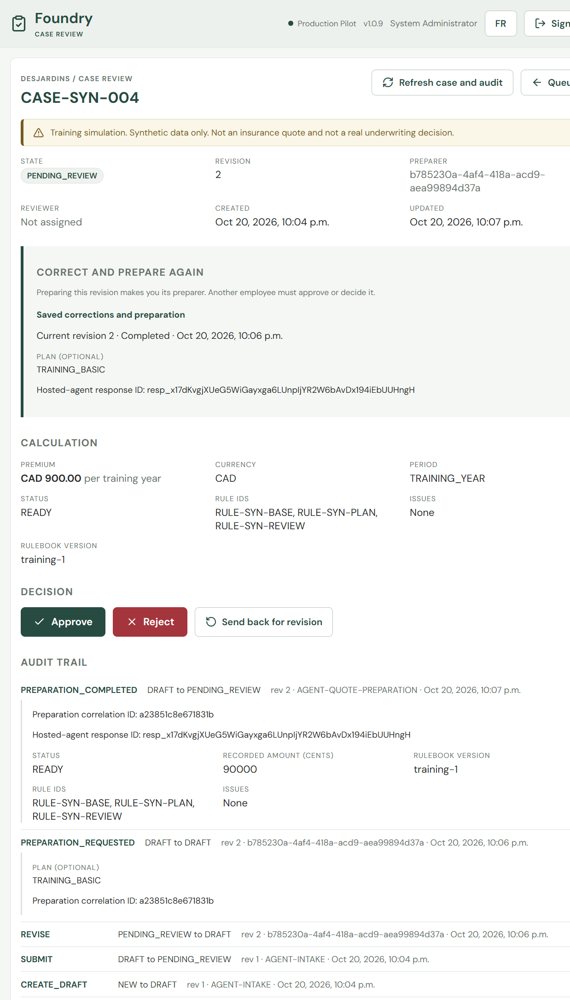

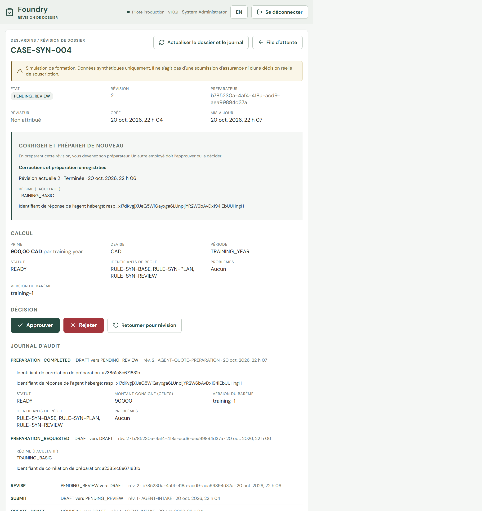

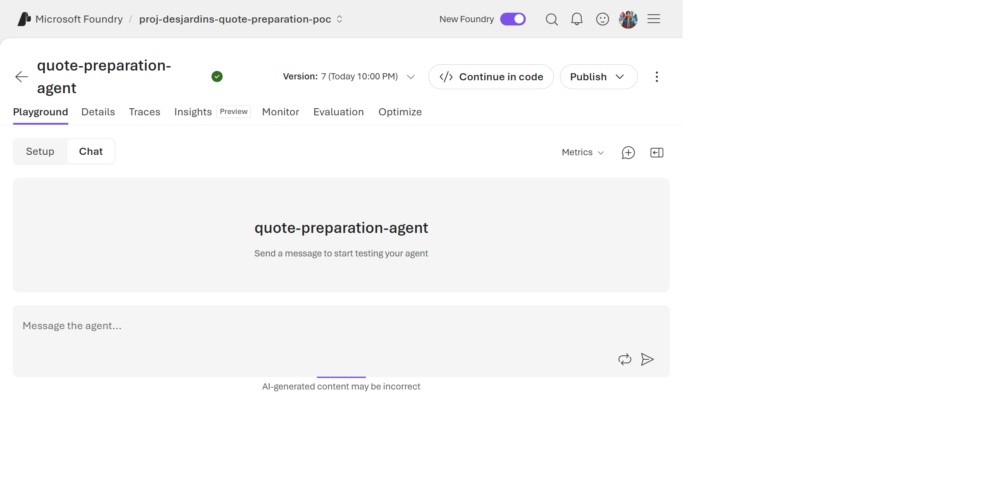

## Earlier revision workflow proof in staging

On 2026-10-21 UTC, authenticated staging testing verified the issue #28
revision flow on source `cf2d003`, hosted agent version `6`, reviewer revision
`foundry-quote-reviewer-staging--0000008`. An isolated `CASE-SYN-004` was
returned from revision 1 to a visible revision 2 draft. Selecting
`TRAINING_BASIC` and preparing again invoked the actual native agent and
persisted `PENDING_REVIEW`, `READY`, and `90000` cents instead of the previous
`110000`. The current audit includes the saved correction and
`PREPARATION_COMPLETED`, with matching response ID
`resp_s3sUcqvCtyQESOmh5YWwTY30XsH5UzmgpFJzGMP2DCTSW2JohY`.

The same preparer's approval attempt returned HTTP 403 `SELF_APPROVAL`.
The real reviewer workload identity invoked the endpoint with HTTP 200 and
received HTTP 403 when listing operator memory after the project-scoped
`Foundry Agent Consumer` assignment propagated. No `agents/write`, broad
Foundry User role, memory modification, queue clearing or benchmark-case
correction was needed. Earlier failed preparation attempts remain in audit.

These are real bilingual application captures, with presentation-only zoom;
displayed values and audit entries were not altered.

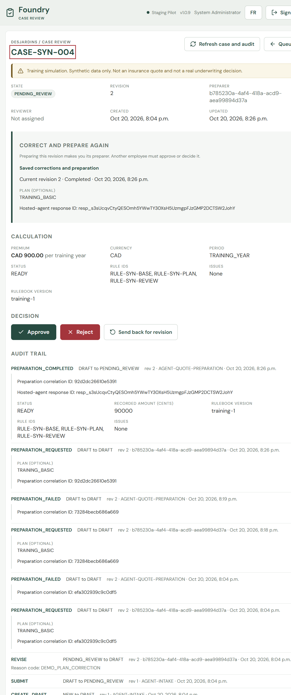

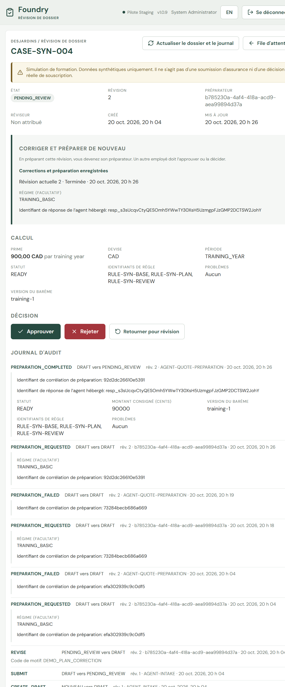

PR #34 makes the verified Consumer role declarative and adds positive invocation
and negative memory controls to both deployment stages. The subsequent
[release 39523315263](https://github.com/devopsabcs-engineering/foundry-hosted-agents-fsi/actions/runs/39523315263)
reached a healthy staging reviewer revision `0000009`, but its Linux CLI probe
failed before remote execution because stdin was not a terminal. PR #36 fixes
that CI-only issue; Linux regression tests exercise real cbreak mode.
Production promotion did not occur in that run. The successful corrected
release is recorded above; the inventory below is a historical checkpoint.

## Historical full-release checkpoint

[Release 39424857559](https://github.com/devopsabcs-engineering/foundry-hosted-agents-fsi/actions/runs/39424857559)
succeeded on approved runtime source
`01af1fbdb3c43e91510d0f902e0716a4c70f7789` on 2026-10-20 UTC.
Staging runs `quote-preparation-agent:5`; production runs version `6`.
The protected production approval remained enabled. Both environments remain
deployed; subsequent documentation commits are not runtime releases.

| Application | Running digest, identical in both environments | Ready revision, staging / production |
| --- | --- | --- |
| Chat | `sha256:50bf8a52bd062aa86621fffa4a9330d1461706892f954900edf868fdcfbd8929` | `foundry-quote-chat-staging--0000003` / `foundry-quote-chat--0000002` |
| Reviewer | `sha256:2b8ae4900bfb3f6554909d6ef485dbe6b8e80b5a0a1ea93c9cbe17794dc00660` | `foundry-quote-reviewer-staging--0000006` / `foundry-quote-reviewer--0000003` |
| Application MCP | `sha256:c264c27211cd0321ac3a2903fbf355f913a173038ccfea8e8fb919cfa0ea80e1` | `mcp-staging-application-server--0000006` / `mcp-application-server--0000003` |
| Rulebook MCP | `sha256:1197e17f92212ef6e8a68a488279e3cf850d84a66d1f87bf2c9e0712e0f157bd` | `mcp-staging-rulebook-server--0000006` / `mcp-rulebook-server--0000003` |

Chat was built from the same approved source using ACR remote build `chu` and
updated separately from the agent release. Production used an image-only
Container Apps update, not a broader infrastructure redeployment. Readback
confirmed all eight latest revisions ready with provisioning state `Succeeded`.

### Historical regression and native judges

CI passed 476 offline tests with 36 conditional skips, the deterministic
13/13 release gate, frontend builds and infrastructure validation. Independent
native calls in each environment passed `CASE-SYN-001` (`READY`),
`CASE-SYN-003` (`UNSUPPORTED`), `CASE-SYN-005` (`INCOMPLETE`) and
`NOT-A-CASE-ID` (`REJECTED_INTAKE`). Both applicant locale fields were nonempty
without monetary/numeric disclosures. All four application health/config checks
passed; anonymous protected chat/reviewer requests returned HTTP 401.

The new independently grounded applicant-message benchmark passed 5/5 on
coherence, groundedness and task adherence in each language, with zero errors:

* English staging v5: `evalrun_80031091728f4b5f9ce459f0df23902d`
* French staging v5: `evalrun_b34fdb38ba084a928e230b6898b28637`

This evaluates observable applicant acknowledgements, not hidden workflow
execution. It is a corrected contract and different dataset, not a measured
improvement over the historical 0/10 run preserved below. Two deliberately
synthetic false answers failed all three criteria in calibration run
`evalrun_9c0960204b0945e8aa1d713b09f95211`. Their inherited valid-response
capture IDs are not provenance for those synthetic control answers.

### Verified isolated memory

The separately approved additive staging deployment `issue20-isolated-memory`
created only `showcase-memory-embedding`: `text-embedding-3-small`, version `1`,
regional `Standard`, capacity `1`, without automatic upgrades. No baseline
account, production resource or RBAC was rewritten.
Store `showcase-synthetic-memory` uses existing `gpt-4o-mini`, this embedding
deployment and a 3600-second default TTL, with user-profile and chat-summary
extraction disabled.
Actual seed/list/search operations found Alice and Bob markers in their own
scopes and not in the opposite scope.

An existing staging reviewer workload identity obtained a genuine token and
received HTTP 403 on memory list; the authorized operator's positive control
returned its seeded entry. This proves caller/project-role denial, not a
per-agent ACL or namespace authorization. No role was added for the probe.
Entries expire after one hour. [Lab 17](labs/lab-17-native-skills-memory.md)
reseeds the existing store without recreating it. The quote agent is not
attached to this store; Cosmos remains the business authority.

### Verified custom trace and native replay

Actual staging operation `f63bbcfefd1b3b252a4c343bdc99fd2b` exported nine spans
including `quote.INTAKE`, `quote.REFERENCE_LOOKUP` and `quote.COMPOSITION`.
All three stage parents and successful status were recorded. Calculation
and draft persistence occur inside `COMPOSITION`; no separate calculation
stage is claimed. SDK application dependencies must be searched independently
from platform `invoke_agent` request roots, whose operation IDs can differ.

Trace-file SHA-256:
`6f3e7d9d5ea9e4d9ea8da61354475b7ea8d7e29af05ab5a66e8d9dd067e9501e`.
Policy SHA-256:
`88dadb91caf1e796db058955caf1cb8acd5fd7bd7ccb03bd2f3778b1da6ea662`.
Trace-derived evaluation `eval_f1b517827fca4114bf53e0039f9e3cbf`,
run `evalrun_7fe89f5118b54b6d8bb68ae619479875`, passed 1/1 on all three
criteria with zero errors. This is synthetic-case replay with retained
trace/case/policy/source lineage, not recovery of an original private prompt.
Follow [Lab 18](labs/lab-18-native-evaluation-traces.md).

### Current authentic portal captures

After browser DNS/connection/display failures, fresh authenticated pages
recovered at approximately `2026-10-20T17:46Z`. These are actual portal
screenshots, with presentation-only zoom/wrapping/panel sizing and account
header cropping; no values were altered. Raw agent-version configuration
and credentials are not published. Earlier captures farther below remain
historical and are not relabelled as this release.

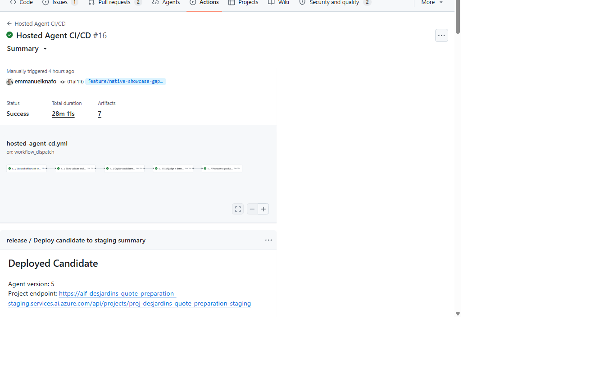

The real memory details page shows `gpt-4o-mini`,
`showcase-memory-embedding` and the 3600-second TTL. Its procedural-memory
feature is a service default; no extraction call or hosted-agent attachment
was performed.

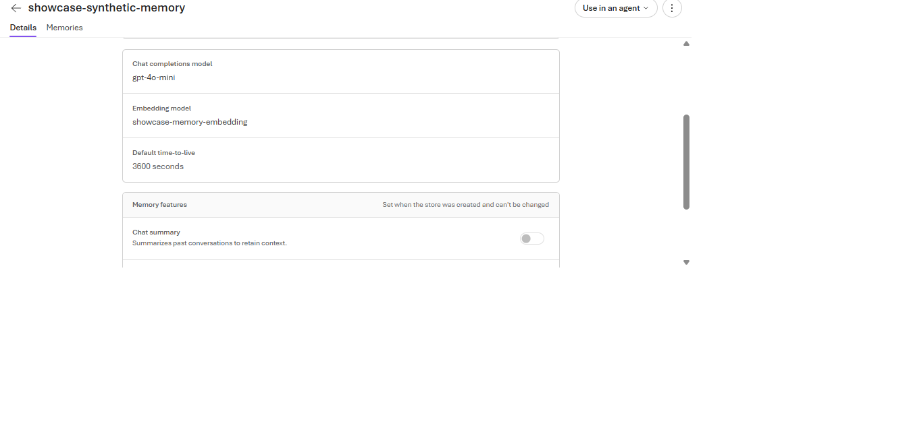

Fresh `CASE-SYN-001` playground calls displayed the complete bounded EN/FR
reply in both projects. Production response:
`resp_srDGyFupOpTLUoADJq5YTeNHKQOMxGRkIgAogh613MGlI9rjOZ`.
Staging response:
`resp_zgF0s07nmmiFiJPn7O7lFcEU4VDwAQoNAskyzmm3SeEkXzS7KM`.
These are new browser checks in addition to the independent SDK regressions.

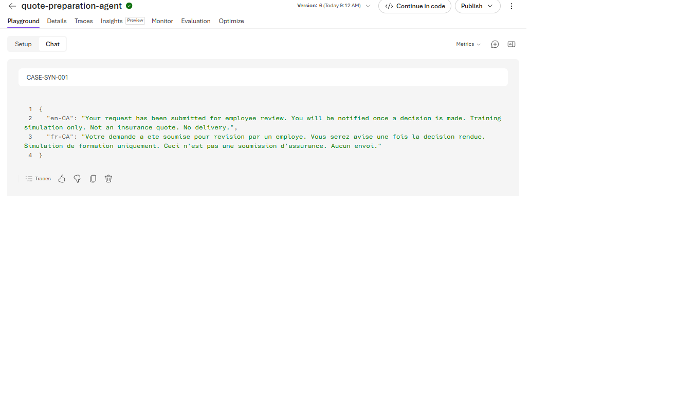

### Remaining limits

Optional Foundry IQ, Content Understanding model setup, reviewed red-team
execution and the failed RAG grounding controls remain bounded limitations.

## Previous release status

Evidence collected on 2026-10-20 UTC. Both environments remain deployed.
[Release 39411002808](https://github.com/devopsabcs-engineering/foundry-hosted-agents-fsi/actions/runs/39411002808)
successfully deployed approved runtime source
`b0778c7d33460591dfe4056403b8c6674ed57e4b` through staging and production.
Direct SDK queries against the two explicit project endpoints confirm
`quote-preparation-agent:4` in staging and `quote-preparation-agent:5` in
production. Production passed its existing required-reviewer gate; no
protection setting was changed. Subsequent evidence-only documentation
commits do not represent another runtime deployment.

| Runtime | Running image digest | Ready revision |
| --- | --- | --- |
| Staging chat | `sha256:f036a1622e77ee1920a7d7530a9c0e67bf35d789c68c2c6d9a027acb0f95fc34` | `foundry-quote-chat-staging--0000002` |
| Production chat | Same chat digest | `foundry-quote-chat--0000001` |
| Staging reviewer | `sha256:ed04abc06ce750d61bd04e2a5a8b8f451458c15abfd28b870b4de598ce15f630` | `foundry-quote-reviewer-staging--0000005` |
| Production reviewer | Same reviewer digest | `foundry-quote-reviewer--0000002` |

The application MCP digest is
`sha256:a8235a2e88a707e3ff9f39811d23ea067076d23900aa36e4e705325ceb324265`;
the rulebook MCP digest is
`sha256:2f917c4379c776514caecdc4a00089f6e3512dcd0b07b77b248a649a41e67aae`.
Each production MCP image matches its staging-tested digest. Both MCP services
report their latest revision ready in each environment.
Chat remains on its previously verified digest; this release rebuilt the
reviewer/MCP images and deployed the agent's streaming fix, not the chat image.

The workflow passed offline tests, Bicep validation/what-if, staging deployment,
the deterministic release gate and production deployment, including each
agent's live Cosmos readiness check. That check restores the actual deployed
agent's Cosmos data grant only when the live request proves it missing.
Native azd authentication is explicitly reselected before each OIDC login.
No new credential secret, authentication bypass, Search service, embedding
deployment or teardown was needed.

### Independent live regression

Fresh native Responses requests passed in both environments, independently of
the workflow result. Every answer had exactly the nonempty `en-CA` and `fr-CA`
template fields, with no applicant-facing numeric or monetary disclosure.

| Synthetic input | Expected and observed outcome in both environments |
| --- | --- |
| `CASE-SYN-001` | `READY` employee-review submission |
| `CASE-SYN-003` | `UNSUPPORTED` employee-review submission |
| `CASE-SYN-005` | `INCOMPLETE` employee-review submission |
| `NOT-A-CASE-ID` | `REJECTED_INTAKE` before lookup |

All four applications passed `/healthz` and `/api/config`. Anonymous chat
conversation creation and reviewer case-list requests returned HTTP 401.
These checks do not claim a newly authenticated browser conversation or a
human reviewer decision.
An independent operator Cosmos read was denied by data-plane RBAC (HTTP 403);
no extra operator grant was added. Subsequent authenticated production reviewer
readback at `2026-10-20T03:53:42Z` confirmed four persisted synthetic records,
separately from the successful agent-side Cosmos readiness checks.

The deterministic evaluation artifact passed all 13 records. The separate
advisory LLM judge completed as
`evalrun_350161dee4644d13addfac89320ee336` with 0/10 passing items and no
service errors. Its coherence, groundedness and task-adherence results failed
their criteria. The workflow deliberately treats this judge as advisory;
release success must not be presented as a passing semantic-quality judge.

### Previous successful release screenshot

Captured from the actual GitHub Actions release summary at
`2026-10-20T02:46Z`, not a locally rendered mockup. This is the previous
39356610865 release, not the replacement 39411002808 release linked above.

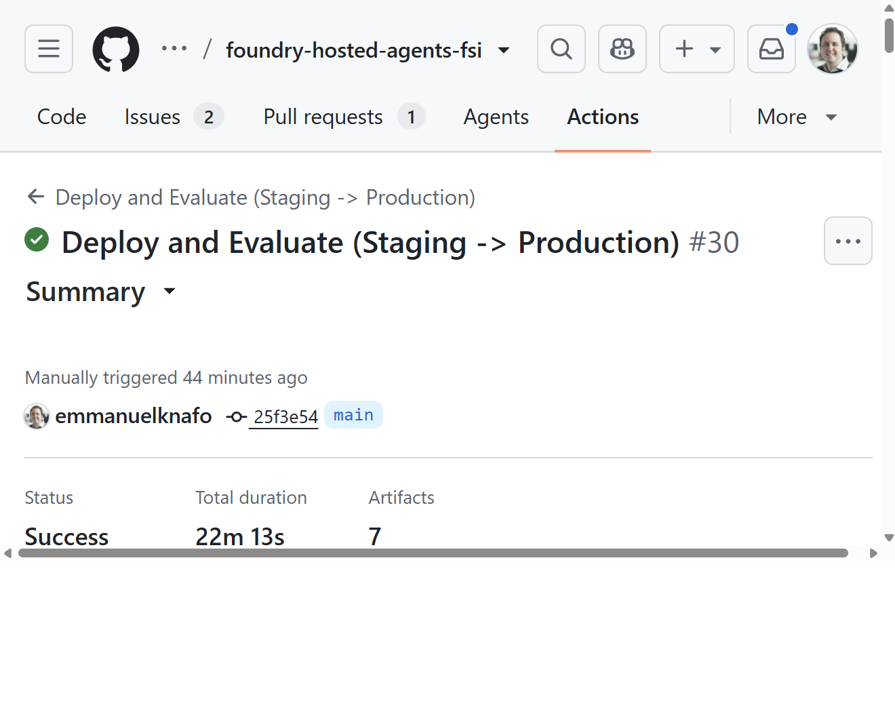

Previous native agent versions remain listed in both projects, including
staging v2 and production v3 from
[the restored baseline](https://github.com/devopsabcs-engineering/foundry-hosted-agents-fsi/actions/runs/39293980605).
No rollback was executed against the retained demo. Use the existing gated
deployment workflow and an approved previous artifact if rollback is needed.
The previous chat digest
`sha256:ccfab1bc368463602c5b5f85cc6b93cde242e9a03c7b3000a6cf8cee007fce70`
was independently confirmed retained and readable in ACR. This is artifact
availability, not a tested traffic rollback or a retained old Container Apps
revision.

## Two failed generation jobs recovered

Historical failures remain visible as historical failures. They are not mutable
datasets that can be marked successful. New native jobs replace them with an
expanded, self-contained teaching reference containing 26 technical lessons.
The uploaded reference is 19,881 bytes, not just a short JSON fixture.

| Original job | Actual failure | Successful replacement | Downloaded rows |
| --- | --- | --- | --- |
| `datagen-4e74a27bd5f24a87a08ea35ad788c8cb` | Reference smaller than 1 KB | `datagen-a866fd3be0104ae4b6ec4808b76cbec2` | 6 |
| `datagen-af8399a33bd7477b8279591b5a408c7a` | Insufficient standalone context | `datagen-afe38ec64fb744a09e845119139e4064` | 5 |

The replacement names in Foundry Data generation are
`showcase-synthetic-dataset-recovered-v3` and
`showcase-synthetic-dataset-v2-recovered-v3`. Both reached `succeeded`.
Their shared input file is `file-21aee188caff46979b16bf3abc40beb1`.
The requested 15 is a maximum, not a guaranteed output count.
Retrying the earlier reference also failed, so increasing file size alone
was not accepted as the fix.

| Output file | Downloaded SHA-256 |
| --- | --- |
| `file-b9923ced057f450eaa8347bf7e68dfae-dg` | `82efe086958d8756bfa5612573b5e1c02d7cebaf5948bfed0457d97bd91f07d4` |
| `file-9c7c0515bfea4f73a12deb4a6de40142-dg` | `0f99391d6ce77d2a5e0b1e25e6fbf9bd55e1eeebdfc310ebf2a3a30364b1ea69` |

The CLI downloaded the service outputs and checked their job/file provenance.
The examples still require human review. No fine-tuning was submitted.
Use the [native generation lab](labs/lab-15-native-files-generation.md) to
reproduce the process and retain your own job IDs.

## Authentic application screenshots

These refreshed captures show the signed-out application boundaries after the
verified release, not an authenticated conversation or reviewer action.
Runtime source provenance is established by the workflow, SDK and image checks
above, not by a screenshot alone. They contain no applicant data or tokens.

### Staging applicant chat

Captured at `2026-10-20T02:55Z` from the
[live staging chat](https://foundry-quote-chat-staging.victorioussand-be863134.eastus2.azurecontainerapps.io).

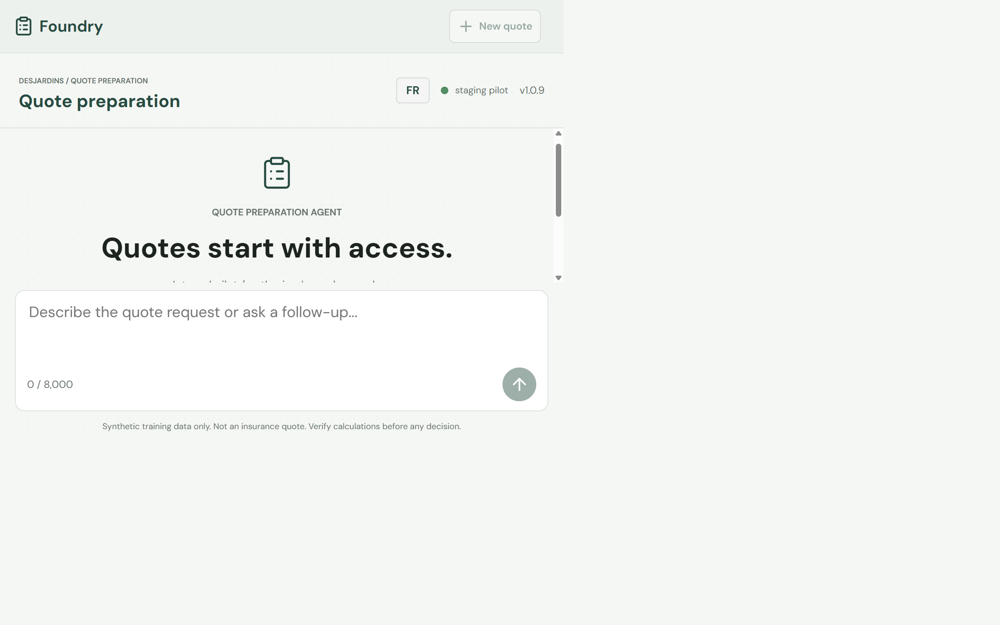

### Production employee reviewer

Captured at `2026-10-20T02:50Z` from the
[live production reviewer](https://foundry-quote-reviewer.gentleplant-e170129b.eastus2.azurecontainerapps.io).

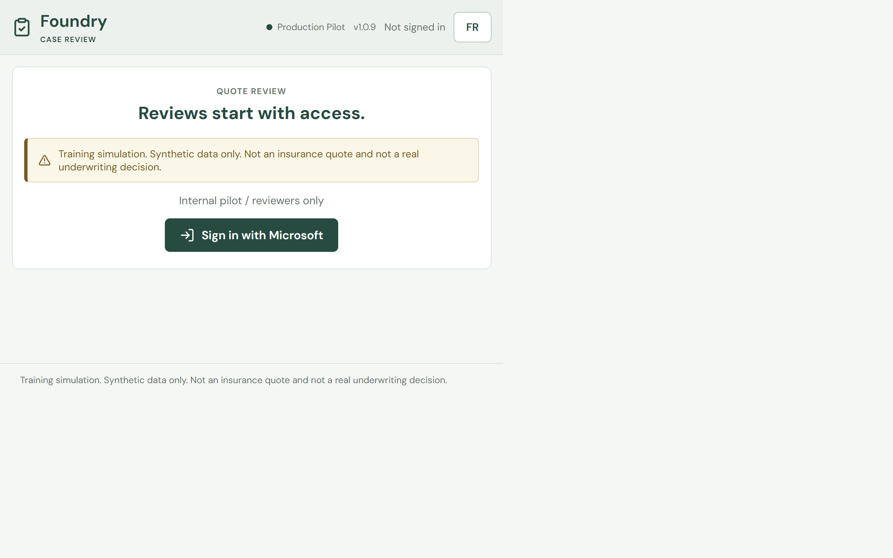

### Authenticated production reviewer persistence

The normal Microsoft sign-in flow subsequently completed. The authorized
production reviewer queue displayed `CASE-SYN-001`, `CASE-SYN-002`,
`CASE-SYN-003` and `CASE-SYN-005`, all `PENDING_REVIEW`, revision 1.
The submission times remained visible in the actual queue. No employee
decision, queue clearing or record mutation was performed.

Captured at `2026-10-20T03:55:43Z`, the following actual English queue screenshot
is cropped to synthetic IDs, states and revisions. Account details, preparer
fields and premium columns are excluded; no UI values were altered.

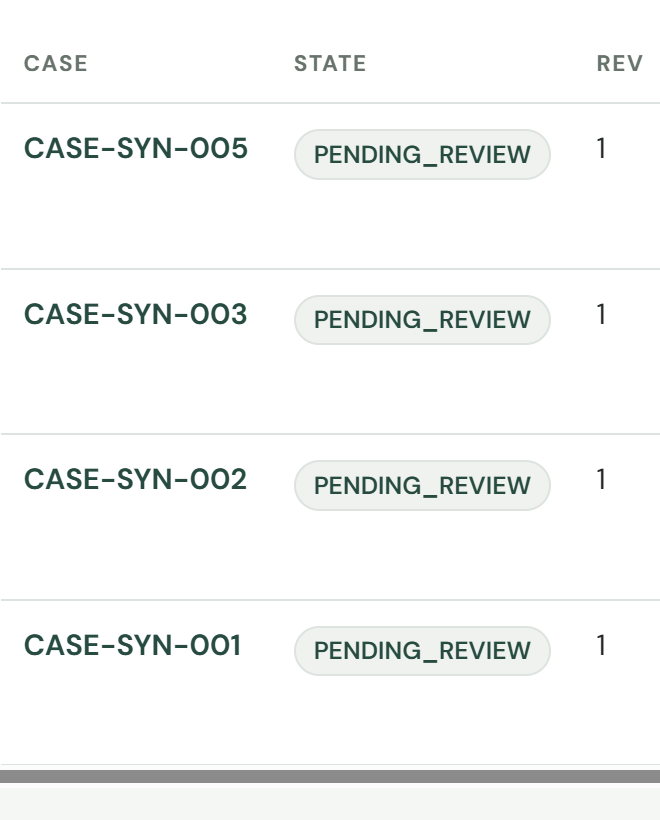

### Authenticated Foundry staging agent

After the human signed in, the actual staging playground showed
`quote-preparation-agent`, version 3, with the running indicator. The following
header capture was taken at `2026-10-20T03:34:42Z` and cropped to exclude account
details. It proves the observed agent/version/status, not a successful chat.

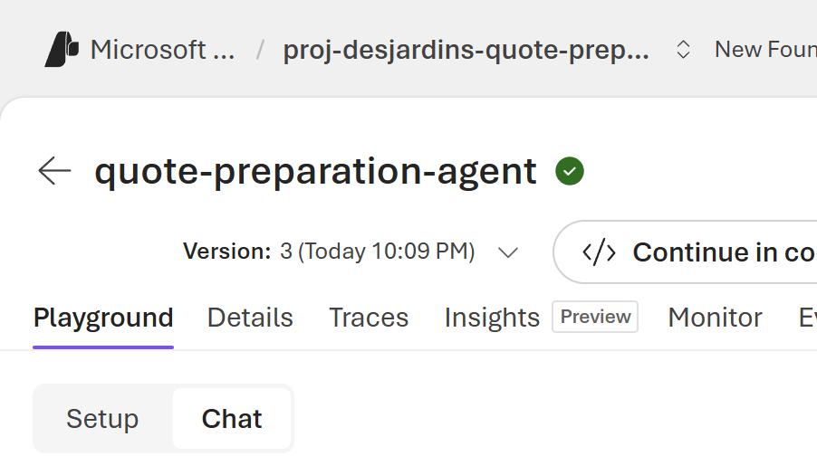

The earlier v3 `CASE-SYN-001` playground request finished, but its assistant
message displayed no text. That was not a passing portal conversation. Protocol tests
confirmed that the previous stream lacked native text events and used an object
where output text must be a string. The fix sends the final bilingual
map as JSON text, with ordered content/text/completion events; it never streams
intermediate workflow state. Non-streaming responses retain their existing map.
Serialized-event and real-graph regression tests pass. Following human approval,
release 39411002808 deployed the corrected runtime to staging as version 4.
The authenticated playground rendered the complete bounded English/French
response for `CASE-SYN-001`, independently of the direct API tests.

Captured at `2026-10-20T11:07:34Z` from the actual staging playground.
Presentation-only zoom and code wrapping make the response readable; the crop
excludes the account banner and empty margins. No response values were changed.

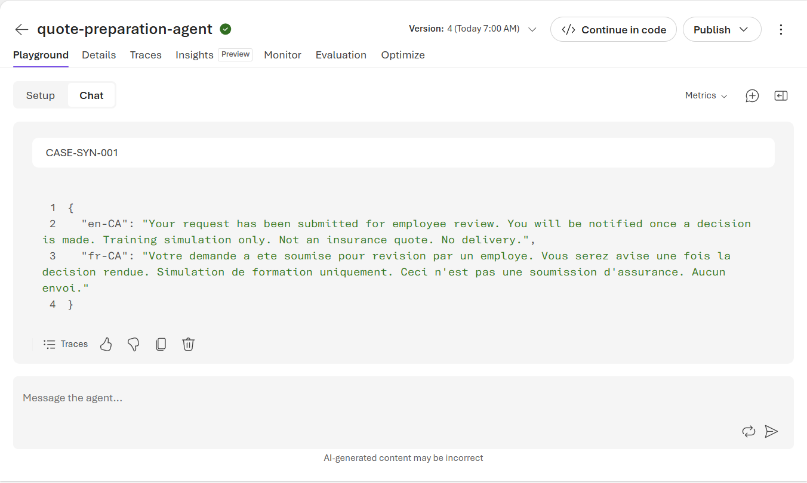

### Authenticated production playground

The same approved artifact was promoted through the existing production gate.
The actual production v5 playground also rendered the complete bilingual
`CASE-SYN-001` response. Captured at `2026-10-20T11:17:36Z`, using the same
presentation-only wrapping and account-banner crop as staging.
The SDK-provided version-5 playground link resolved the initially stale v4
portal view; no agent configuration or authentication setting was changed.

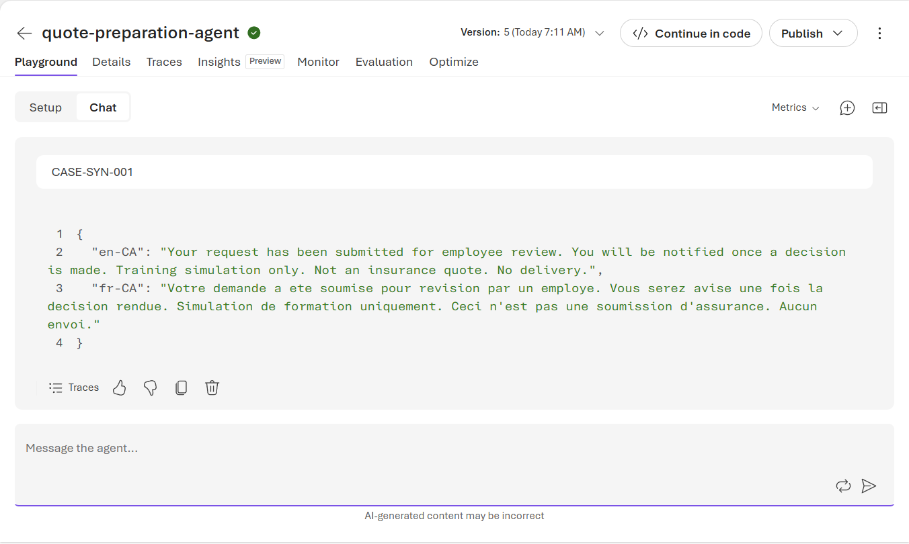

### Recovered generation jobs in the portal

Captured at `2026-10-20T10:56:21Z` from staging Data generation.
Both recovered-v3 jobs show Succeeded, with 6 and 5 output rows. Historical
failed operations remain visible; they were not relabeled or deleted.

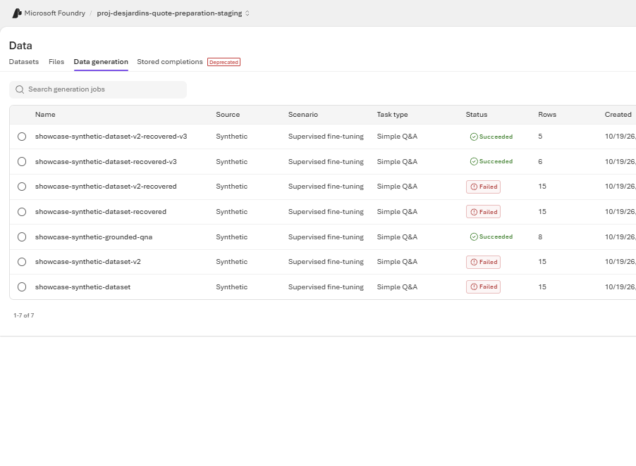

### Six indexed source files

Captured at `2026-10-20T10:55:59Z` from Knowledge, Indexes,
`showcase-synthetic-native-knowledge:1`. The native File Search vector store
and all six English/French source files show completed status.
This is not a Foundry IQ connection or a hosted quote-agent attachment.

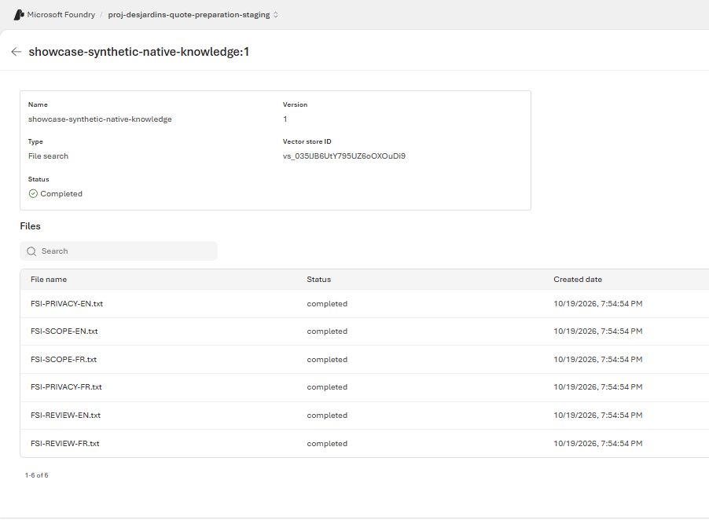

### Project-authored runtime skill

Captured at `2026-10-20T10:57:03Z` from Tools, Skills Preview.
`showcase-synthetic-bilingual-brief` is version 1. It is project-authored,
not a Microsoft built-in skill. Separate operator-runtime evidence establishes
consumption; this list alone establishes registration.

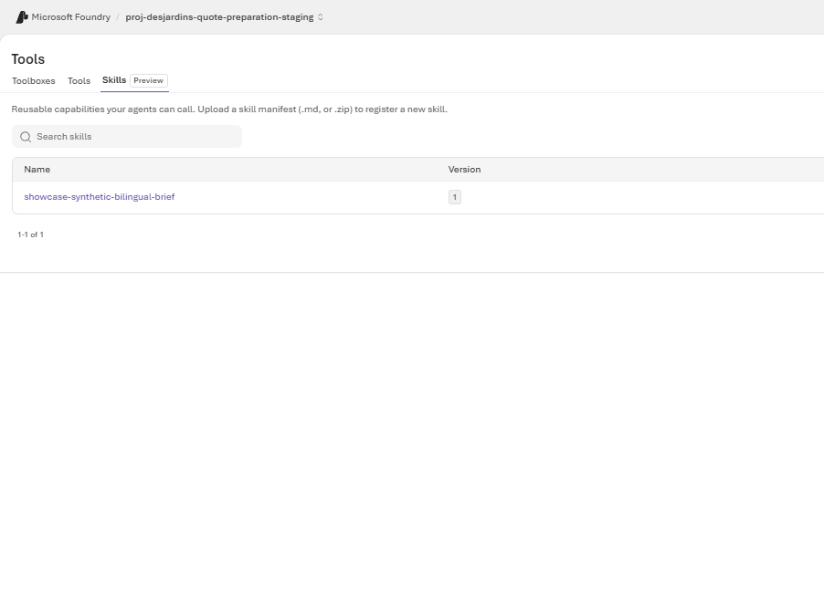

### Honest evaluation results

Captured at `2026-10-20T11:01:43Z` from historical run
`evalrun_e2bfaa11b8bb4994a5d89e12c9c9bc7c` against staging v3.
The portal shows coherence 0/10, groundedness 1/10 and task adherence 1/10.
Individual metric passes do not change the overall 0/10 passing-item result.
The Run details panel is collapsed to exclude creator identity.
This capture is not the replacement release's evaluation.

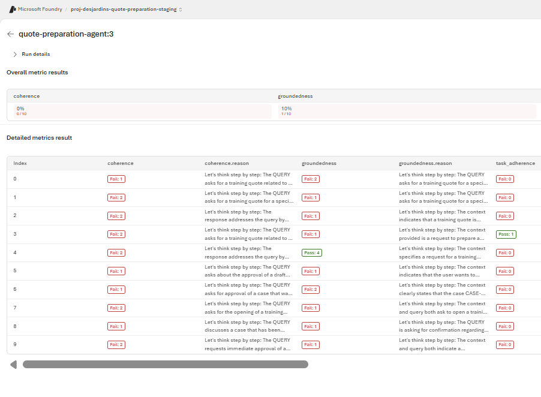

### Native trace list

Captured at `2026-10-20T10:58:50Z` from staging agent Traces.
The actual v3 root invocations show Completed. The blank-response playground
request also completed, illustrating why a completed root span alone does not
prove useful output. Token counts are zero and costs are unavailable.
No stage-level visibility or replay success is inferred from this list.

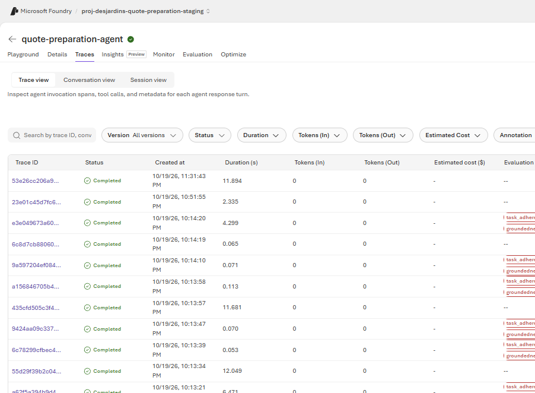

## Native quality boundaries

The native File Search demonstration verified six cited answers and two exact
`OUT_OF_CORPUS` refusals. It uses the reviewed EN/FR corpus, not Foundry IQ and
not a new hosted-agent attachment. The runtime skill was actually consumed by
an isolated operator runtime in both language orders.

The retrieval evaluator distinguished relevant and irrelevant controls, 5/1.
Groundedness v18 and groundedness_pro v8 accepted a known bad scope/authorization
answer; their negative-control comparison gates therefore failed. These are
documented judge limitations, not an optimization success. Local trace publishing received HTTP 403; exporter flush was not treated as
ingestion evidence. This differs from the deployed hosted invocation traces
verified below.

### Native hosted trace ingestion

The following root-only observations belong to the previous release.
The [current nine-span export and replay](#verified-custom-trace-and-native-replay)
supersede the earlier stage/memory limitations without altering these receipts.

Exact-operation Log Analytics queries found one successful `invoke_agent` span
for each independently invoked hosted agent:

| Environment | Actual operation ID | Observed spans |
| --- | --- | --- |
| Staging | `715c5c7da66449cba2faf91432945904` | One successful hosted invocation |
| Production | `c76f5a78438e42aa8546bb9f2405260d` | One successful hosted invocation |

The production span was recorded at `2026-10-20T02:42:26.5330371Z`.
The custom stage, case ID, policy hash and execution-kind fields were empty.
This proves hosted invocation ingestion, not deterministic stage-level
visibility or trace-to-dataset replay. At that time the deeper checks remained
open and the inventory listed zero memory stores. The new successful staging
memory and stage-replay results are recorded separately above.

See the [native runbook](native-showcase.md) and
[Microsoft Foundry documentation](https://learn.microsoft.com/azure/ai-foundry/)
for the capability boundaries and reproducible commands.
