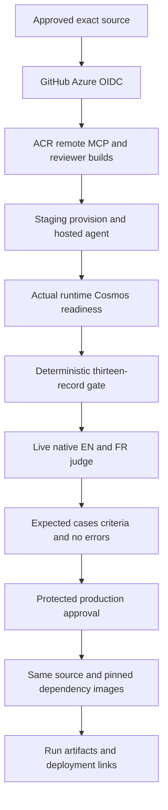

[Architecture](../architecture.md) | [Operations](operations.md) |
[Native showcase](../native-showcase.md)

## Checked-in workflow inventory

The [workflow directory](../../.github/workflows) contains ten maintained YAML
workflows. GitHub can additionally display dynamic Pages, CodeQL and Dependabot
runs; those are not extra checked-in release entry points.

| Workflow | Trigger and responsibility | Deployment boundary |
| --- | --- | --- |
| [Continuous validation](../../.github/workflows/continuous-validation.yml) | PR and main tests, deterministic gate, frontend/Bicep validation | No runtime rollout |
| [Deploy and evaluate](../../.github/workflows/deploy-and-evaluate.yml) | Manual or reusable staging-to-production release | Protected production approval |
| [Hosted agent CD](../../.github/workflows/hosted-agent-cd.yml) | Manual wrapper for release inputs | Not automatic main deployment |
| [Publish test trends](../../.github/workflows/publish-test-trends.yml) | Trusted completed main validation | Wiki, screenshots, trends and actual release links |
| [Reviewer build](../../.github/workflows/reviewer-app-build.yml) | Reviewer image build | Image publication, not app rollout |
| [Chat build](../../.github/workflows/web-chat-build.yml) | Chat image build | Image publication, not app rollout |
| [Linked issue](../../.github/workflows/require-linked-issue.yml) | PR issue linkage | Require closing issue reference |
| [Full teardown](../../.github/workflows/full-teardown.yml) | Explicit manual destruction | Never a normal release step |
| [Network rebuild teardown](../../.github/workflows/network-rebuild-teardown.yml) | Explicit manual infrastructure reset | Destructive |
| [Reviewer teardown](../../.github/workflows/reviewer-app-teardown.yml) | Explicit manual reviewer removal | Destructive |

## Staging to production

<!-- mermaid-checked: safe labels, quoted subgraphs and edge labels, closed subgraphs, unique ids -->

The native judge is active, not disabled with `if: false`. Five English and
five French messages are evaluated for coherence, groundedness and task
adherence. Scores are advisory, but the independent evidence-completion gate
blocks absent/incomplete items and service errors. The deterministic gate and
live judge are different datasets and must not be conflated.

Azure login uses secretless federation. Native azd authentication disables
CLI delegation before login; provisioning enables the intended Azure CLI
context. Runtime Cosmos role repair is tied to an actual deployed-agent
authorization denial, not a blanket role expansion.

Production rebuilds the agent from the approved source and uses reviewer/MCP
digests resolved in staging. Chat rollout remains separate. The optional
memory embedding deployment is not provisioned by every normal release.

## Documentation and wiki publication

The publisher verifies the triggering run belongs to this repository, is
completed and originates from main before using its artifacts. It needs a
configured `WIKI_PUSH_TOKEN` and does not invoke Azure provisioning.

[publish_showcase_wiki.py](../../scripts/publish_showcase_wiki.py) renders
source-backed Home, navigation, architecture, operations, workflow and release
guides plus paired native runbooks/evidence. PNG screenshots are copied
byte-for-byte. Test trends retain their own artifact-driven generator/history.
Actual staging/production deployment-link fragments replace the marked Home
section only when supplied; missing new artifacts preserve the last section.
This prevents a docs-only run from erasing live customer links.

See [Microsoft Foundry](https://learn.microsoft.com/azure/ai-foundry/agents/concepts/hosted-agents)
and the [evidence guide](release-evidence.md) for platform and provenance limits.
